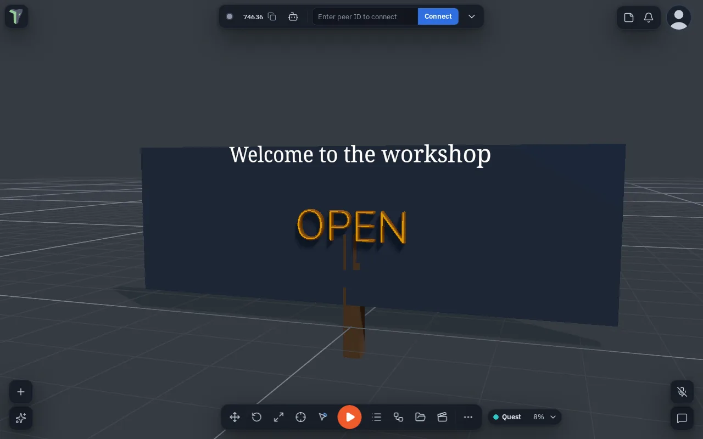

# 3D Text

Signs, titles, labels, a score over a goal: **Add ▸ Text** puts words in the scene. One text object does both looks:

- **Flat** letters are crisp at any distance, can have an outline, can follow a path, and can colour each letter on its own.
- **Solid** letters are real 3D shapes with depth, a bevel, and separate face and side colours. They cast shadows.

You can switch between the two at any time. The words, the font and the colour stay. Every change is one undo step and shows for everyone in the session.

## Adding text

Open **Add ▸ Text** and pick one:

| Item | What you get |
|---|---|
| **3D text** | Flat letters reading "Text" |
| **Solid 3D text** | The same, already solid |
| **Text on a path** | Flat letters on an arc (see [Text on a path](#text-on-a-path)) |

Select it and open Properties ▸ **Text**. Type in the box. <kbd>Enter</kbd> starts a new line.

## The Text section

| Row | What it does |
|---|---|
| **Flat / Solid** | The look. **Solid** is greyed out while the text follows a path |
| **Font** | A bundled font or one from your Library (see [Fonts](#fonts)) |
| **Size** | Letter height in metres |
| **Colour** | The letters (the face, for solid text) |
| **Spacing** / **Line height** | Gaps between letters and between lines |
| **Align** | Left, centre, right, or justify, for text with more than one line |
| **Wrap width** | Lines break at this width, in metres. 0 means a line only ends at <kbd>Enter</kbd> |
| **Anchor** | Which point of the block sits on the object: one of nine, from top-left to bottom-right |
| **Bold** / **Italic** | Flat Noto Sans only |
| **Outline** | Flat only: an outline around each letter, with its own colour |

### Solid letters

Switch to **Solid** and these rows appear:

| Row | What it does |
|---|---|
| **Depth** | How thick the letters are |
| **Bevel** / **Bevel depth** / **Bevel steps** | The rounded edge: how wide, how deep, how smooth. A bevel of 0 means sharp edges. The width stops at 6 % of the letter size, so thin strokes and small holes (a, e, g) stay whole |
| **Curves** | Low, medium or high: how smooth the round parts are (more triangles) |
| **Sides** | The colour of the sides. ↺ sets it back to a darker shade of the face colour |
| **Metal** / **Roughness** | The material of face and sides |
| **Glow** | Makes the letters glow in their own colour |
| **Bake to mesh…** | See below |

A solid text is built on every screen from these settings. The mesh itself is never sent or saved, so a sign costs the same few hundred bytes whatever its size.

### Bake to mesh

**Bake to mesh…** turns solid text into an ordinary mesh. You can then edit its vertices in [Mesh Editing](mesh-editing.md), but not its words, font or bevel. It asks first, and one undo brings the text back.

Mesh Editing does not open on text that is not baked. The next rebuild would undo the edits.

## Fonts

### Bundled

| Font | Style |
|---|---|
| **Noto Sans** | Sans (the default; also draws most of the world's scripts in flat text) |
| **Noto Serif** | Serif |
| **IBM Plex Mono** | Mono |
| **Nunito** | Rounded |
| **Press Start 2P** | Display (pixel) |
| **IBM Plex Sans** | Sans |

All are under the SIL Open Font License. They load only when a text uses them.

### Your own fonts

Fonts you add become **Library fonts**. They live in the [Explorer](explorer.md) and peers download them once. They are saved inside the scene's `.tpscene` and go into an export.

- **Upload a font…** takes a TTF, OTF, WOFF or WOFF2 file. You can also drop one into the Explorer.
- **Google font…** takes a family name such as `Lobster`. The app fetches the font **once** and stores it like an upload. After that, the scene never contacts Google: peers, a reload, offline use and exports all use the stored file.

Under the Font row, the **licence line** shows what the font file says about itself, with a link if it gives one.

!!! warning "Fonts that may not be embedded"
    Some commercial fonts mark themselves as not embeddable. The Text section says so in amber. Exporting or
    publishing a scene that uses one shows the same licence warning as other restricted assets.

If a peer or a reloaded scene doesn't have a font yet, the text uses Noto Sans and a short notice says so. It switches as soon as the font arrives.

## Limits

| | Flat | Solid |
|---|---|---|
| Desktop | 2000 characters | 300 characters |
| Phone or headset | 500 characters | 80 characters |

Typing past your device's limit is refused with a message. If a phone or headset shows longer solid text from a desktop peer, it draws only its first 80 characters.

## Text on a path

Set **Follows** to a line, an arc, a circle or a wave, or to another object such as a [spline](splines.md). The letters then run along it. **Offset %**, **Lift** and **Turn** place them on the curve. **Letter styles** nudge, scale, turn or colour single letters. Text on a path is always flat.

## Saving and older versions

A scene saves the text's settings, never its mesh. If a scene was made with a newer version of theprototype.app, a notice says some text may look different here. Editing the text keeps the settings the newer version added.

## With an agent

Agents make text with **create_shape** `{action: "text"}`. For example: "a big solid HELLO with a bevel over the door". They change it with **edit_shape** `{action: "params"}`: words, font, size, depth, bevel, align, wrap width, anchor and colours. **assets** `{action: "fonts"}` lists the bundled fonts, your Library fonts and the fonts the scene uses. The `font` field takes a bundled font, any Google Fonts family name, or `{asset: "<hash>"}` for a Library font. An agent can add a font file with `import_file`. See [Shapes and modelling with an agent](ai/agent-geometry.md).
