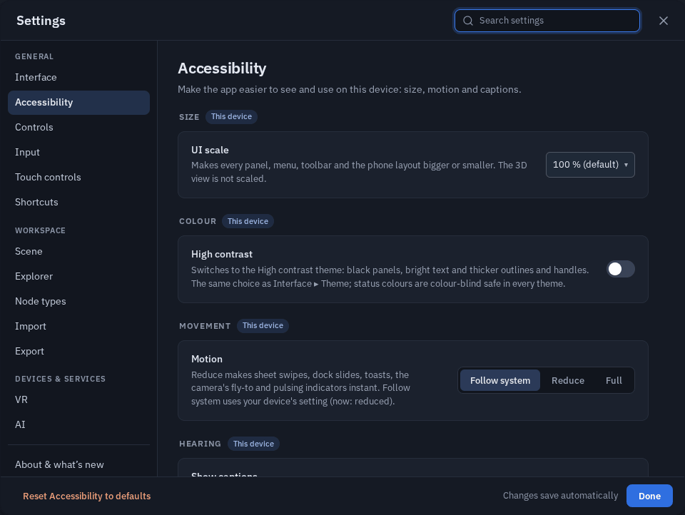
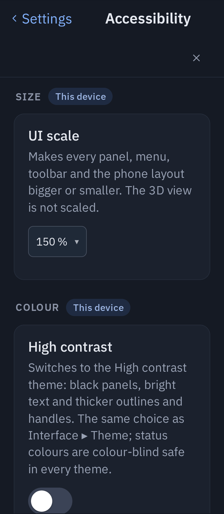
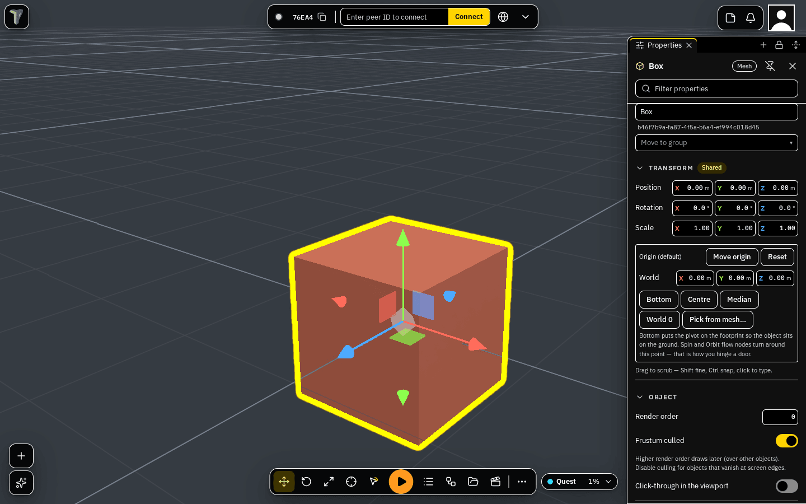

# Accessibility

1.41 is an accessibility pass over the editor — for people who need bigger text, more contrast, no mouse, a screen
reader or captions. Everything on this page is a choice **for this device only**: nothing is sent to the other people
in your session, and their choices never change your screen.

Most of it lives in **Settings ▸ Accessibility** (under General, right after Interface). Settings search finds the page
by *accessibility*, *a11y*, *zoom*, *low vision*, *contrast*, *colour blind*, *motion*, *captions* and similar words.

The games you make have their own **Accessibility** page for players — see
[Making your game accessible](making-your-game-accessible.md).

## UI scale

**Settings ▸ Accessibility ▸ Size ▸ UI scale**: **90 %**, **100 %** (default), **110 %**, **120 %**, **130 %**,
**140 %**, **150 %**.

Every panel, sheet, dock, toolbar, menu, toast and the phone layout grows or shrinks with it.

- The **3D view is not scaled**. It keeps drawing at your screen's full resolution, so a bigger UI does not make the
  scene blurry or slower.
- Panels you resized yourself (the side column, the bottom dock, floating windows) follow the scale, so you do not
  have to resize them again.
- The scale is applied before the app draws its first frame, so a reload never flashes the old size.
- On a small phone, 150 % leaves less room for the scene; 120–130 % is often the best balance there.

{ width="300" }

## High contrast

**Settings ▸ Accessibility ▸ Colour ▸ High contrast** (the same choice as **Interface ▸ Theme ▸ High contrast**).

White text on black, a yellow accent, and every surface measured against WCAG: text reaches **7:1** (AAA) on every
panel, and buttons, borders and switches reach **3:1**. It is built on the same theme tokens as Dark and Light, so
every panel, window and the node editor follow it.

The 3D view follows it too, on this device only:

- the selection outline becomes a thick yellow edge, readable on a dark sky and on a light wall;
- an object another person is holding gets a pink-red outline;
- the move / rotate / scale handles are bigger and drawn in brighter axis colours (X red, Y green, Z light blue).

If you picked your own selection-outline colour in Settings, High contrast keeps yours. Switching High contrast off
here goes back to the theme you had before.

## Status colours you can tell apart

In **every** theme, statuses use a colour set that people with red-green (protanopia, deuteranopia) or blue-yellow
(tritanopia) colour blindness can tell apart — the scene budget (chip, object list, Statistics), connection and network
quality, badges, draw-call counts and the node editor's "can't connect here":

| Status | Colour (Dark) | Shape |
|---|---|---|
| fine | teal | ● disc |
| careful | amber | ▲ triangle |
| over / error | crimson | ✕ cross |
| not measured / off | grey | ○ ring |

**Colour is never the only signal.** Every status mark also has its shape, a warning toast shows a triangle and an error
toast a crossed circle, and the draw-call count shows ▲ or ✕ before the number (on the desktop counter and in the VR
strip).

In the node editor every socket type has a colour **and a shape** — number disc, vector3 diamond, boolean square, color
hexagon, object pentagon, event arrow, effect star, anything else a capsule. The ⚙ panel's **Socket types** legend shows
both, and while you drag a wire a socket that cannot take it becomes a red cross. See [Node System](node-system.md).

## Motion

**Settings ▸ Accessibility ▸ Movement ▸ Motion**: **Follow system** (default) / **Reduce** / **Full**.

- *Follow system* uses your device's own setting (Windows: *Animation effects*; macOS / iOS: *Reduce motion*;
  Android: *Remove animations*). The row says which one your device asks for now.
- *Reduce* makes these instant: sheet swipes, dock and panel slides, pop-up toasts, the camera's fly-to
  (<kbd>F</kbd>, saved views, note jumps) and pulsing indicators — even when your device setting is off.
- *Full* keeps every animation, even when your device asks for reduced motion.

Games play normally either way: this covers the editor's own interface and camera moves. For VR comfort see the
[VR Guide](vr.md#comfort-for-everyone).

## Keyboard navigation

Everything in the editor can be reached and used from the keyboard.

- <kbd>Tab</kbd> / <kbd>Shift</kbd>+<kbd>Tab</kbd> move through the controls in reading order — the skip link, the main
  menu, the touch tools, the Connect bar, the top-right group and your profile, then the toolbar, the corner buttons,
  the budget chip and any open panel. Every control shows a **focus ring** in the theme's accent.
- **Toolbars are one stop each.** In the bottom toolbar, the corner stacks, the touch tools and the top-right group,
  <kbd>←</kbd> / <kbd>→</kbd> (or <kbd>↑</kbd> / <kbd>↓</kbd>) move between buttons, <kbd>Home</kbd> / <kbd>End</kbd> go
  to the ends and <kbd>Enter</kbd> / <kbd>Space</kbd> press.
- **Skip to the 3D viewport** is the first thing <kbd>Tab</kbd> reaches. With the viewport focused the 3D shortcuts
  work as usual (W A S D, 1 2 3, F, Delete, Tab = Edit Mesh on the selection), and <kbd>Esc</kbd> gives the keyboard
  back — nothing is trapped in the canvas. <kbd>Tab</kbd> is Edit Mesh only in the 3D view; on any control it moves
  focus.
- <kbd>F6</kbd> / <kbd>Shift</kbd>+<kbd>F6</kbd> jump between regions: main menu, Connect, top-right, object list,
  Properties, windows, docks, toolbar, corner buttons, viewport.
- **Object list:** <kbd>↑</kbd> <kbd>↓</kbd> select, <kbd>→</kbd> / <kbd>←</kbd> expand / collapse (or go to the
  parent), <kbd>Home</kbd> / <kbd>End</kbd>, <kbd>Enter</kbd> opens Properties, <kbd>F2</kbd> renames, letters jump by
  name.
- **Menus:** the arrow keys walk a menu and its submenus, <kbd>Enter</kbd> runs, typing filters, <kbd>Esc</kbd> closes
  and puts focus back where it was. <kbd>Shift</kbd>+<kbd>F10</kbd> or the <kbd>Menu</kbd> key opens the selection's
  menu (or the viewport's Add menu when nothing is selected).
- **Dialogs** keep <kbd>Tab</kbd> inside them; <kbd>Esc</kbd> closes them and focus returns to what opened them. The main
  menu, notifications, the Connect drawer, notes and the peers panel close with <kbd>Esc</kbd> too.
- **Number fields** in Properties: type a value and <kbd>Enter</kbd> commits and keeps your place, so the next
  <kbd>Tab</kbd> goes to the next field.

**Settings ▸ Shortcuts** lists <kbd>F6</kbd> and "Esc leaves the viewport" under Navigation. <kbd>F6</kbd> cannot be
rebound.

## Screen readers

The editor's interface and your selection work with a screen reader (NVDA, JAWS, VoiceOver, TalkBack). The 3D scene
itself is not narrated.

What is read aloud:

- **Toasts** — every notice is spoken politely, after whatever the reader is saying; errors ("Could not …",
  "… failed", "Something went wrong") interrupt. Toasts you moved into the Connect drawer are still read.
- **Connection requests** — "Connection request ABC123", plus the room's label when there is one.
- **Selection** — selecting an object says its name and kind ("Crate, box", "Sun, directional light",
  "Pillars, group"); several objects say "3 objects selected"; clearing says "Nothing selected".

**The object list is a tree.** Each row is announced with its name, kind and level, whether it is selected or expanded,
and its badges ("hidden", "local only", "locked by Ada"). The toolbars are announced as toolbars with a name ("Scene
tools", "Notes, notifications and people", "Left corner buttons").

**Names.** Every icon button, menu row, dialog and floating window has an accessible name; windows are announced by
their title ("Explorer, region"), submenu rows say they open a menu, and greyed-out rows say they are unavailable.

Not covered: scene narration, Play-mode announcements, and game HUDs (those are whatever the game's author built).

## Captions

**Settings ▸ Accessibility ▸ Hearing ▸ Show captions** shows a caption line for every sound that has one — Timeline
audio clips and Sound / Game Sound nodes — everywhere, the editor included (handy while you preview a
[Timeline](timeline.md) sequence). Players also turn captions on in a game's pause menu ▸ Accessibility.

To give a sound a caption: the **Caption** field of a Timeline audio clip, or the **caption** field of a Sound or Game
Sound node. See [Making your game accessible](making-your-game-accessible.md#captions).

## For contributors: the accessibility check

CI runs an axe-core check (`npm run e2e -- a11y-axe`) over the editor shell, the object list, Properties, Settings, the
Asset Browser and the phone shell. It **fails on serious or critical** violations; moderate and minor findings are
listed in the `axe-report` artifact. New UI uses the kit primitives and theme tokens, which already carry the names,
focus ring and contrast this page describes.
