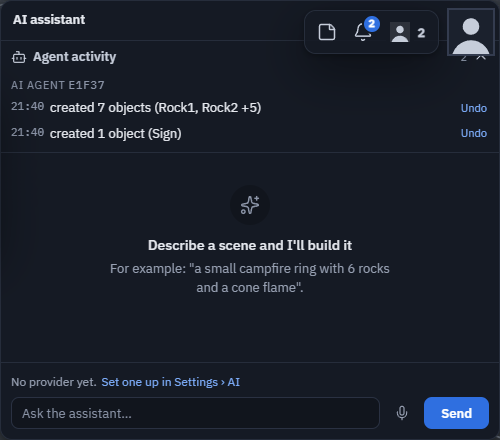

# Build with an AI agent

You can invite an AI agent — Claude Code, Claude Desktop, or any tool that speaks
[MCP](https://modelcontextprotocol.io) — into your session and build with it. Hand it a link,
it joins like any other peer, and you watch the scene grow live. Everything it does is
replicated to everyone and undoable, exactly like a person's edits.

!!! info "New in NEXT"
    Agents join from a link, see the scene through screenshots, and get the app's full tool set
    (objects, flow nodes, physics, and mesh generation through *your* provider).

## For you, the person in the session

1. **Give the agent a way in.**
    - *Plain link:* copy your session link (the peer id in the Connect bar). The agent knocks, and
      you press **Approve** on the request card — it carries a robot badge. On theprototype.app
      with accounts, Approve may admit it **view-only**: a view-only agent cannot change anything
      (it is told so plainly). Give it **Editor** in Users ▸ role, or use an invite instead.
    - *Invite (recommended):* **Connect ▸ Request AI** makes a single-use, short-lived link that
      joins in one step with the role you pick (Edit by default) and shows you the ready-made
      command to paste into your agent. See [Invite people and agents](../invites.md).
2. **Tell the agent what to build**, in its own chat: *"Join my theprototype session and build a
   campfire with six rocks, a flickering light and a spinning sign."*
3. **Watch and steer.** Its changes appear as they happen. Undo (**Ctrl+Z**) takes back one of
   its tool calls at a time; edit alongside it — it notices your changes.

What an agent never does: move your camera, read anything outside the scene, or use API keys of
its own inside the app. If it generates a 3D model (*generate_mesh*), that runs on **your** mesh
provider (Settings ▸ AI ▸ Mesh generation) — you see who asked on the progress card and can
cancel it there.

## For the agent (setup)

```sh
claude mcp add theprototype -- npx -y @theprototype/agent mcp 'https://theprototype.app/#F0FD3'
```

Claude Desktop: add `npx -y @theprototype/agent mcp <link>` under `mcpServers`. Node 20 or
newer. The first run downloads a headless Chromium unless Chrome, Edge or Chromium is already
installed. The bridge opens the link in that browser — it *is* the app, at the app's own version
— joins, and turns the app's tools into MCP tools.

A good first exchange is three calls: **status** (am I in, can I edit?), the tool list, and one
batched **create_objects**. Then **screenshot** to check the result.

### What the agent gets

| tool / method | what it does |
|---|---|
| the app's tools | `create_objects`, `update_objects`, `delete_objects`, `group_objects`, `create_flow_nodes`, `update_flow_nodes`, `set_physics`, `create_joints`, `control_simulation`, behaviours where available, `generate_mesh` when the host has a provider — with their full JSON schemas |
| `status` | joined or waiting, its role and whether it can edit, who is connected, which scene it and the host are in (`withHost`), whether a scene is still arriving (`loading`), any code behaviour that is failing (`behaviourErrors`), whether it is paused because the host left (`hostAway`), which tools or modules are missing and why |
| `screenshot` | a clean picture (no gizmo, grid or helpers) from a temporary camera — `iso`, `top`, `front`, `current`, or `focus` on one object — without moving anyone's view |
| `wait_for_edit` | waits until someone else changes the scene |
| `install_modules` | installs the modules the other peers run (games, tools) so the agent sees the same scene |
| `pending_offers` / `accept_offer` | answers questions the app asks (for example an admin-role offer) |

### Rules a good agent follows

- Read the scene first and edit by **uuid**.
- Put a whole request into **one** `create_objects` call (one undo step).
- Y is up, distances in metres, rotations in radians; the ground is y = 0.
- Motion is **flow nodes**: one behaviour node (spin, bounce, path patrol…) in an object's graph
  drives that object.
- Pin scenery with `set_physics` `mode: "static"` so Play does not collapse the scene.
- `control_simulation` runs on the **host's** machine, so physics plays at its real speed; an agent's own page
  never simulates.
- Lights take their settings directly: `color`, `intensity`, `distance`, `angle`, `penumbra`, `aim` and so on, on
  `create_objects` and `update_objects`. A field that does not apply comes back in that object's `errors`.
- Never fight a person: a locked object is skipped, and the agent waits with `wait_for_edit`.

## What you see while it works

- The agent shows in the Connected panel with a **robot and "AI"** — no character, no voice, no cursor. A small
  **AI camera marker** shows where its last screenshot looked, and a **presence marker** — a bot icon with the agent's
  name — stands over the object it is editing, on desktop and in a headset alike. The presence marker fades while
  the agent is idle, hides in Play, and leaves with the agent. **Settings ▸ Connection ▸ Show where AI agents look**
  (on by default) switches both off.
- The **AI assistant** window lists every step it takes under **Agent activity** — "Claude · created 12 objects
  (Campfire)" — on every peer, including people who join later. Click a line to select what it touched; editors can
  **Undo** that one step for everybody.
- **It goes where you go.** Save the scene under another name, or open another scene, and the agent follows you
  there on its own; it holds its edits while it travels, so nothing lands in the scene you left. Open a scene
  **privately** and it waits (it tells its user why) until you are back in a shared scene. An agent never takes over
  as host or decides a game's rules for the people playing, and nobody joins your session through it.
- **If the host leaves**, the agent carries on with the person who takes over. If everybody leaves, it **pauses**:
  it can still read the scene but builds nothing, and waits for its host (10 minutes by default). When the host is
  back, the agent asks to come in again — the ordinary approval card — and carries on.
- To stop it, revoke its invite or use **Remove from session** on its row ([Users and moderation](../people.md)).

{ width="500" }

## Security notes

- An invite's token lives in the URL **hash**, which browsers never send to any server. Link
  preview bots (Slack, Discord, Telegram) cannot use it: joining needs a full WebRTC client and
  your live approval check. The risk is a link forwarded on, which single use, expiry, the "used
  by" line and **Revoke** in Users limit.
- More in [Invite people and agents ▸ Security notes](../invites.md#security-notes).
- An agent is a peer with your session's normal permissions — nothing more. Its edits go
  through the same replicated paths as yours.

## For developers: the in-page API

The bridge drives `window.tpAgent`, a supported, semver'd API that exists only when the URL
carries `&agent` (`#F0FD3&agent`) or `localStorage.agentApi = '1'`. Any driver that can evaluate
JavaScript in the page can use it: `tools()`, `systemPrompt()`, `exec(name, args)`,
`snapshot()`, `status()`, `waitForEdit(ms)`, `screenshot(opts)`, `pendingOffers()`,
`accept(id)`, `leave()`. The full contract is in the app repository's
[AGENT-SESSIONS.md](https://github.com/theprototype-app/core/blob/main/AGENT-SESSIONS.md) and
inlined in [/llms-full.txt](https://theprototype.app/llms-full.txt).

**Versions.** `tpAgent.version` is the contract (1.x): new methods and fields are minor versions, a removed or changed
one is a new major. The `@theprototype/agent` package follows the app release it shipped with and says so in its
`status` (`contractNote`) when the page speaks a different contract major — update it with
`npx -y @theprototype/agent@latest`.

For a light peer without a browser (objects only), see the [Console Agent](console-agent.md)
(`--engine=wire`).
