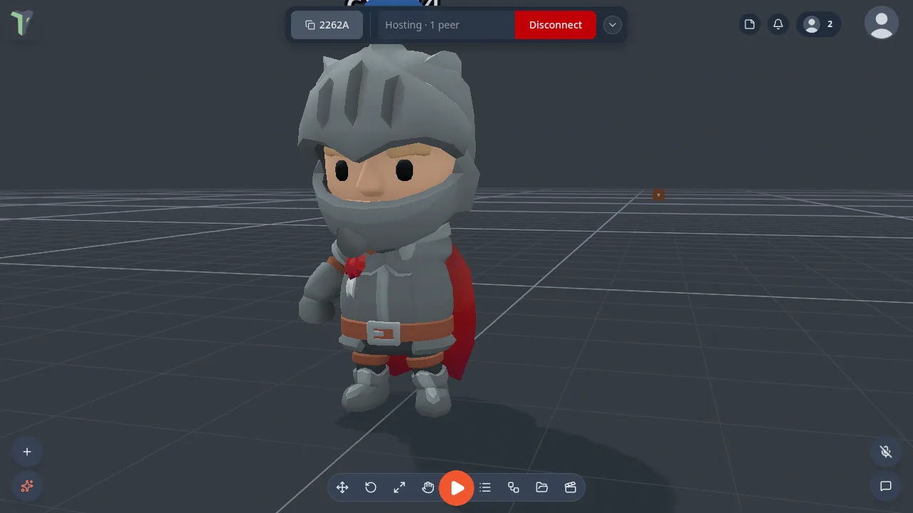
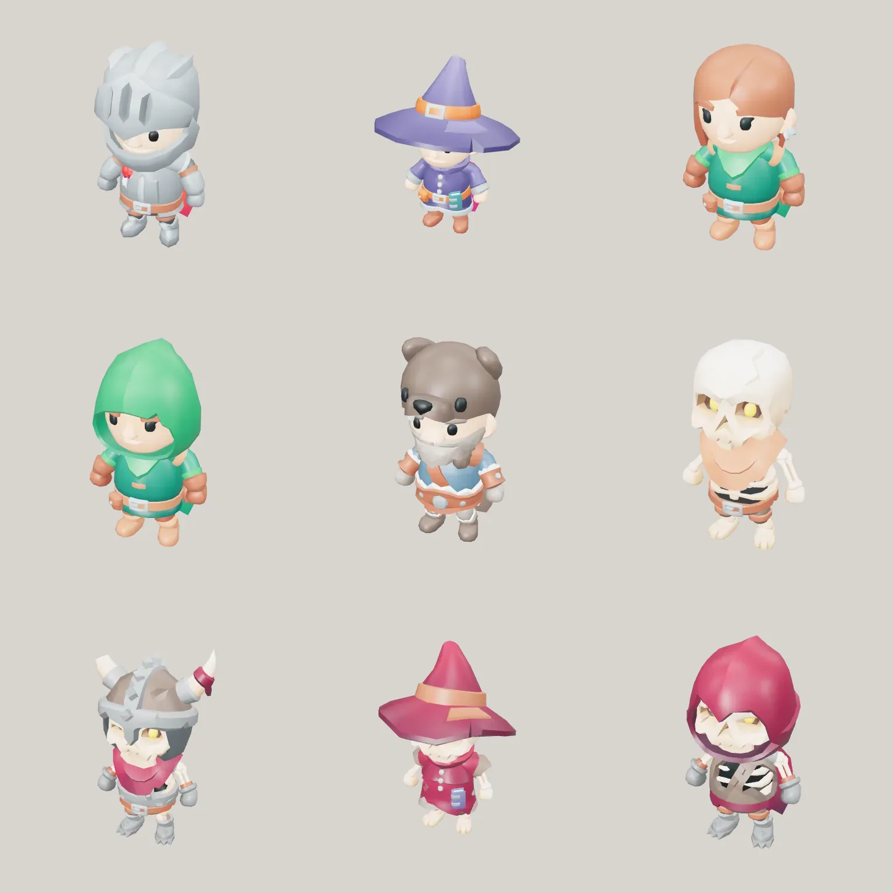
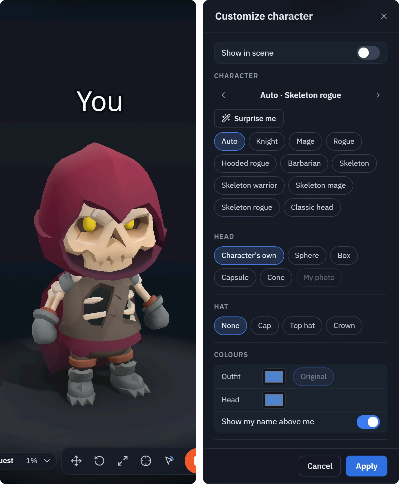
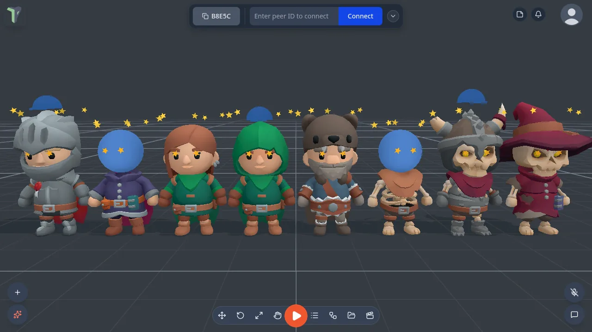

# Your Character

Since 1.24 everyone in a session appears as a **rigged, animated character** instead of a floating head. The body
stands under the person's viewpoint, **walks, runs, strafes, jumps and idles** with the way they move, turns to face
where they look, and — when they are in **VR** — reaches for their controllers with its arms. The classic floating head
is still there as a choice.

{ .shot width="1280" height="720" loading=lazy }
/// caption
Another person's character stands where their camera is.
///

## The characters

Nine characters ship with the app: **Knight**, **Mage**, **Rogue**, **Hooded rogue**, **Barbarian**, **Skeleton**,
**Skeleton warrior**, **Skeleton mage** and **Skeleton rogue**, from Kay Lousberg's free CC0 KayKit packs.

{ .shot width="1536" height="1536" loading=lazy }
/// caption
The nine characters.
///

If you never pick one, you get **Auto**: a character chosen from your id, so everyone sees the same one for you.
The same characters are also an Explorer pack, **Packs ▸ Adventurers**, that you can place in a scene as animated
models (see [Packs](packs.md#adventurers-124)).

## Customize Character

Profile menu (your picture, top right) ▸ **Customize Character** — also **Settings ▸ Interface ▸ Avatars ▸ Customize
character…**. A drawer opens (a bottom sheet on a phone) and puts **your own character** in a plain **studio**: a
neutral backdrop in your theme's colours, a floor disc and a soft key light.

{ .shot width="688" height="835" loading=lazy }
/// caption
Customize character on a computer. The studio is on the left of the screen, the drawer on the right.
///

### The studio

The scene is hidden from *your* view only while you customise — nothing in it changes, and other people in the session
keep seeing the scene (and you) as before.

- **Orbit** — drag in the free part of the view to turn the camera around your character like a turntable; the wheel or
  a pinch zooms.
- **Show in scene** — the switch at the top of the panel previews your character in the current scene instead, handy to
  check how a colour reads against the world. The choice is remembered for next time.
- Your whole character **stays in view** whatever the screen does: resize the drawer or the window, rotate a phone, or
  fold or unfold a foldable — the camera re-frames on every layout change.

### Choosing a look

- **Presets** — **Auto** (picked from your id), the nine rigged characters (step through them with ‹ ›) and the
  **Classic head**. Picking one shows *its* defaults: its own head, no hat, its own outfit colours.
- **Custom** — change any part (head, hat, outfit or head colour) and a **Custom** entry appears and is selected.
  Picking a preset again resets to that preset; picking **Custom** brings your edits back.
- **Surprise me** — a new random character on every press: body, head, hat and colours, never the same one twice in a
  row. A surprise you like is your Custom look; press **Apply** to keep it.

The name label and your ping colour and sound are your own preferences: presets and Surprise me leave them alone.

| Section | What you choose |
|---|---|
| **Character** | a preset — **Auto**, one of the nine, or **Classic head** — or **Surprise me**; your own edits are **Custom** |
| **Head** | the character's own head, a stylised **Sphere**, **Box**, **Capsule** or **Cone** in your colour, or **My photo** (your profile picture on a card; needs a profile photo) |
| **Hat** | None, Cap, Top hat or Crown — it sits on whatever head you chose |
| **Colours** | **Outfit** recolours the character's clothes (skin and face keep theirs; **Original** puts them back); **Head** colours a stylised head or the classic avatar |
| **Show my name above me** | your name label |
| **Ping** | the colour and chime of *your* [pings](notifications.md#pinging); **Preview** pings beside your character (only you see and hear it) |

Since 1.30 the panel is a **drawer** on the right (a bottom sheet on a phone): drag its inner edge to make it wider or
narrower — the keyboard works too (focus the edge, then the arrow keys; <kbd>Shift</kbd> for bigger steps) — and the
camera keeps your character in the part of the screen the drawer leaves free. The size is remembered on this device.

Every change shows on your character at once; nothing reaches other people until you press **Apply**, which saves it and
shows it to everyone. **Cancel**, <kbd>Esc</kbd>, ✕ or swiping the sheet away throw the changes away. Either way the
camera and the scene come back exactly as they were before you opened it.

## Showing everyone as classic heads

**Settings ▸ Interface ▸ Avatars ▸ Show everyone as classic heads** draws other people as the floating head instead of
their character — on **this device only**, and lighter on a headset with many people in the room. They still see your
character.

## Knocked-off idle

When someone gives no input for a while, everyone sees their character **knocked off**: little stars circle its head,
the head sways in a slow figure-8, and its eyes turn into spinning stars. Any key, click, mouse move or head move wakes
them, and it fades out smoothly.

{ .shot width="1280" height="720" loading=lazy }
/// caption
Knocked off: stars circle the head.
///

**Settings ▸ Interface ▸ Avatars ▸ Knocked-off idle** chooses when *you* count as idle: **Off**, **10 s**, **20 s** (the
default) or **60 s**. It is a setting for this device.

It works on every head — the character's own, the stylised ones, a photo card and the classic floating head — and costs
one extra draw call per idle character, none while awake.

## Feet on the ground

Since 1.26 characters stand on the floor in Play. (Before, a walking player sank about 0.9 m into the ground on everyone
else's screen.)

- A walking player tells the others where their feet are, so the character stands on the same floor — steps and raised
  floors included — in desktop Play, with a [Character Controller](build-a-game.md#3-a-character-that-walks) node in walk
  mode, and walking in VR Interact.
- Each foot stays planted while walking or running: the animation's heel roll no longer pushes a foot through the floor.
- A player who is flying or editing is still drawn with the body hanging under the head, as before.

## In VR

A VR user's character follows their head, and its arms reach for their controllers; a hand held out of the arm's reach
falls back to the floating controller marker. Pointing at an object puts the character's hand on it.

## Limits

- The bodies are stylised (big heads): a character is about 2.2 m tall so its eyes sit where the person's are.
- In the editor, a character follows the editor camera — flying the camera makes the body float.
- On a steep slope (20–30°) the feet follow the walker's capsule and can float a couple of centimetres above the slope;
  there is no foot IK yet.
- Characters add no network traffic: each screen works the bodies out from the position and hand data already shared.
- Each character is at most about 6,000 triangles with one material, so eight people stay inside a Quest's budget.
