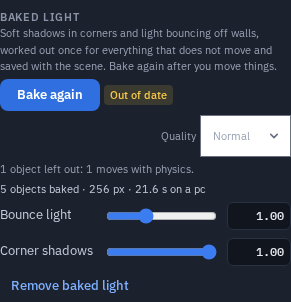

# Baked Light

**Baked light** works out soft shadows in corners (ambient occlusion) and light bouncing off
walls once, for everything in the scene that does not move, and saves the result with the
scene. A red wall tints the floor beside it, and a crate sits in a soft shadow, without any
cost while you play. It looks the same on a phone, in a headset, and on the desktop next to
it.

## Baking

1. Arrange the scene first. A bake is a snapshot of where things are now.
2. Open **Configure Scene ▸ Scene look** and find **Baked light**.
3. Choose a **Quality** (Draft, Normal or High) and press **Bake light**.

A progress bar shows how far it has got, and **Cancel** stops it at once. Nothing in the
scene changes until a bake has finished. You can keep working while it runs: the bake
happens in the background and never freezes the editor.

When it finishes, everyone in the session sees the baked light, it is saved with the scene,
and **Undo** takes the whole bake off in one step.

Two sliders then tune it without baking again:

- **Bounce light** — how strong the bounced light is (1 = as baked).
- **Corner shadows** — how dark the ambient occlusion is.

**Remove baked light** takes it off again (also one Undo step).

## What gets baked

Everything that **does not move**:

- Left out: objects with a physics body that moves (dynamic or kinematic), objects moved by
  a node graph or played by an animation clip, animated characters, instanced objects,
  hidden objects, and anything spawned while a game runs.
- Everything that is baked also **casts** onto everything else — a pillar's shadow lands on
  the floor.
- The panel lists what was left out and why, for example *"2 objects left out: 1 moves with
  physics, 1 has an animation."*

The light that bounces comes from the scene's own lights (the sun, point and spot lights).
Those lights and the sky still light the scene live as before, so moving objects and baked
ones match. A scene with no lights bakes the corner shadows only.

## When things move: "Out of date"

If you move, delete or reshape a baked object, or change the lights, an **Out of date** chip
appears next to the button. The old bake stays until you press **Bake again** — move things
back and the chip goes away.

## Lightmap UVs

A bake needs a second set of texture coordinates that do not overlap. The app makes them for
you: it uses the model's own second UV set when it has a clean one, and otherwise unwraps the
object itself. Your model is never changed — the bake's coordinates live beside it and are
rebuilt the same way on every device.

If an object's UVs overlap and cannot be unwrapped cleanly, it gets the **corner shadows
only**, and the panel says so in one line.

## Devices

| Device | Lightmap | Time limit | Download it shows |
|---|---|---|---|
| Desktop | up to 2048 px | 2 minutes | up to 16 MB |
| Phone | up to 1024 px | 1 minute | up to 2 MB |
| Headset | 512 px | 45 seconds | up to 1 MB |

A bake made on a desktop also stores a small 512 px copy, which phones and headsets show when
the full map is too big for them. A bake that hits the time limit keeps what it has and says
so; **Bake again** on a faster device for a cleaner result.

## Asking an AI to bake

The [Claude connector](ai/claude-connector.md) and the in-app assistant can bake too: ask it to
*"bake the light"* once the layout is done. It uses **set_look** with the **bake** action
(`do`: bake, status, cancel, clear or strength), asks the host first like any scene-wide look
change, and can tell you when the bake is out of date.

## Limits worth knowing

- **Moving objects are not baked.** They are still lit live and still receive the live
  shadows, but they get no baked corner shadows.
- **A bake is one bounce.** The light bounces once off the surfaces it hits; the sky is not
  baked (it stays live).
- **Objects drawn by a [Shader Graph](shader-graph.md)** and materials that cannot take a
  lightmap are not baked (they still cast onto others).
- **A GLTF export does not carry the bake.** Save a **Scene (`.tpscene`)** to keep it. The
  lightmap is saved in the scene and shows in **Scene ▸ textures**.
- Scenes saved before this version open exactly as they did.
