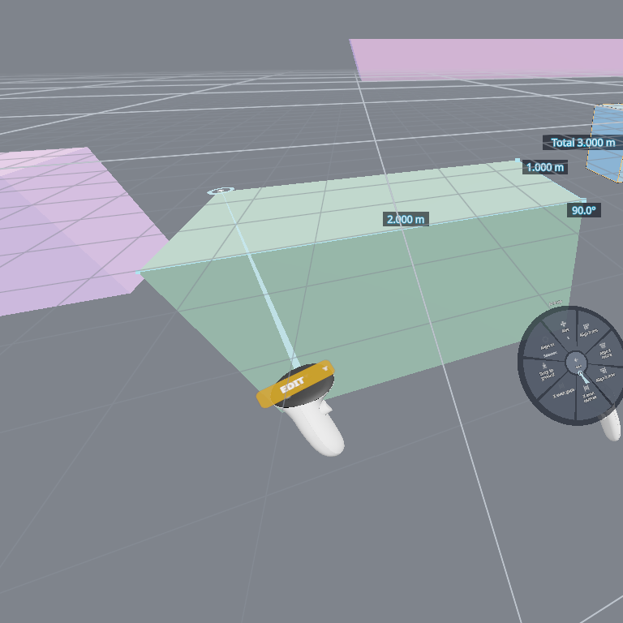
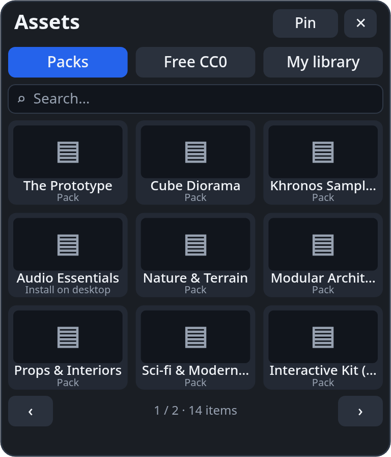
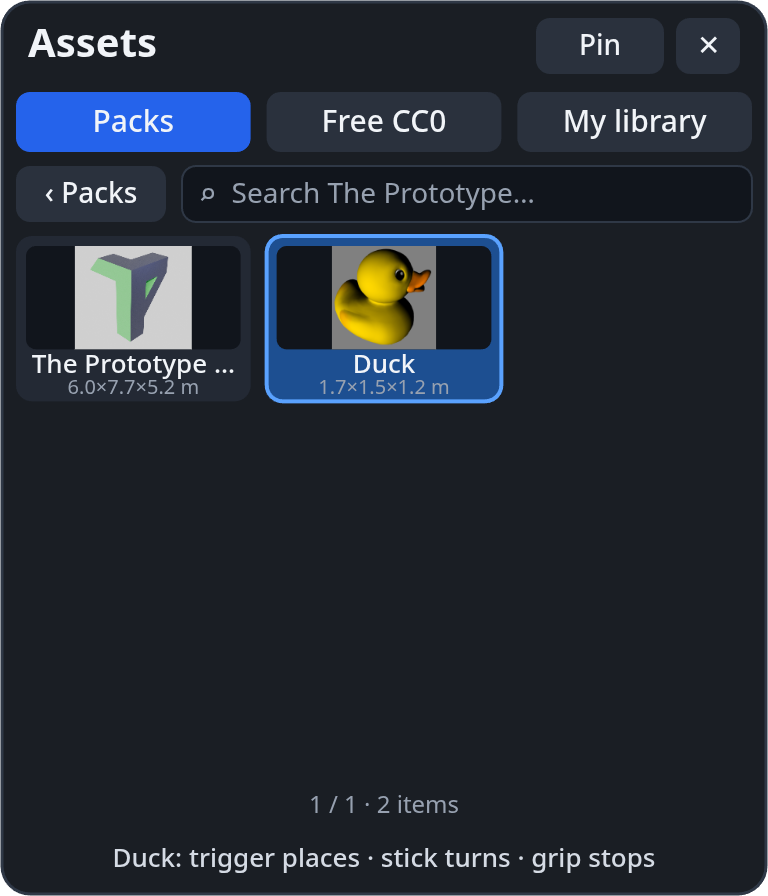
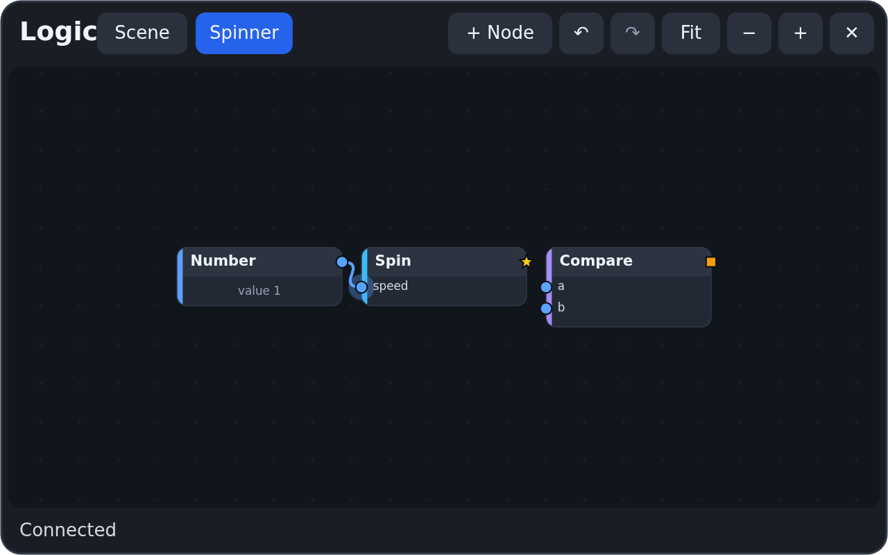
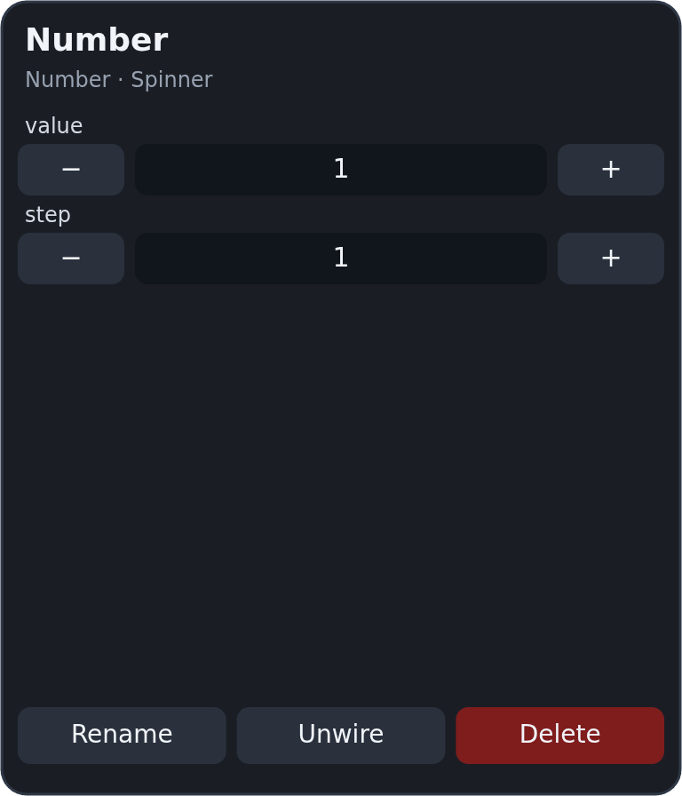

# Building in VR

Since 1.45 you can build a whole scene with the headset on: measure and line things up, paint terrain and scatter, pull
models off your wrist and drop them in, and shrink the world to a miniature to work on it from above. Since the next
release you can also [edit the game logic](#logic-in-the-headset) — the node graph — without taking the headset off. Everything here
works in **Edit**; the radial menu, grabbing and getting around are on the [VR Guide](vr.md).

**Controllers do everything.** With [hand tracking](#hands) you can browse and place; tools that need precision ask you
to pick up a controller. The comfort settings — vignette, seated, one-handed — apply to every tool on this page.

## Shrink the world: miniature mode

In Edit, **both grips always grab the world**, wherever your lasers point and whatever you stand inside.

- Pull your hands **together** to shrink the world, **apart** to grow it, **twist** to turn it, move them to move it.
- It sticks, with a tick in your hands, at **1:50 · 1:10 · 1:5 · 1:2 · 1:1 · 2× · 5× · 10×**, and a readout between your
  hands shows the scale (for example *1:10*). Turn the steps off with **Settings ▸ VR ▸ Controls ▸ World grab snapping**.
- **Back to 1:1** appears on the radial's first ring while the world is scaled, turned or moved.
- The **comfort vignette** closes in while the world scales or turns around you.
- Only you see the miniature: it changes your view, not the scene.

To scale or turn an **object** with two hands, grab it with one hand and **move it a little first** (about 2 cm), then
add the second grip. A grip that has not moved its object yet, joined by the other grip within a quarter of a second,
lets the object go back where it was (no undo step) and grabs the world instead.

Grips never take the **terrain**, **locked** objects, things **bigger than about 2 m**, or a room you are standing
inside by touch. To move one of those, select it with the trigger first, then grip it (terrain never moves by grip).

Prefer the old way? **Settings ▸ VR ▸ Controls ▸ Both grips scale the world**: *Always* (the default) or *Only in empty
air* (two grips on an object scale that object).

## Measure

Radial menu ▸ **Tools ▸ Measure** — a trigger tool beside Select, Box select and Draw mode.

- Point the laser of the hand that does not hold the menu. A dashed segment and a marker show where the next point lands.
- Pull the **trigger** to put a point down. Points **snap** like the desktop [Measure tool](measure-align.md): to a
  corner, an edge (or its middle) or a face centre within about 3° of the laser, so a slightly shaky hand still measures
  corner to corner. With grid snapping on, a point on a plain surface or the floor lands on the grid. A harder click
  tells you a point snapped.
- Keep pulling to make a **chain**: each segment shows its length, each corner its angle, and a chain of two or more
  segments a running **Total**.
- **Keep** it: pull the trigger twice on the same spot, or use the **Measure ring** the radial opens on while the tool is
  up — **Keep · Undo point · Discard · Snap · Done**. A kept chain is a **measurement item** in the object list, saved
  with the scene, seen by everyone and undoable, the same as one made on the desktop.
- **Edit** one: select it, then **Selected ▸ Edit measurement**. Point at a point and pull the trigger to pick it up, pull
  again to put it down; pull anywhere else to add a point at the end. **Done** on the Measure ring ends editing.
- The **labels** face you wherever you stand and stay the same size to your eye at any distance. Labels that would
  overlap are hidden instead of stacked.

Measuring needs a controller. Switching to Interact, leaving the headset or picking another tool ends it, and a chain of
two or more points is kept.

## Arrange: align, distribute, drop to ground

Select two or more objects, then radial ▸ **Selected ▸ Arrange**:

**Axis** (tap to cycle X → Y → Z) · **Align min / centre / max** · **Even centres** · **Even gaps** · **Drop to ground** ·
**Align to** (Selection / Active)

- **Align** lines every object's edge or centre up on the chosen axis with the selection's bounds — or, with **Align to:
  Active**, with the last object you picked, which stays put.
- **Even centres** and **Even gaps** need three or more objects; the two outermost stay where they are.
- **Drop to ground** rests each object on the surface below it (or the floor), lowest first.

The results are the same as the desktop's [Arrange](measure-align.md), each press is **one undo step** for the whole set,
and everyone in the session sees the objects move.

## Brushes on the controller

The terrain [sculpt brush](vr.md#sculpting-terrain-in-vr) now has two more tool sets on its **Sculpt** ring:

- **Paint ▸** — terrain layers **1 – 4**, the same layers as the desktop's [terrain paint](terrain.md).
- **Scatter ▸** — **Paint**, **Erase**, **Rotate**, **Scale**, **Relax**, and **Source ▸** to choose what you scatter
  (the current source, the ones already in use, or a primitive). See [Scatter](scatter.md).

Pull the **trigger** to paint. The pointing hand's thumbstick sets the brush: **left / right** the radius, **up / down**
the strength (or the density while you scatter-paint). A ring on the surface shows the brush, a short buzz starts each
stroke, and the label on your hand reads, for example, *Paint 3 · 3.0 m · 50%* or *Sphere · 3.0 m · 0.50/m²*. Brushes
work in a miniature too: the ring and the stroke follow your laser at the world's scale.

## The Asset Browser on your wrist

Radial menu ▸ **Add ▸ Assets** opens a panel on the wrist of your menu hand, facing you. Point at it with the other hand.

- **Packs** — the packs in your Explorer. Press a pack to open it, **‹ Packs** to go back.
- **Free CC0** — free models from Poly Haven. A card with **↓** downloads first (the card shows the progress) into your
  Library, folder *Poly Haven*, with its credit; **✓** means it is already in your Library.
- **My library** — your models and prefabs.
- **Search** — press the search box: the VR keyboard opens and the cards filter as you type. Page with **‹ ›**, or push
  the stick up and down while you point at the panel.

### Placing

The same drag-to-place ghost as the desktop: the item's size before it loads, its real look when it is ready, resting on
whatever you point at — amber when it overlaps something, red when there is nowhere to put it.

- **Trigger-drag** a card out of the panel and let go where it should land: it is placed there, once.
- **Click** a card and it rides your laser: each **trigger** places one more, the **stick** sideways turns it 15° a
  flick, and the **grip** stops. The panel's bottom line says what the trigger does right now.
- Each placement is one undo step, and everyone sees it.
- In a **miniature** the object still lands at full size, at the spot under your laser.

**Pin it:** grip the panel and let go in the air — it stays there, bigger. Grip it again and let go near your wrist to put
it back (or press **Pin** / **To wrist**). In one-handed mode it opens pinned in front of you.

Add ▸ **Prefabs** uses the same ghost: real size, the stick turns it, it rests on surfaces and snaps.

## Logic in the headset

Radial menu ▸ **Tools ▸ Logic** opens the scene's node graph as a panel in front of you. With one object selected,
**Selected ▸ Edit logic** opens that object's own flow instead (tabs at the top switch between the two). It is the same
graph as the desktop [node editor](node-editor.md): every change is one undo step, and everyone in the session sees it
land live.

| Do this | With |
|---|---|
| Move a card | **trigger-drag** the card |
| Wire two sockets | **trigger-drag** from a socket and let go on another. The wire is green while the types fit and red when they don't; a wire into a value input that already has one replaces it |
| Move or remove a wire | **trigger-drag** from an input that already has a wire: drop it on another socket to move it, or on the empty graph to remove it |
| Pan | **trigger-drag** the empty graph |
| Zoom | push the **stick** up or down while your laser is on the panel (it zooms where you point) |
| Move the panel | **grip** it and let go where it should stay |

The buttons along the top: **+ Node** opens a palette with the desktop's groups — pick a node and it lands in the middle
of the view; **↶ / ↷** undo and redo; **Fit** frames every card; **− / +** zoom; **✕** closes the panel.

{ width="320" }

**Click** a card (trigger, no drag) to select it: its values open on a **wrist pad** on your other hand.

- **− / +** step a number; press the value itself to type it on the VR keyboard.
- **‹ ›** cycle a choice or a colour; toggles flip on a press.
- **Rename**, **Unwire** (removes its wires) and **Delete** act on the selected card.
- A node with more values than fit has pages: push the stick up or down while you point at the pad.

In [one-handed mode](vr.md#comfort-for-everyone) the pad sits beside the panel instead of on your wrist. A
**viewer** sees the panel read-only, and it says so.

!!! note "Limits"
    - Groups are read-only in VR: you can move a collapsed group's card, but not wire into it or delete it. Edit groups
      on the desktop.
    - Custom (code) nodes, Object Flow nodes and Sound nodes need desktop pickers, so the palette leaves them out —
      add them on the desktop, then wire and tune them here.

## Hands

Without controllers, a **pinch is the trigger**: pinch a card to pick it, pinch-drag it out of the panel and let go to drop
it, or pinch a card and pinch again to place it. Tools that need precision — the sculpt, paint and scatter brushes,
measuring, moving vertices or faces — show **Pick up a controller** next to your hand instead.

!!! note "Limits"
    - Hands cannot turn the ghost (there is no stick); pick up a controller for that.
    - The Free CC0 tab lists Poly Haven models. Skies, textures and materials stay in the desktop Asset Browser.
    - A pinned panel's place is not remembered for the next session.
