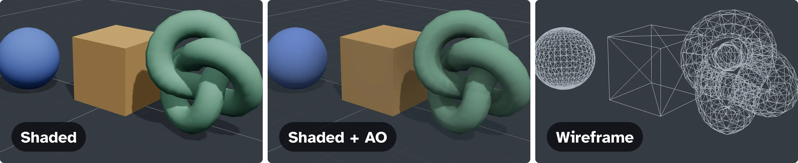
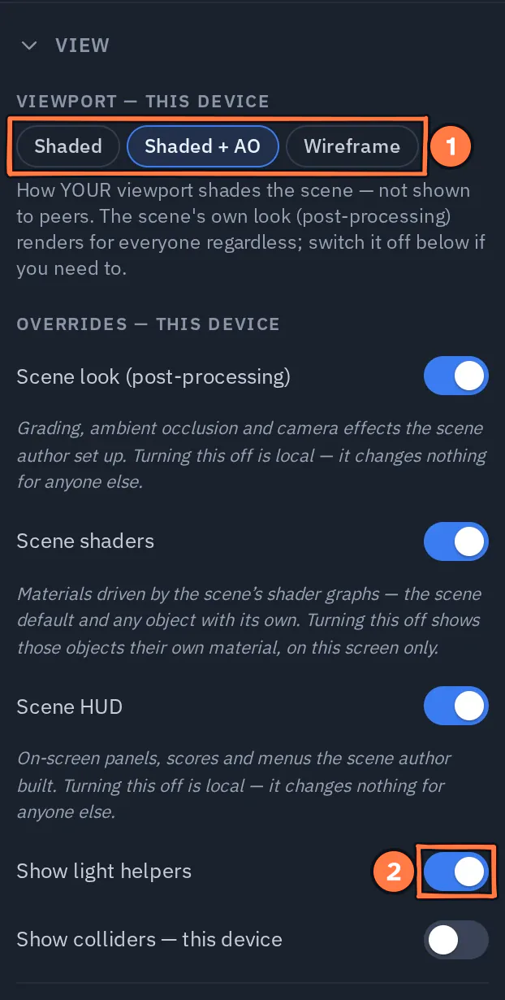
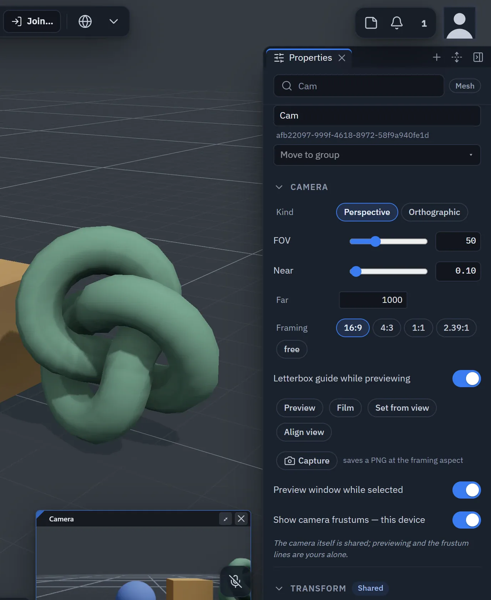
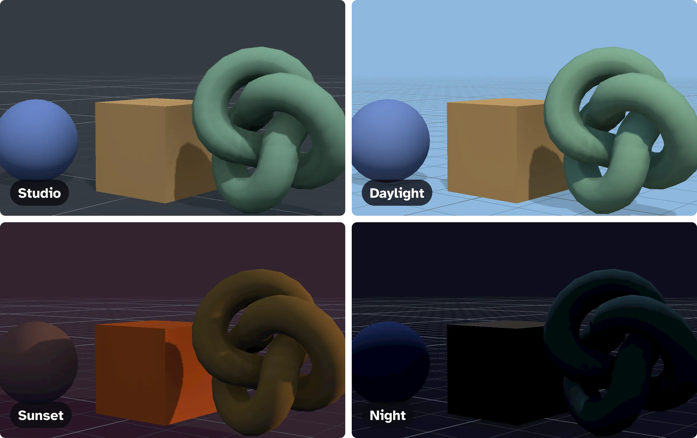
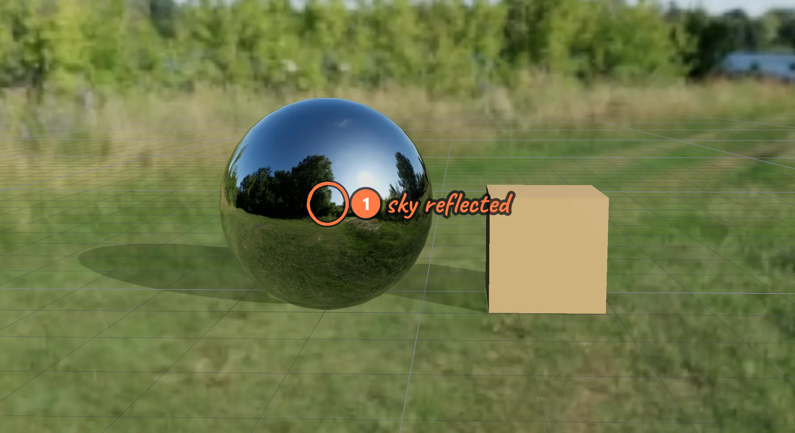
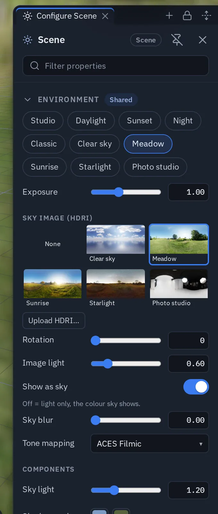
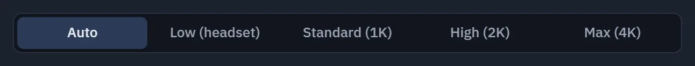
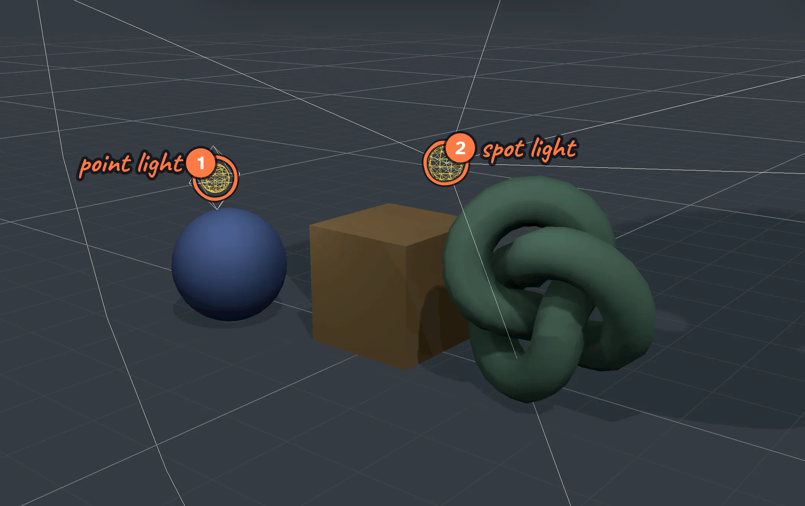

# Camera & View

Everything about how the scene *looks on your screen* — the camera lens, render mode, shadows, the grid and the environment — lives in one place: **Configure Scene**.

## Opening Configure Scene

Click **Configure Scene** in the sidebar menu. It opens as a tab of the [sidebar](interface.md#sidebars) on the right
(drag its tab to the left to keep it there). *Since 1.64* its sections are in two groups: **The scene** (shared,
everyone sees them) and **This device** (only you), and only Environment and Scene look start open:

- **Quality** — the quality preset and the automatic-quality, shadow and model switches (your device only; see
  [The Quality preset](performance.md#the-quality-preset)).
- **Environment** — lighting preset, exposure, [sky image](#sky-images-hdri), saved presets (shared).
- **Music** — the shared background track and your local volume (see [Music & Sound](audio.md)).
- **Lights** — the scene's [shadow quality](#shadow-quality) (shared; *since 1.79*).
- **View** — the render mode (on a computer, a row that opens the Preview menu), the scene-look overrides and light
  helpers (your device only).
- **Camera** — lens presets, field of view and clip planes (your device only).
- **Background** and **Fog** (shared).

A dot appears next to the menu item while the panel is open; click it again to close.

**Who changed it** (*since 1.64*): under each shared section a small line says who changed it last and when — a person
by name, an AI agent, or *Claude (AI)* through the connector. Loading a scene or joining does not count as a change.

!!! note "Shared vs. this device"
    The **Environment**, **Background** and **Fog** settings replicate to everyone. The **View** and **Camera** sections — render mode, lens and clip planes — are **local to your device**, so you can zoom, wireframe or dim shadows without changing what your peers see.

## Render mode (View)

*Since 1.79*, on a computer and a tablet, how this device draws the scene lives in the **Preview** menu at the top right
of the 3D view (the chevron beside **Preview**), under **Draw as**: Configure Scene ▸ View then has one row, *How this
device draws the scene: open Preview*, which opens that menu. Phones keep the three chips in View. <kbd>Z</kbd> works
everywhere. See [Cinematic view](cinematic-view.md#the-preview-pill) for the rest of the menu.

Three per-device render modes:

| Mode | Look |
|---|---|
| **Shaded** | Plain lit shading. |
| **Shaded + AO** | Adds ambient occlusion — soft contact shadows in creases and corners (the default on a desktop; phones and tablets start in plain **Shaded**). |
| **Wireframe** | Shows every edge. |

{ .shot width="1944" height="400" loading=lazy }
/// caption
Shaded, Shaded + AO and Wireframe. AO darkens creases and the ground where objects touch it.
///

[Try it](https://theprototype.app/){ .tryit data-tryit="camera-render-mode" }

<kbd>Z</kbd> in the 3D view cycles them: Shaded → Shaded + AO → Wireframe (Shaded + AO is skipped when the scene's own
look already sets ambient occlusion). Rebind it in **Settings ▸ Shortcuts**.

On a desktop with Chrome or Edge, **Preview** at the top right (<kbd>Shift</kbd>+<kbd>Z</kbd>) switches to the
[Cinematic view](cinematic-view.md): bounced light and reflections, on this computer only.

### Draw as: modes for checking a model

*New in 1.79.* Under the three render modes the Preview menu's **Draw as** has five more, for checking a model rather
than looking at the scene:

| Mode | Shows |
|---|---|
| **Wireframe over shaded** | the lit scene with every triangle edge drawn on top |
| **Ambient occlusion only** | white clay with soft contact shadows: shapes without colour or texture |
| **Normals** | which way each surface faces, as colour |
| **UV checker** | a checker pattern through each model's texture coordinates: stretching shows as uneven squares |
| **Weights** | skin weights: the selected bone's influence from blue (none) to red (all); with no bone selected, each bone a colour. Greyed when nothing in the scene is skinned |

They are for **this device only** and go back to the everyday look when you reload or change scene (Shaded, Shaded +
AO and Wireframe are remembered as before). While one is on, a dot on the Preview chevron says so. Play, a headset and
the Cinematic view always draw the normal look. On a phone, add the optional **Preview** drawer (**More ▸ Windows**)
for Draw as and Quality.

Ambient occlusion and wireframe are **desktop-only** and never shown to peers. AO detail follows your shadow-quality setting (below), so lowering shadow quality also lightens the AO cost.

These are SHADING modes — they are not how you see the scene's own look. A
[scene look](post-processing.md) renders for everyone in every mode except Wireframe, and
you switch it off for yourself under **Overrides — this device**. If the scene sets its own
ambient occlusion, **Shaded + AO** switches off and says so: the scene's setting is used
instead of yours.

{ .shot width="311" height="615" loading=lazy }
/// caption
Configure Scene ▸ View: how the scene is drawn on your screen. Since 1.79 the render mode chips show here on a phone;
on a computer a row opens the Preview menu instead.
///

1. The **render mode** switch.
2. **Show light helpers**.

[Try it](https://theprototype.app/){ .tryit data-tryit="camera-view-section" }

The **Show light helpers** toggle here draws icons for lights so you can see where they are — in the editor only; see [Helpers hide in Play](#helpers-hide-in-play).

## Camera objects

Besides your own view, a scene can hold **cameras** of its own — the shot a game starts from, a cutscene angle, a
security monitor. Add one from **right-click ▸ Add ▸ Camera ▸ Perspective** (or **Orthographic**). It appears as a small
camera marker you move and turn like any object; selecting it opens **Properties ▸ Camera**:

{ .shot .fade-l .fade-b width="688" height="840" loading=lazy }
/// caption
A camera's properties, with its preview window at the lower left.
///

| Row | What it does |
|---|---|
| **Kind** | Perspective or Orthographic |
| **FOV** (perspective) | field of view, 10–140° |
| **Size** (orthographic) | how much of the scene fits, 0.5–50 |
| **Near / Far** | the clip planes |
| **Framing** | 16:9 · 4:3 · 1:1 · 2.39:1 · free (follows the viewport) |
| **Letterbox guide while previewing** | bars that show the framing while you look through it |
| **Preview** | look through the camera. A banner says *Previewing ‹camera›*; its **Control** button lets you fly the camera with <kbd>W</kbd><kbd>A</kbd><kbd>S</kbd><kbd>D</kbd> and the mouse (its new pose is kept, as one undo step) |
| **Set from view** | move the camera to where your view is (and take its FOV) |
| **Align view** | fly *your* view to look through this camera (it stays your camera) |
| **Capture** | render one frame through this camera and download it as a PNG at the framing aspect |
| **Preview window while selected** | the picture-in-picture window (below), on by default |
| **Show camera frustums — this device** | draw every camera's viewing pyramid |

The camera itself — including its *Letterbox guide* and *Preview window while selected* switches — is shared with
everyone; previewing and the frustum lines are yours alone. The object's right-click menu has **Preview camera** and **Set from current view** too.

**Picture-in-picture.** While a camera is selected, a small window shows what it sees, live. **⤢** looks through it full
screen, **✕** hides the window (the *Preview window while selected* row brings it back), and right-drag moves it. Since
1.34 it resizes too: drag the grip in its top-left corner (the picture keeps the camera's framing), or double-click the
grip for the default size. The size is remembered.

A game uses cameras through the [Set Active Camera](nodes/setcamera.md) node, the [Start camera](nodes/gamestart.md) node's
camera, [Set Look](nodes/setlook.md) for each camera's own [look](post-processing.md), and since 1.27 the
[Camera Rig](nodes/camerarig.md) node, which makes a camera follow or watch an object.

## Camera lens

The default camera is a **40° field of view** — a natural, product-viz look with real depth and little wide-angle distortion. You can change it in the **Camera** section:

**Lens presets** (labelled by their full-frame focal-length equivalent):

| Preset | Feel |
|---|---|
| **Wide** (24 mm) | Roomy, exaggerated depth. |
| **Classic** (35 mm) | Reportage, slightly wide. |
| **Natural** (50 mm) | Close to how the eye sees. |
| **Portrait** (85 mm) | Compressed, telephoto. |

Below the presets, the **Camera FOV** slider gives fine control (15°–120°).

!!! note
    Your FOV is broadcast, but a peer only *sees through* it while they're spectating your view — during normal editing everyone keeps their own camera.

## Clip planes

In the **Camera** section, the near/far clip planes control the depth range the camera renders (per-device):

- **Near clip** (0.01–2) — surfaces closer than this are cut away. Lower it if very close objects vanish.
- **Far clip** (from 10) — the far limit. It **grows automatically to fit the scene**, and the orbit zoom-out limit is paired to it so you can never dolly past the far plane and blank the scene.

## Shadow quality

*New in 1.79.* **Configure Scene ▸ Lights ▸ Shadow quality** sets how the scene's shadows are drawn, for **everyone**
in the scene, and is saved with it:

| Level | What it draws |
|---|---|
| **Off** | no shadows |
| **Basic** (the default) | one shadow map per light that casts: the look every scene had before 1.79 |
| **Soft** | softer shadow edges. In a scene a few hundred metres across the edges stay as Basic draws them (a wider blur on that big a shadow map would wash small shadows out). |
| **Far** | Soft, and the sky's sun draws two layers of shadow: sharp near you and present out to 300 m. Past 300 m the sun draws no shadow at Far (Basic's single map covers the whole scene, more blurred). Lamps and suns you placed in the scene draw Soft's edges. |

**What a device draws.** A computer draws up to **Far**, a phone at most **Soft** and a headset **Basic** (more would
cost frames there). When this device draws less than the scene asks, the row says so (*This device draws Soft*). The
[Cinematic view](cinematic-view.md) draws Far as Soft. No device draws contact shadows yet (the thin dark line where an
object meets what it stands on): they cost frames on laptop graphics and phones.

Every scene made before 1.79 is **Basic** and looks exactly as it did.

**This device's cap.** **Configure Scene ▸ Quality ▸ Shadow detail** — the same setting as **Settings ▸ Scene ▸
Performance ▸ Shadow quality**: **Off · Low · Medium · High** (default High) — caps every light's shadow-map size on
your computer, and so caps what the scene asks for here; *Off* disables shadows entirely. Per-light shadow settings still
replicate; this only changes what your machine renders. Settings search finds both rows: *Shadow quality* (this device)
and *Scene shadow quality* (it opens Configure Scene ▸ Lights).

!!! note "Someone on 1.78"
    A peer still on 1.78 drops the setting from the look it sends back: the scene reads Basic for them, and after their
    next sky or light change it reads Basic for everyone. Set it again once everyone has updated; the saved file is fine
    until then.

## The grid

The floor grid can be toggled from the viewport right-click menu ▸ **View ▸ Show/Hide grid**, or the **Show grid** checkbox in Settings. Its fade distance scales with how far you've zoomed out, so it stays visible when you pull the camera way back. The grid hides itself in wireframe mode.

## Environment presets

The **Environment** section sets the scene's lighting and sky. Pick a preset chip:

| Preset | Look |
|---|---|
| **Studio** | Neutral grey studio (the default). |
| **Daylight** | Bright sky, strong sun, soft fog. |
| **Sunset** | Warm, low sun. |
| **Night** | Dim and cool. |
| **Classic** | The pre-lighting look with the rig **off** — bring your own lights. |
| **Product shot**, **Cinematic**, **Stylised** | *New in 1.63.* Pro presets: they also set the tone mapping and a stack of post effects. See [Pro Look](pro-look.md). |

{ .shot width="1292" height="812" loading=lazy }
/// caption
Studio, Daylight, Sunset and Night on the same three objects.
///

[Try it](https://theprototype.app/){ .tryit data-tryit="camera-environment" }

*Since 1.64* the section shows **six preset pills plus More** (a preset picked from More takes the sixth pill while it is
applied), and a line that says what the preset is for and what it sets. After you edit a value it reads, for example,
*Studio · Modified: sun*, with a **Reset** button that puts the whole preset back in one undo step, for everyone. A
**dot** beside a row (Exposure, Sky light, Sky / ground, Sun, Sun color, Background, Fog) marks a value that differs from
the preset; press the dot to put just that value back.

Since 1.27 five more chips — **Clear sky**, **Meadow**, **Sunrise**, **Starlight** and **Photo studio** — use a real sky
photo; see [Sky images](#sky-images-hdri).

An **Exposure** slider tunes overall brightness. The lit presets add a sun that casts shadows, with a shadow-catcher disc under the scene so shadows land even on the infinite grid.

Environment is a **shared, latest-wins** setting — the most recent change wins for everyone. You can also **save**, **export** and **import** custom presets (stored locally), and adopt presets other peers have shared.

Below Environment, **Background** sets the clear color and **Fog** adds fog, both shared. A fog you set by hand keeps exactly the near and far you typed; a preset's fog still grows with a big scene.

### Fog kinds

*New in 1.74.* The Fog rows start with **Kind**:

| Kind | Rows | What it looks like |
|---|---|---|
| **Linear (near to far)** (the default) | Near, Far | no fog up to Near, full fog colour from Far |
| **Distance** | Density | fog that thickens the further you look, with no hard edge — a hazy valley, a dusty hall |
| **Height (ground fog)** | Density, Ground height, Thickness | fog lying on the ground: thickest at **Ground height**, thinning out over **Thickness** metres above it. Looking down into it fogs more than looking across above it, and a tower top stands clear |

- Density 0.01 is a light haze, 0.1 is thick; Thickness 2-6 m reads as ground fog, 20 m and more as a low cloud.
- Peers on an app older than 1.74 see a linear fog from Near to Far instead.
- The [Cinematic view](cinematic-view.md) draws Distance fog; Height fog is listed in its *Not shown* chip.
- Agents set it with `set_sky` fog `{kind, density, base, thickness}`.

## Sky images (HDRI)

Since 1.27 a sky image — an HDRI, a 360° photo that keeps the real brightness of the sun and the sky — can be the
scene's sky **and** its light. Every object picks up the image's colours and brightness, shiny objects reflect it, and
[water](water.md) mirrors the real clouds. The scene's sun is placed where the photo's sun is, so shadows agree with the
sky.

{ .shot .vignette width="1100" height="600" loading=lazy }
/// caption
The Meadow sky image lighting a mirror sphere and a box.
///

1. The sky image lights the scene and shows in every reflection: the **sky reflected** in the mirror sphere.

It lives in **Configure Scene ▸ Environment**. The skies are presets: pick one from the six preset pills or **More**;
like every Environment setting, everyone in the session sees it. (*Since 1.64* the sky picture cards and their tour are
gone; the small **None** and **Upload HDRI…** chips stay.)

Since 1.53 a sky downloads the first time you pick it and stays [on this device](settings.md#downloads-kept-on-this-device). Offline or
with the download blocked, the preset's flat colours show until the sky can load. Exported games still carry their sky.

| Sky | What it looks like |
|---|---|
| **Clear sky** | open blue sky with clouds, haze on the horizon |
| **Meadow** | a sunny meadow with trees |
| **Sunrise** | a low warm sun and long shadows |
| **Starlight** | dusk under the stars |
| **Photo studio** | softbox lighting over a plain grey backdrop — light only; reflections show the studio |

In VR the five skies are they are in the radial menu's **Scene ▸ Environment**. All five are CC0
images from [Poly Haven](https://polyhaven.com).

{ .shot width="311" height="395" loading=lazy }
/// caption
Configure Scene ▸ Environment, with its Sky image section.
///

| Row | What it does |
|---|---|
| **Upload HDRI…** | use your own sky (up to 25 MB; 1k–2k is plenty): an equirectangular `.hdr` or `.exr`, a [cube map](#cube-map-skies), or an equirectangular `.png` / `.jpg` / `.webp`. It is added to the [Explorer](explorer.md), your peers download it from you automatically, and it is saved inside `.tpscene` files and exports |
| **Rotation** | turns the sky; the sun and its shadows turn with it |
| **Image light** | how strongly the image lights objects (the sky itself is unchanged) |
| **Show as sky** | off keeps the image's light and reflections but shows the colour sky instead |
| **Sky blur** | softens the background — handy behind a product shot |
| **Tone mapping** | **ACES Filmic** (the default), **AgX** or **Neutral**: how the bright image is fitted to the screen |
| **None** | back to the colour sky and the light rig |

**Exposure** brightens or darkens the whole picture, and while a sky image shows it works on the
desktop whatever else is on. Editing any of these turns the preset into *Custom*, like any other sky edit; **Save
preset** keeps it.

A short tour points at the cards the first time you see them (**Settings ▸ Interface ▸ Tours ▸ Reset all** shows it
again).

### Cube-map skies

*New in 1.74.* **Upload HDRI…** also takes a sky made of six square faces, and turns it into an equirectangular
`.hdr` (at most 2048 × 1024) that is stored and shared like any uploaded sky:

- **one image** laid out as a **cross** (4:3 or 3:4) or a **strip** of six faces (6:1 or 1:6, in the order +X −X +Y −Y
  +Z −Z), in `.hdr`, `.exr`, `.png`, `.jpg` or `.webp`;
- **six files** picked together, named by face: `px nx py ny pz nz` (also `posx`… `negz`, or `right left top bottom
  front back`).

The cross centre is the front (+Z) face, as in three.js and most skybox tools; nothing is mirrored. A `.png` or `.jpg`
sky has no light brighter than white, so it lights the scene more flatly than an `.hdr`. A toast names the converted
file; the original faces are not kept. Agents can upload a cube-map cross or strip with `assets upload` the same way.

### How sharp the sky is

*New in 1.59.* The five skies come as **UltraHDR** images in several sizes: 1K, 2K and 4K, and 8K for **Meadow**. The
small one shows first, so the scene is lit and has its sky after one small download; then, if your device should show
more, the sharper one downloads and swaps in. **The lighting always comes from the 1K file** — the larger files only
draw the sky you see — so objects look the same at every quality and nothing shifts at the swap.

The sizes are for the five built-in skies, shown as the sky (**Show as sky** on) with no **Sky blur**. A sky you
uploaded yourself shows as it is.

#### Sky quality for the scene

While a built-in sky shows as the sky, two more rows sit under **Tone mapping**. They are shared, like every
Environment setting:

| Row | Choices |
|---|---|
| **Sky quality** | **Auto** (the default), **Standard (1K)**, **High (2K)** or **Max (4K)** |
| **Minimum quality** (only while Sky quality is Auto) | **Standard (1K)**, **High (2K)** or **Max (4K)**: the least anyone gets, for a showcase that must not look blurry |

**What Auto picks:** **High** on a desktop; **Standard** in a headset, on a phone, on a slow connection or with Data
Saver on, and when the [quality governor](performance.md#the-quality-governor) has switched effects off on a loaded
machine. Auto never picks Max by itself: 4K is several times the download for a difference most views never show.

**Max** is 4K, or the 8K Meadow (about 7 MB) on a device with 8 GB of memory or more that is not a phone. A file
larger than the graphics card can hold steps down a size.

**Which choice wins**, in this order:

1. A device set to **Low (headset)** in Settings ([below](#sky-image-quality-this-device)) stays at Standard, whatever
   the scene says.
2. A scene set to **Standard**, **High** or **Max** gets it.
3. A scene on **Auto** uses the player's pick in the game menu (**Settings ▸ Sky quality**), else this device's
   **Sky image quality**, else Auto's own pick.
4. The scene's **Minimum quality** raises that result.
5. A headset never goes past **High**, even for a scene's Max or its minimum.

**Exported games keep the option.** An [export](publish-export.md#export-a-game-in-a-zip) carries the 1K, 2K and 4K
files (and the 8K Meadow for a scene set to Max), so players can pick theirs in the game menu without any download from
our servers. The game menu's **Sky quality** row only counts while the scene's Sky quality is Auto.

### Sky image quality (this device)

**Settings ▸ Scene ▸ Performance ▸ Sky image quality** is for **this device only** — the scene and your peers are
unaffected:

{ .shot width="646" height="62" loading=lazy }
/// caption
Sky image quality, for this device only.
///

| Choice | What it does |
|---|---|
| **Auto** (the default) | follows the scene and the device, as above. In a headset, in VR, or once the scene is too heavy for effects, the light and reflections are also prepared at 512 px |
| **Low (headset)** | the sky stays at Standard whatever the scene says, and the light and reflections are prepared at 512 px — a quarter of the memory, softer reflections |
| **Standard (1K)**, **High (2K)**, **Max (4K)** | your own pick for scenes that leave Sky quality on Auto (a player's pick in a game's menu comes first) |

### Limits

- An `.exr` must be RGB or RGBA.
- Files over 25 MB are refused — your peers could not receive them.
- Someone on an app older than 1.27 in the same session sees the preset's flat colours instead of the image.
- A [scene look](post-processing.md) with its own [Tone mapping](post-processing.md#tone-mapping) effect keeps its own curve.

## Lights

A **directional** or **spot** light shines where it points. Turn it with the rotate gizmo — or type into the rotation rows — and the beam and its shadow follow, the way a light behaves in any 3D tool. Older scenes that aimed a spot at a saved point load aimed the same way.

**Aim at**, in the Properties panel's Light section, points the light once at a spot: type a world **X / Y / Z**, or press **Pick in viewport** and click a surface (<kbd>Esc</kbd> cancels). It writes the rotation, so the gizmo and the rows agree afterwards.

A directional light has a direction, not a distance. Its helper line reaches as far as **Settings ▸ Scene ▸ Light helper length** says — display only.

{ .shot .vignette width="1080" height="680" loading=lazy }
/// caption
Light helpers show where each light is and where it shines; they are editor-only.
///

1. A **point light**'s helper.
2. A **spot light**'s helper, with the cone it shines into.

### A light with an origin

Lights have an [origin](controls.md#each-objects-origin) like any other object. Give a sun one — type it in the Transform section's Origin block, or press **World 0** — and **Rotate** swings the light around that point instead of turning it in place: a sun on an orbit, in one gesture. *Move* still moves the light and carries its origin along.

### Helpers hide in Play

Light helpers, camera frustums and camera markers are editor furniture. They disappear when Play starts, and camera previews and captures never show them, so a screenshot is the game and nothing else.

**Show helpers in Play (debug)** — on the viewport menu under **View**, and in **Settings ▸ Controls** — brings them back while you debug a scene, with an amber **DEBUG · HELPERS** chip in the corner so a capture cannot be mistaken for the real thing. It is your setting alone.
