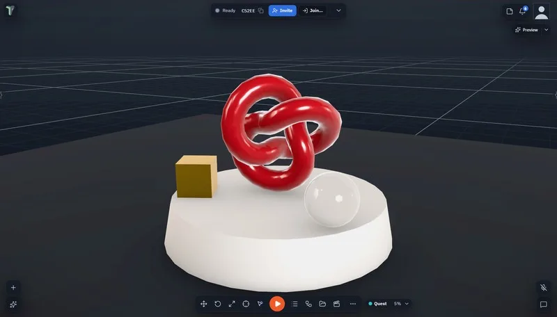
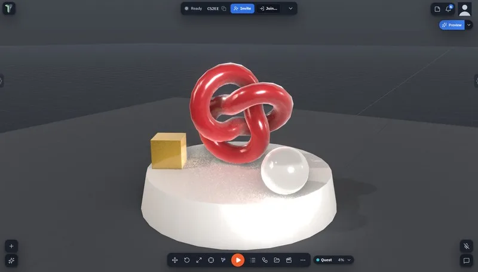

# Cinematic View

*New in 1.69.* **Preview**, at the top right of the 3D view, switches the viewport to the **Cinematic view**: the
same live scene, drawn with light that bounces between surfaces, reflections on shiny surfaces, softer shadows and
a gentle glow. You keep working while it is on: select, move things with the gizmo, undo, run flows and physics,
press Play, and the people in your session keep editing with you.

{ .shot width="800" height="456" loading=lazy }

{ .shot width="800" height="456" loading=lazy }

The standard view (top) and the Cinematic view at Standard quality (bottom).

## Turn it on and off

| Where | How |
|---|---|
| Viewport | press **Preview** at the top right |
| Keyboard | <kbd>Shift</kbd>+<kbd>Z</kbd> in the 3D view (rebind it in **Settings ▸ Shortcuts**) |

It is a setting of **this computer**. Other people in the session keep their own view, nothing is sent to them, and
the scene file does not change. If you leave it on, it comes back on by itself a few seconds after the app loads.

## The Preview pill

*New in 1.79.* **Preview** sits in one pill at the top right of the 3D view, which replaced the Cinematic switch and
the budget chip of earlier versions. It never covers a side panel: it sits beside it.

- **Preview** turns the Cinematic view on and off where it is offered (and is lit while it is on); elsewhere it opens
  the menu.
- **One part per device you judge for**, with its icon and the percent of that device's budget the scene uses, in the
  verdict colour. Click one to open [Statistics ▸ Budget](performance.md#statistics-budget) for that device. When the pill
  would meet other controls, the parts fold to the worst one and *+N*.
- **The chevron** opens the **Preview menu**: **Cinematic view** (Off and the quality levels, then the
  [Reflections and Global light](#reflections-and-global-light) switches), **Draw as** (the
  [render modes and the checking modes](camera.md#draw-as-modes-for-checking-a-model)), **Quality** (the
  [device quality preset](performance.md#the-quality-preset)), **Judge for** (This device, Phone, Quest, PC: each one
  you tick gets a part in the pill), **Statistics…** and **Scene look settings…**. A dot on the chevron says Draw as is
  not the everyday look.

Everything in the Preview menu changes how **this device** draws the scene: it is never saved and never shared.
Configure scene is what the scene **is**: saved, and everyone sees it.

**Judge for** starts with nothing ticked. **This device** ticks itself once, the first time the scene goes over 100 % of
this device's budget; Quest is never ticked for you. A device you picked on the old budget chip carries over. You can
judge for several devices at once.

The pill moves and hides like the other controls (right-click it, or [Edit positions](controls.md#moving-the-clusters));
a place or a hide you gave the budget chip carries over. **Phones** have no pill: add the optional **Preview** item
(**More ▸ Windows** on a folded phone, **Customize toolbar** on an unfolded one) for a drawer with Draw as and Quality.

## Quality

The chevron beside **Preview** opens the Preview menu; its **Cinematic view** group has **Off** and the quality levels:

{ width="280" height="884" loading=lazy }
{ width="280" height="884" loading=lazy }
/// caption
The Preview menu with the Cinematic view on at Standard.
///

| Step | What it adds |
|---|---|
| **Basic** | soft contact shadows (ambient occlusion), smoothing and glow, no bounced light |
| **Standard** (the default) | bounced light and reflections at half resolution, on top of Basic |
| **High** | bounced light and reflections at full resolution; offered up to a 1440p-sized window |

When frames get slow (below about 30 frames a second for two seconds), the view **steps down by itself**: first the
quality level, then a [switch](#reflections-and-global-light) you set to **On**. The chip under the Preview pill says
what it turned off (*Lowered to Basic, Reflections off to keep it smooth*). It does not step back up on its own: pick
the step in the menu again to try it; changing a switch starts over.

## Reflections and Global light

*New in 1.79.* Two switches under the quality levels, for how **this computer** draws the Cinematic view:

- **Reflections** — screen-space reflections on shiny and smooth surfaces.
- **Global light** — light bouncing between surfaces.

Each has **Auto** (what the quality level decides: Basic = off, Standard and High = on), **On** (at every level, half
resolution at Basic) and **Off**. They work while the Cinematic view is on.

**What it costs here.** Once this computer has drawn the view with and without a switch (flip it once), the row shows
what it costs, for example *On · costs about 3 ms*.

The switches and the measured costs stay on this device: they are never saved with the scene or shared, and other
people in the session see their own view.

**Baked light is not lit twice.** Objects with [baked light](baked-light.md) (Configure scene ▸ Pro look ▸ Bake light)
keep their own baked light and shadows: at Standard and High they get no bounce light or screen AO on top. Scenes
without baked light look the same as before.

**Shadows.** The Cinematic view draws a scene's [Far shadows](camera.md#shadow-quality) as Soft.

## What it does not show yet

This is the first version. A few things are drawn as **plain stand-ins** while the view is on, and a note under the
Preview pill names the ones in your scene:

- [shader graph](shader-graph.md) materials and hand-written shaders (they show their base colour),
- [water](water.md) surfaces and fluid tanks,
- particle effects,
- painted terrain layers,
- jiggle (the object shows, without the wobble).

[Gaussian splats](gaussian-splats.md) (1.75) are not drawn at all while the view is on: they are hidden, and the
**Not shown in Cinematic view** note names Gaussian splats.

The grid also fades less with distance than in the standard view.

Text shows as in the standard view (since 1.71): 3D text, names over people, ping names and path numbers keep their
font, colour and outline. Raised (extruded) 3D text is real geometry and is lit by the scene; flat text is not.

Switch the view off to see them as usual. Nothing in the scene is changed.

## Photo, video and VR

- **Photo mode** and **video takes** are made through the Cinematic view while it is on. A path-traced photo needs
  the standard view: Photo mode says so, so switch the view off first.
- **Entering VR** turns the view off first; VR always uses the standard view.

## Which devices get it

**Preview** turns the Cinematic view on only where it can work (elsewhere it opens the Preview menu):

- a **desktop or laptop** computer,
- **Chrome or Edge** with WebGPU on a hardware graphics card (not a software one).

Phones, tablets and VR headsets do not get the Cinematic view and **download nothing extra** for it. If the graphics card
fails while the view is on or while it starts (a shader that does not compile, a lost device, the browser dropping
the graphics device), it switches back to the standard view by itself and tells you why. **Preview** then stays on
screen greyed out, with the reason under it (press it to read it again), until you reload the page.

## What it costs

Measured on 2026-11-20 in real Chrome 156 on a desktop PC with an RTX 4090 (the same window as the standard view,
no vsync), median frame time:

| Scene | Standard view | Basic | Standard | High |
|---|---|---|---|---|
| Tavern interior | 4.2 ms | 5.6 ms (1.3x) | 5.8 ms (1.4x) | 5.9 ms (1.4x) |
| Castle courtyard | 2.8 ms | 3.3 ms (1.2x) | 3.7 ms (1.3x) | 3.6 ms (1.3x) |
| Product shot | 1.1 ms | 1.5 ms (1.4x) | 1.9 ms (1.7x) | 2.4 ms (2.2x) |

On a Steam Deck (a 1920x1080 window), Standard holds in the Castle courtyard and the Product shot; in the Tavern it
steps down to Basic by itself, and High steps down in every scene. On a handheld, pick **Basic**.

## See also

- [Camera & View](camera.md#render-mode-view): the Shaded / Shaded + AO / Wireframe render modes and the Draw as modes
- [Performance & Budgets](performance.md#judge-for-will-it-fit-on-a-quest): Judge for and Statistics ▸ Budget
- [Pro Look](pro-look.md) and [Scene Look](post-processing.md): the look every viewer sees, saved with the scene
- [Photo Mode](photo-mode.md)
