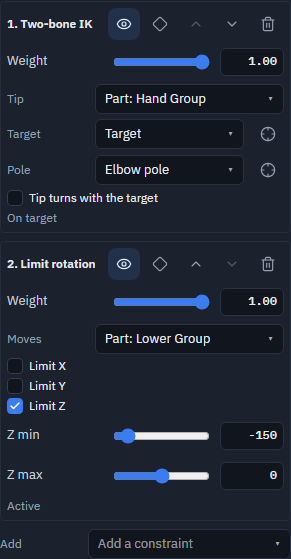

# Constraints and IK

*New in 1.75.* A **constraint** makes an object, or one bone or part inside it, follow another object while the scene
runs: it looks at it, copies it, or reaches for it. Constraints are part of the scene: they save with it, and every
person in the session sees the same result. Each computer works the pose out itself from the objects' positions, so a
constraint sends nothing while it runs.

## Add a constraint

Select one object and open **Inspector ▸ Constraints**. Pick a kind from **Add a constraint**:

| Kind | What it does |
| --- | --- |
| **Look at** | Turns the object (or a bone) so one axis points at the target. Pick the **Aim axis** (cameras and lights look down -Z) and the **Up axis** that stays up. |
| **Copy transform** | Copies the target's position (per axis), rotation and scale. |
| **Parent (follow with offset)** | Copy transform that keeps the distance and turn it had when you added it: the object rides along with the target from where it is. **Keep offset** turns this on and off. |
| **Limit rotation** | Keeps the local rotation inside a range per axis (degrees): tick **Limit X**, **Y** or **Z**, then set its min and max. Put it after an IK to stop an elbow bending backwards. |
| **Two-bone IK (arm, leg)** | Bends the two parents of the **Tip** (a hand, a foot) so the tip reaches the target. The **Pole** is an object the elbow or knee points at; without one the joint keeps bending the way it bends now. **Tip turns with the target** also copies the target's rotation onto the hand. |
| **Chain IK (tail, tentacle)** | Bends a chain of **Joints** (2-16) above the tip towards the target. More **Iterations** = closer, slower. |

## What every constraint has

- **Weight** (0-1): how much of the effect is applied. 0 = off, 0.5 = half way.
- **Mute** (eye button): turn it off without losing its settings.
- **Key weight** (the diamond button): adds a key for the weight on the [Timeline](timeline.md) at the playhead (it
  makes a sequence if there is none). Key 0 at one moment and 1 at another to blend an IK in and out.
- **Move up** / **Move down**: constraints run from top to bottom, and an object that is a target is always worked out
  before the objects that use it.
- **Select target** / **Select pole** (crosshair): selects that object so you can move it with the gizmo.

On a model with bones, **Moves** / **Tip** picks the bone; **Target bone** aims at a bone of the target. While the
object is selected, a blue line runs to each target and a dashed orange line runs to each pole (in Edit mode only;
nobody sees them in Play).

The status line under a constraint says what happened in the last frame: **On target**, **Out of reach by 0.25 m**
(the chain is fully stretched), **Pick a target**, **Weight 0** or **Muted**.

## Moving a constrained object

While you drag a constrained object with the gizmo, its constraints let go so you move the pose you set by hand; they
come back when you let go. Saves always keep the pose you set by hand, not the pose the constraints make.

**Keyboard:** <kbd>Tab</kbd> through the section like the rest of the Inspector. Each button has a name and a tooltip,
and the lists open with <kbd>Enter</kbd> or <kbd>Space</kbd> and take the arrow keys.

## From the flow graph

Two nodes in the **Logic** group change a constraint while the game runs:

- [Set Constraint Weight](nodes/constraintweight.md) sets the weight (0-1) of one of the object's constraints. Wire a
  number into it, for example from a trigger and a smooth step, to fade a reach in and out.
- [Set Constraint Target](nodes/constrainttarget.md) points one of the object's constraints at the wired object (the
  hand reaches for whatever the graph picks).

Both are local to each computer like [Set Color](nodes/setcolor.md): every peer runs the same graph, so every peer gets
the same weight and target. When the node stops, the constraint goes back to its own settings.

## Exporting: Bake constraints

A GLTF export normally carries the pose you set by hand. Turn on **Bake constraints** in
[Save options](saving.md#save-options) (under **Scene and GLTF files are made for**) to export the pose your
constraints and IK make right now instead. Scenes (`.tpscene`) and projects (`.tp`) keep the constraints themselves.

## See also

- [Animation](animation.md): clips and keys.
- [Characters and motion](characters-and-motion.md): rigged characters and their clips.
- [Look At](nodes/lookat.md): a flow node that turns an object to face a target while it runs.
