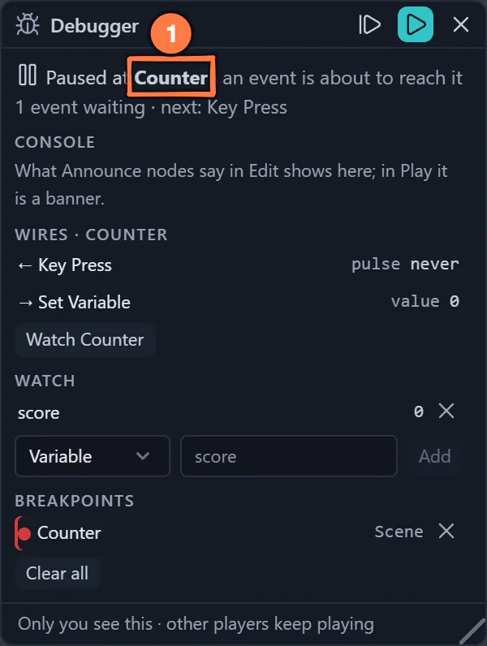
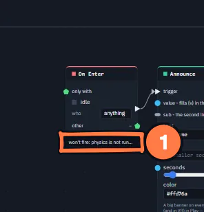
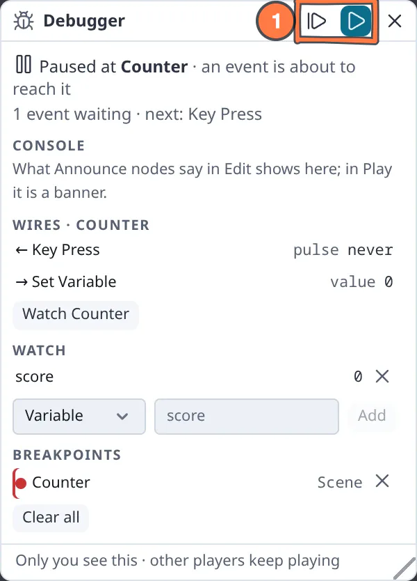

# Node Graph Debugger

*New in 1.39.* The debugger lets you watch your flow graphs while you play: pause the game when an event reaches a
node, step through what happens event by event, read the value on every wire into and out of a node, and keep an eye
on variables in a watch list.

It is **yours alone**. The other players in the session keep playing, and nothing you set in the debugger is saved
into the scene or sent to anyone.

{ .shot width="300" height="341" loading=lazy }
/// caption
The Debugger paused at a Counter.
///

1. **Paused at** the node the event reached, before it runs; the wires, the watch list and the breakpoints follow under it.

## Breakpoints

In the [node editor](node-system.md), right-click a node ▸ **Breakpoint (pause Play here)**, or select nodes and press
<kbd>F9</kbd>. A red dot marks the node. Remove it the same way.

Breakpoints pause on **events**. A pure value node (Math, Number) never pauses — watch it instead; the panel says so.

## The Debugger panel

Open it with the **bug** button in the node editor's top bar. It also opens by itself when a breakpoint pauses Play. On
a phone it is a bottom sheet.

1. **Set a breakpoint** on the node you want to watch — an On Click, a Counter, a Set Variable.
2. **Press Play.** The game runs normally until an event reaches that node. Then your view of the game pauses *just
   before the node runs*, the pointer is freed, and the panel says **Paused at ‹node›**.
3. **Step** (<kbd>F10</kbd>) runs the next event: first the one that just paused you, then each event as it arrives — a
   click, a key, another player's action, a Delay finishing. With nothing waiting, Step runs the next event the moment
   it comes.
4. **Wires** lists the node's inputs (←) and outputs (→) with their current values: numbers, on/off, vectors, object
   names. An event wire shows **● pulse** when it fires, or how long ago it did. Click a neighbour to walk the graph.
5. **Watch** a variable — a Set / Get Variable name, or **My variable** for a per-player one — or press
   **Watch ‹node›** to follow any node's output.
6. **Resume** (<kbd>F8</kbd>) rejoins the live game. **Pause** (<kbd>F8</kbd> while running) pauses at any moment,
   without a breakpoint. Leaving Play always resumes.

The debugger works in Play (and Test play). In the editor it lists your breakpoints and watches, and the
[Console](#the-console).

| Key | Does |
|---|---|
| <kbd>F9</kbd> | Breakpoint on / off for the selected nodes |
| <kbd>F10</kbd> | Step: run the next event |
| <kbd>F8</kbd> | Resume, or pause while running |

## Why did this not fire?

*New in 1.64.* The trigger nodes — [On Enter](nodes/onenter.md), [On Exit](nodes/onexit.md),
[On Hover](nodes/onhover.md), [On Click](nodes/onclick.md), **Collect pickup** ([Game kit](game-kit.md#pickups)) and
[Timer](nodes/timer.md) — remember their **last check** on this device: when it was, who or what it was about (*the
player*, an object's name), and whether it fired or what blocked it.

**On the node card** (while the node editor is open) one line says it:

- *fired 2 s ago* — it fired;
- *blocked: not the player* — something reached it in the last few seconds, and this stopped it;
- *won't fire: physics is not running* — nothing has reached it yet, and this is why nothing can right now.

{ .shot width="148" height="154" loading=lazy }
/// caption
A trigger card says why it will not fire.
///

1. The card's **line**: *won't fire* and the reason, *blocked* and what stopped it, or when it last fired.

**In the Debugger** (in Play), the node you are focused on — the one Play paused at, or one you clicked in the panel —
gets the full sentence above its wires:

> Last check 3 s ago · the player: blocked, the player (wants objects).
>
> Right now it cannot fire: physics is not running.

With no check yet it says *No check yet: nothing has reached it on this device.*

| Reason | What it means, and what to do |
|---|---|
| in Edit mode (use Play) | triggers do not fire while you edit — press Play (or Interact) |
| physics is not running | sensor zones are checked by the physics world — start Play or a simulation |
| checked on the physics peer | object sensor edges are only checked on the peer running the simulation; this device just hears the result |
| no object to watch | wire the node into an [Object Selector](nodes/objectselector.md), or put it in the object's own flow |
| its object is not a sensor | turn on Inspector ▸ **Physics ▸ Sensor** on the zone |
| not the player | the node's **who** is *player*, and an object came in |
| the player (wants objects) | the node's **who** is *objects*, and the player came in |
| the filter did not match | something other than the **only with** object touched it |
| still in its cooldown | it fired a moment ago; wait for its cooldown |
| "enabled" is off | a boolean wired into **enabled** is false |
| another player (who: me) | the node only listens to your own pointer, and it was someone else's |
| its object is muted | the object has **Disable flow effects** on (its right-click menu) — switch them back on |
| touch off, nothing wired | **Collect pickup** with *Collect on touch* off and no trigger wired in |
| refused | the game kit said no — the card adds its reason (taken already, the round is over…) |
| nothing wired into it | **Timer** has no input |

Checks are **local to each device**: nothing is sent, and each player's card says what *their* device saw. That is the
point — on a joiner, an On Enter of an object may well say *checked on the physics peer*.

An AI agent asks the same question with `inspect_runtime` ([Test and fix a game](ai/agent-runtime.md)).

## The Console

*New in 1.64.* An [Announce](nodes/announce.md) in Edit draws no banner: its line goes to the Debugger's **Console**
instead, newest first, with the time and the node that said it. Press the node's name to focus it and see its wires.
Messages from modules show here too. **Clear console** empties it. In Play, Announce shows its banner as before.

## What "local" means

While you are paused, **your** view is frozen and events queue up for you; the session does not stop.

- Physics, spawns and behaviour reactions keep running for the other players.
- With other players connected, the values every player writes together (Set Game State, a shared Set Variable) stay
  in your paused view. Their games already made the same write, so nothing is counted twice when you resume.

!!! note "Limits"
    Breakpoints are off in VR — on a headset the game just keeps running. [Module](modules.md) code keeps running while
    you are paused.

{ .shot width="300" height="341" loading=lazy }
/// caption
The Debugger in the light theme.
///

1. **Step** (F10) runs the next event; **Resume** (F8) rejoins the live game.

## Several HUD Buttons, one module input

Also in 1.39: several **HUD Buttons** can be wired into one module input (a Match Button's *press*, a Realms Button's
*press*) — any of them presses it. A HUD Button wires straight into a module input; the Delay "bridge" older templates
used is no longer needed, and the Football and Dungeon Realms templates are simpler for it.
