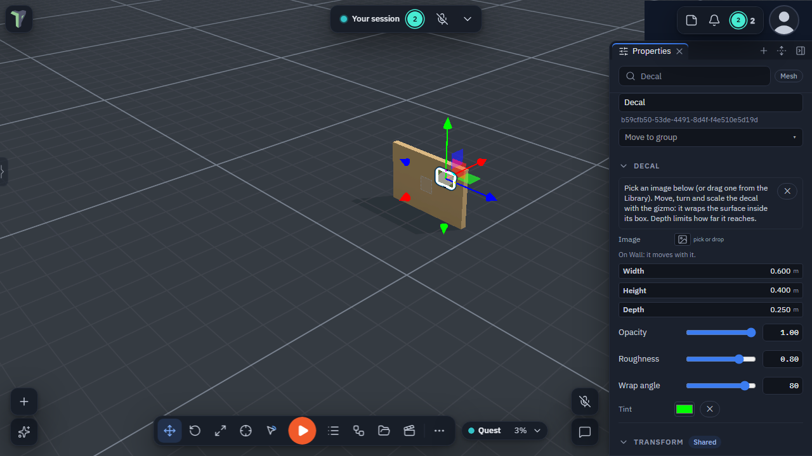

# Decals

*New in 1.7X.* A **decal** is an image projected onto the surface under it: a sign on a wall, an arrow on the
floor, dirt, a crack, a logo. It wraps the surface (round a curved pillar, over the steps of a stair) and moves with
the object it sits on.

## Put one on a surface

1. Right-click the surface where it should go and choose **Add decal here**. A dashed square shows where it is.
2. In **Properties ▸ Decal**, pick the **Image**: import a picture, or drag one from the Library. The
   **Decals Starter** pack (**Explorer ▸ Packs**, right-click ▸ **Install pack**) has 12 free (CC0) ones: arrows,
   chevrons, a turn arrow, warning and no-entry signs, hazard stripes, a footprint, a dirt splat, a mud smear, two
   kinds of cracks and a scorch mark.
3. Move, turn and scale it with the gizmo like any object. It re-wraps the surface when you let go.

## Settings (Properties ▸ Decal)

| Setting | What it does |
| --- | --- |
| **Image** | The picture projected. With none, a dashed square marks the decal. |
| **Width**, **Height** | The size of the decal (the same as its scale X and Y). |
| **Depth** | How far into and out of the surface it reaches (scale Z). Keep it small so it does not reach faces behind. |
| **Opacity** | How solid it looks. |
| **Roughness** | Shiny (0) to matte (1). |
| **Wrap angle** | Faces turned further than this from the decal are not covered, so it does not smear round corners. |
| **Tint** | Multiplies the image's colours; white shows it as it is. |

Undo, redo, saving, sharing with people in the session, [Photo mode](photo-mode.md), [baked light](baked-light.md)
and the [Cinematic view](cinematic-view.md) all work with decals.

## Marks while playing: Stamp Decal

The [Stamp Decal](nodes/decalstamp.md) flow node (**Scene** group) presses a mark onto a surface while the game
runs: a footprint, a scorch, a paint splat. Wire an [On Impact](nodes/onimpact.md) into its trigger and it stamps
where that object touched; wire a Decal object into **look** to copy its image, tint and opacity.

- **size**, **depth**: the mark's size (when no look is wired).
- **seconds**: how long a mark lasts (0 = for the whole run); it fades in its last second.
- **most at once**: up to 64; past that the oldest mark goes.

Marks are not saved and not undone; they all go when the run stops. Everyone in the session sees the same marks.

## For agents

`create_objects` takes `{kind: "decal", on: "<object uuid>", normal: [x, y, z]}` (aimed at that object from that
side), or a `point` on its surface; plus `image` (a Library hash or file name), `size`, `depth`, `opacity` and
`tint`. See [Build with an AI agent](ai/build-with-an-agent.md#rules-a-good-agent-follows).

## Limits

- Not on animated characters (skinned meshes) or on scattered copies: you get a message saying so.
- A very detailed object (more than 400,000 triangles) cannot take a decal.

## See also

- [UV & Textures](uv-editor.md) and [Paint on meshes](mesh-paint.md): paint into the object's own texture instead.
- [Packs](packs.md): installing a pack such as Decals Starter.
