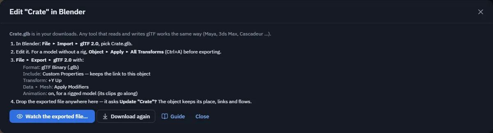

# Edit in Blender

Take a model to Blender (or Maya, 3ds Max, Cascadeur, any tool that reads and writes glTF) and bring it back. The object
keeps its place, flows, physics and clips. There is nothing to install.

## The round trip

1. Right-click the object ▸ **Mesh ▸ Edit in Blender…**, or use Properties ▸ **Model**. `<object name>.glb` downloads, with
   its rig, weights and clips if it is animated, and a short card shows these steps.
2. In Blender: **File ▸ Import ▸ glTF 2.0**, pick the file, and make your edits.
   For a model without a rig, use **Object ▸ Apply ▸ All Transforms** (Ctrl+A) before exporting.
3. **File ▸ Export ▸ glTF 2.0** with these settings:

    | Setting | Value |
    |---|---|
    | Format | **glTF Binary (.glb)** |
    | Include | **Custom Properties**: this keeps the link to the object |
    | Transform | **+Y Up** |
    | Data ▸ Mesh | **Apply Modifiers** |
    | Animation | On, for a rigged model, so its clips go along |
    | Units | Metres (Scene ▸ Units ▸ Unit Scale 1.0) |

4. **Drop the exported file anywhere** in theprototype. It recognises the object and asks **Update "<name>"?**, with no need
   to select anything. If you left *Custom Properties* off, select the object, drop the file on it and choose **Replace**.

## Watch the file

In Chrome or Edge on a computer, the card has **Watch the exported file…**. Pick the `.glb` you export from Blender, and each
time you export again theprototype offers **Reload**, or **Always reload** to update on every save. Properties ▸ Model shows
the watched file with *Reload automatically* and *Stop*.

Other browsers can drop the file instead. The watch is on your computer only and ends when you reload the page. The update
itself reaches everyone.

## Replace a model from any file

*Replace model…* swaps an object's model for another file, whether or not it came from Edit in Blender.

- **Where:** right-click an imported model ▸ **Mesh ▸ Replace model…**, or Properties ▸ **Model ▸ Replace model…** (the only
  place for a single primitive such as a box). Or drop a model file **onto the selected object** and choose **Replace**.
  Choose *Add as a new object* for the old behaviour, and tick *Remember for this session* to stop being asked until you reload.
- **Formats:** `.glb`, `.gltf`, `.vrm`, `.fbx`, `.stl`, and `.obj` (pick its `.mtl` and textures along with it).
- **What stays:** the object itself: its name, position, rotation, scale, its parent and place in the object list, its flows and
  every flow node pointing at it, behaviours, physics, colliders, notes, and materials you changed in theprototype, on the part
  with the same name. Only the model changes.
- **Undo:** one Ctrl+Z puts the old model back for everyone. The new model reaches every peer and anyone who joins later.
- **Limits:** a replace is refused while a simulation runs and while someone else is editing the object.

### Animations

A clip the old model had and the new file lacks is **kept when every bone it moves exists in the new model**, matched by bone
name, so re-rigging or fixing weights in another tool does not lose it.

- A clip the new file has under the same name wins.
- A clip that names a bone the new model lacks is dropped. The message after the replace lists what was kept and dropped.
- Clips inside the old model's file need a `.glb` replacement, because they are written into the new file so everyone gets them.
- [`.tpanim` clips](characters-and-motion.md) follow the same rule and stay separate files; a humanoid clip stays when the new
  model has humanoid bones. A dropped one comes back with Ctrl+Z.

### Checks before it is placed

If the new model looks off, theprototype says so and offers a one-click fix, or *Replace as it is*:

| It looks like | The fix |
|---|---|
| About **100× larger or smaller** than the model it replaces (the centimetre / metre mix-up, common with FBX) | *Scale by 0.01* (or 100) |
| **Lying on its side** (exported Z-up) | *Stand it up* |
| **Transforms not applied** (a scale or a quarter turn left on the file's root) | *Apply transforms* for models without a rig; for a rig, apply them in your tool and export again |

## Earlier versions

Ctrl+Z right after an update brings back the previous one, and earlier versions come back from [checkpoints](checkpoints.md).

## Let an agent do it

Claude Code can make the whole trip for you: see the [Agents + Blender recipe](ai/agents-and-blender.md).
