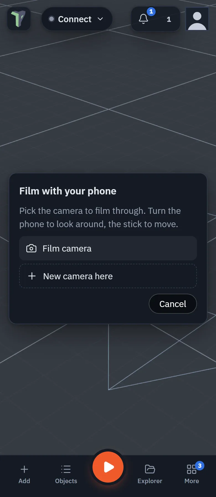
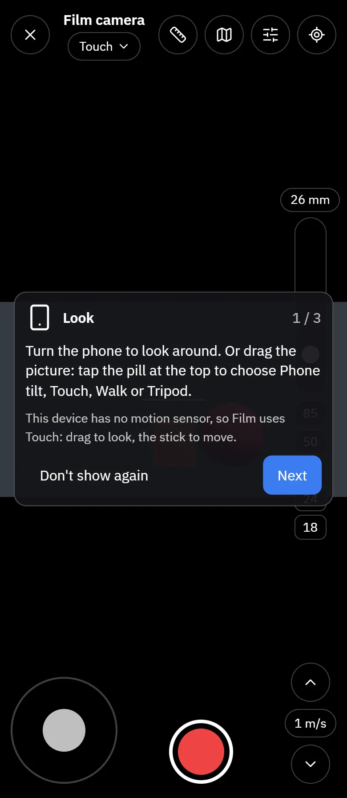
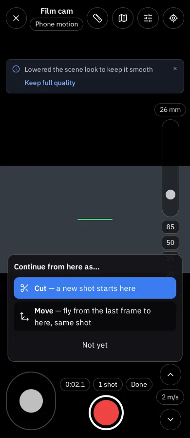
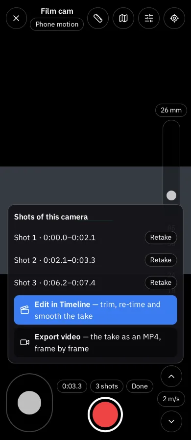

# Film with your phone

Your phone becomes the viewfinder of a camera in the scene. Hold it up and turn it to look
around, use the stick to move, and press **●** to record. The shot is added to the
[Timeline](timeline.md) while the Timeline plays, so you can film moving scenes.

## Opening Film mode

- **Phone:** **More ▸ Film with phone**.
- **Any device:** right-click a camera ▸ **Film with this camera**, or press **Film** beside
  **Preview** in the camera's Inspector section.

Opened from **More**, Film asks which camera to film through. Pick one, or press
**New camera here** to place a camera where you are looking.

{ .shot width="390" height="896" loading=lazy }
/// caption
The camera picker on a folded OPPO Find N6.
///

The first time you open Film, three short cards show how to film: **Look**, **Move** and **Record and cut**. Step
through them with **Next** and **Done**, or press **Don't show again**. To see them later, open the settings (the
sliders button) and press **How to film**.

{ .shot width="390" height="896" loading=lazy }
/// caption
Filming through the Film camera, with the first-use card.
///

While you film, the rest of the editor is hidden, and so is every headset menu and panel, in any session. The 3D view
is cropped to the camera's aspect ratio, so the picture on screen is exactly what gets recorded. Press **✕** (or
**Esc** on a keyboard) to leave. Leaving does not move the camera object.

## How the camera moves

The pill at the top, beside the camera's name, always says how the camera moves. Tap it to choose:

| Choice | What it does |
|---|---|
| **Phone tilt** | Turn and tilt the phone to look around. It works in portrait and in landscape. |
| **Touch** | Drag the picture to look, and use the stick to move. |
| **Walk** | Your real steps move the camera (Android with AR, [below](#walk)). |
| **Tripod** | The camera stays in place and only turns. The stick is hidden; the **Tripod ✕** chip goes back to handheld. |
| **Keyboard + mouse** | On a computer: **W A S D** to move, drag to look. |

The choice is remembered on this device. A phone without a gyroscope gets **Touch**: **Phone tilt** is greyed out with
the reason. On an iPhone, Phone tilt shows **Use phone motion** beside the pill the first time: press it and allow
motion access (if you decline, Touch still works).

Whichever you choose:

| Control | What it does |
|---|---|
| **Recentre** (⌖, or **R**) | Makes the direction the phone points right now "straight ahead" for this camera. |
| **Horizon lock** | Keeps the picture level however the phone leans. |

## Moving

- **Stick** (bottom left): moves along the floor in the direction you are looking.
- **▲ / ▼**: rise and sink. **m/s** cycles the speed (0.5 to 8 metres per second).
- On a keyboard: **W A S D** to move, **E / Q** to rise and sink.
- **Mini-map**: a top-down map of the scene. Tap a spot to move the camera there.

### Walk

On an Android phone with Chrome and Google Play Services for AR, choose **Walk** in the pill. Your real steps now move
the camera, and the chip at the top says **Walking ×1** (the scale). If Walk was your last choice, the pill says
**Walk · tap to start** when you open Film: tap it, then Walk, to start (the phone has to be asked each time).

The pill's sheet has a **While walking** part:

- **Passthrough** — what you see behind the scene: **Off** (the scene's own sky, the default), **On** (the scene over
  your room) or **Dimmed** (the room faint behind it). Only the live view changes, never the recorded take or its
  export.
- **Walking scale** — how far the camera moves for each metre you walk: **×0.5**, **×1**, **×2** or **×5**, and
  **Fine scale** from ×0.1 (a miniature set) to ×20 (a city in a few steps). Tap the **Walking** chip at the top to
  change it quickly while you walk.

The stick, **Recentre** and the mini-map keep working while you walk. Press **✕** beside the Walking chip to stop.

!!! note
    While you walk, the phone's AR view shows the scene at the phone camera's own lens. Zoom and dutch angle are still
    recorded, and you see them when you play the take back.

#### If tracking is lost

If Walk cannot start (AR was not allowed, or could not start) or the phone loses track of the room while you film, Film
does not leave you with a frozen view. The take **pauses at a mark**, a short message says why — for example *Tracking
was lost — the take paused at a mark. Filming with the thumbstick now.* — and Film carries on with the stick and phone
tilt. The message has a **Recentre** button. Your choice stays Walk, so you can start it again from the pill.

## The lens

- **Zoom:** pinch the picture, or drag the rail on the right edge. The lens buttons
  **18 / 24 / 35 / 50 / 85 mm** jump straight to those lenses, and a pinch or drag that ends
  close to one snaps to it.
- **Settings ▸ Smoothing:** steadies a shaky hand. The recording keeps the steadied
  movement, and the raw movement is saved alongside it.
- **Settings ▸ Dutch:** tilts the picture on purpose. Double-click the slider to reset it.
- **Settings ▸ Depth of field:** turns on focus and aperture. Tap something in the picture to
  pull focus to it, and use **Aperture** to set how blurry the background gets (f/1.4 is very
  blurry, f/16 keeps almost everything sharp). If the camera's [look](post-processing.md) has
  no **Depth of field** effect yet, Film offers to add one.

## Rigs

Choose a rig in **Settings ▸ Rig**:

- **Handheld:** the default.
- **Tripod:** the camera stays in place and only turns (the same as **Tripod** in the pill).
- **Track:** tap an object and the camera keeps it framed the way it was when you tapped,
  even as you move.

## Guides

**Settings ▸ Guides** draws a rule-of-thirds grid, a safe area, and a level line that turns
green when the picture is level. **Mask** shows a 16:9, 9:16 or 2.39:1 frame inside the
shot. Guides are never recorded.

## Recording

1. Press **●**. With **3-2-1 countdown** turned on, the phone counts down and buzzes first.
   The Timeline plays from its playhead while you film.
2. Press **❚❚** to pause. The shot so far is added to the Timeline as a single undo step.
3. Press **●** again and choose how to continue:

    { .shot width="390" height="896" loading=lazy }

    - **Cut** (the default) starts a new shot from where you are now.
    - **Move** flies the camera from the last frame to where you are, then keeps recording
      as the same shot.
4. Press **Done** to finish. Your shots stay in the Timeline.

While recording, press **Mark** (or **M**) to drop a marker on the Timeline.

From the first shot on, a **shots** pill (*1 shot*, *3 shots*) sits beside the record button: see
[Your shots](#your-shots).

### What gets recorded

The camera's position and rotation are saved as Timeline keys. They are thinned out but stay
within 1 cm and 0.5° of what you filmed. Zoom, dutch angle, focus and aperture each get
their own track, but only if you changed them. The full-detail movement is kept as a hidden
file in your Library.

## Your shots

Press the **shots** pill to open **Shots on this camera**. Each row has a thumbnail, the shot's name (*Shot 1* until
you rename it), its length, and how it was cut: *Cut*, or *Cut + 2 moves* when you resumed it with **Move**.

{ .shot width="390" height="896" loading=lazy }
/// caption
The shots sheet (shown here as it looked in 1.58).
///

- **Tap a row** to preview the shot, with play / pause and a scrub bar. **Done** goes back to the list.
- **⋯** on a row opens its actions:
    - **Preview** — the same as tapping the row.
    - **Trim** — the preview with **In** and **Out** handles. They stop at the shot as it was recorded, so trimming
      back out brings the cut part back.
    - **Rename** — type a name and press <kbd>Enter</kbd>.
    - **Retake** — records the shot again. A retake that runs long trims the start of the next shot.
    - **Delete** — removes the shot; the message that confirms it has **Undo**.
    - **Edit in timeline** — closes Film and opens the take in the [Timeline](timeline.md) at that shot, where you can trim it and
      **Smooth keys** (the track menu ⋯ of a property track) to take the handheld shake out.
- At the bottom: **Edit in timeline** for the whole take, and **Export all (N)**. Tick shots in the list and it
  becomes **Export K selected**.
- With more than one shot to export, Film asks how: **One video** (the shots joined in the order you recorded them)
  or **One file per shot** (each goes to **Explorer ▸ Recordings**, one after another). It opens
  [Export a video or GIF](recording.md), set to MP4.

Preview, Trim, Retake and Delete wait while you are recording.

## Filming with others

When you film in a shared session, everyone else sees the camera move as you film. They get
a **Watch the shot** button that opens your live view in their camera preview window. Only
**editors** can record; a view-only guest can film and be watched, but the **●** button is
off for them.

Others see your camera move, but nothing is saved until you record. When you stop filming,
the camera goes back to where it stands.

## On a phone without motion sensors, and on a computer

Film works everywhere: where there is no gyroscope (or you decline motion access), it uses **Touch** — drag the
picture to look. On a computer it starts on **Keyboard + mouse**: **W A S D** and **E / Q** move the camera.

## Limits

- A phone exports at most 20 seconds of video at a time (see [Export a video or GIF](recording.md#on-a-phone)).
- Walk needs Android with Chrome and AR support; Quest's browser is not a target. Where AR is not available, Walk is
  not in the pill.
- Walking drifts slowly over long takes: recentre now and then.

