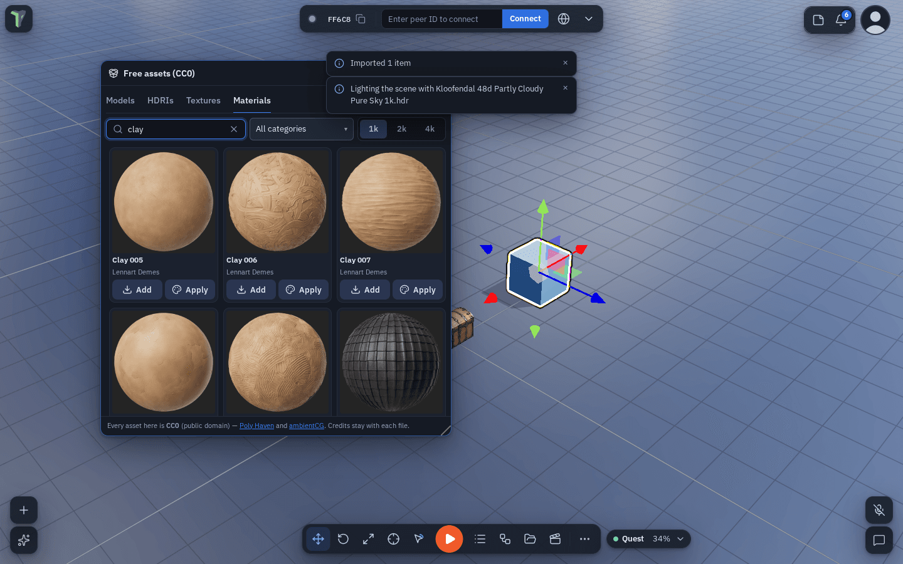
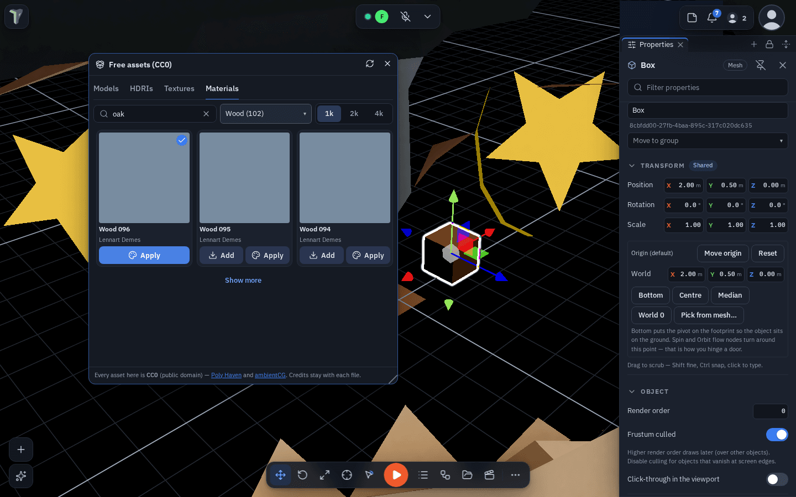
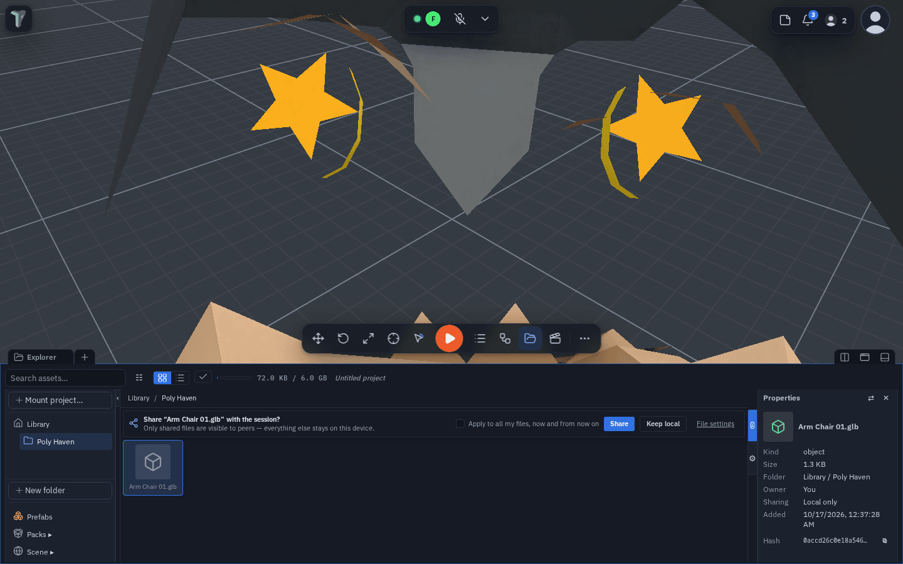
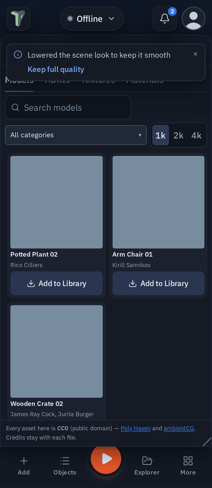

# Free Assets (CC0)

The **Asset Browser** (1.38) brings free, public-domain (CC0) assets straight into your project: **models, skies
(HDRIs) and texture sets from [Poly Haven](https://polyhaven.com)**, and **PBR materials from
[ambientCG](https://ambientcg.com)**. No account, no key, no attribution required — the app still keeps each asset's
credit for you.

**Where:** main menu ▸ **Free assets (CC0)**, or **+ Add ▸ Free assets (CC0)…**. It is a floating window that can
**dock** like Statistics or Chat (drag it onto the dock, or the dock's **+** ▸ Free assets). On a phone it opens as a
bottom sheet.

## Finding an asset

- Pick a tab — **Models**, **HDRIs**, **Textures**, **Materials** — then **search** by name or tag and narrow by
  **category**.
- Pick a **resolution**: **1k** (the default on a Quest or a phone), **2k** (the desktop default) or **4k**. Bigger
  files take longer to download and to reach the people in your session.

## Bringing it in

- **Models** — *Add to Library* downloads the model at that resolution, packs it into one `.glb` and adds it to the
  Explorer's **Poly Haven** folder through the same import as dropping a file there — so a big one is
  [optimized on import](import-optimize.md) like any other. Then *Add to scene*, or drag it from the Explorer.
  Everyone in the session sees it.
- **HDRIs** — *Use as sky* downloads the `.hdr` into the Library and lights the scene with it (Configure Scene ▸
  Environment ▸ Sky image shows it too). It reaches everyone like any sky.
- **Materials and textures** — *Add* saves it to your [material presets](materials.md) (the Inspector's Material
  swatches); *Apply* also puts it on the selected objects. Colour and normal maps are kept; roughness and metalness
  come from their maps.

## Credits

Every download keeps its source — site, authors, licence (CC0) and a link. You see it in the Explorer's
**Properties**, in the **Inspector** for a placed object or a CC0 material, and on the material swatch's tooltip. A
model carries it inside the file, so a peer's copy — and the optimized copy the importer makes — has it too.

## Offline and errors

Lists you have opened are saved on this device (for a day), so the browser still shows them offline — a banner says
when it is showing a saved list. Downloads need a connection; when a site or the ambientCG relay does not answer, the
window says so in plain words and offers *Try again*.

## Limits

- A Library file is at most **25 MB** (what peers can receive): a model bigger than that at the picked resolution is
  refused with "Pick 1k".
- ambientCG is reached through theprototype.app's own relay (its site does not let browsers read it directly); Poly
  Haven is reached directly.
- A large material preset may not appear in a *peer's* swatch list (the preset library broadcast is capped at 2 MB) —
  the material you apply always reaches everyone.

