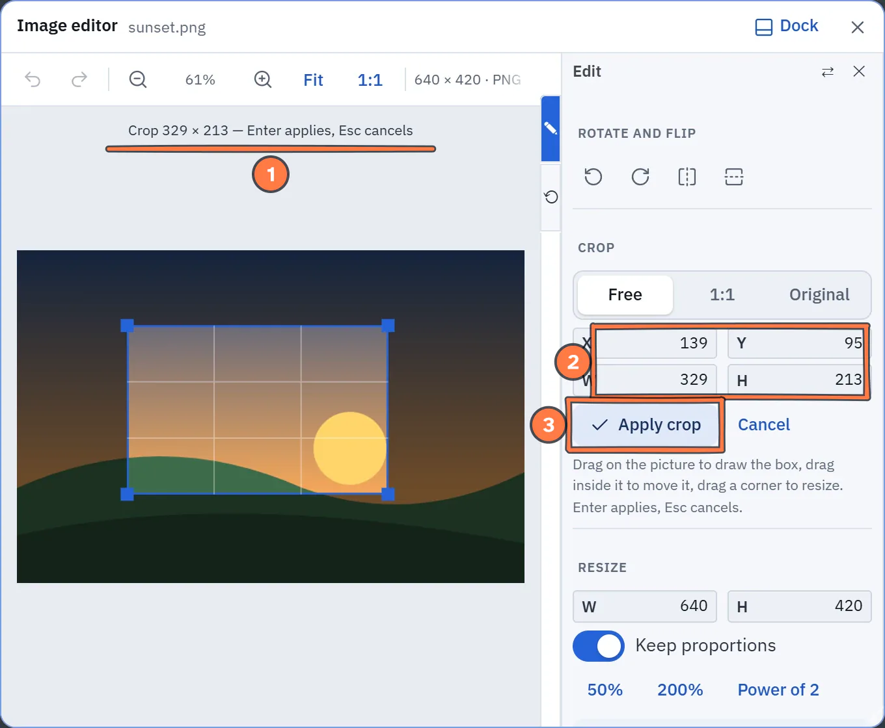
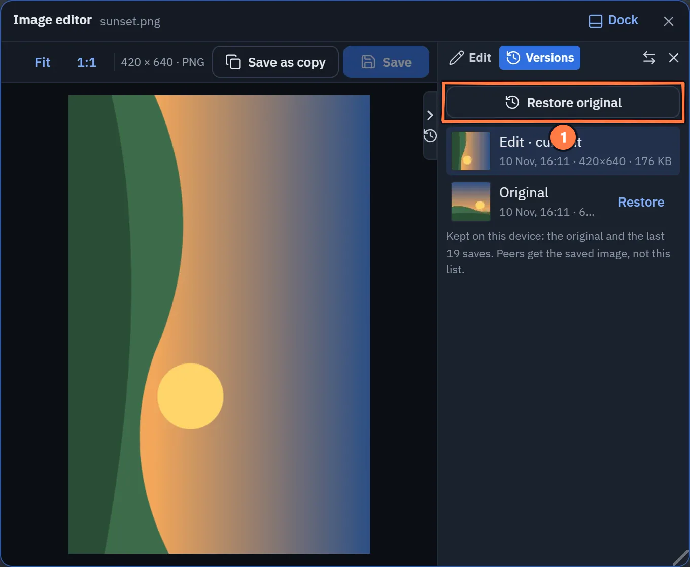
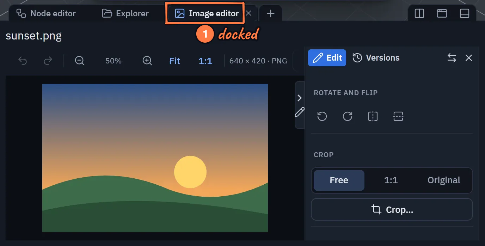
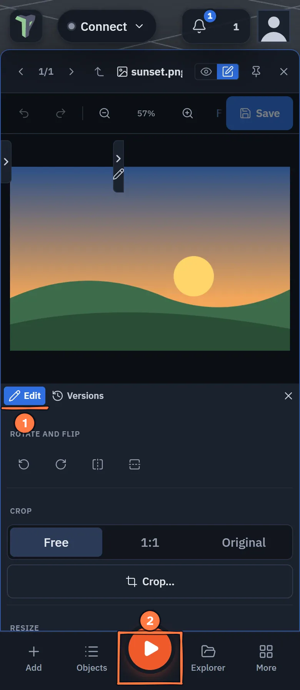

# Image Editor

New in 1.32: the **Image editor** crops, rotates, flips, resizes and adjusts a picture in your
[Explorer](explorer.md) library. When you save, every texture made from that picture updates for everyone in the
session.

!!! note "Since 1.65 the editor is the Preview's Edit view"
    The Image editor is no longer a window or a dock tab of its own. It is the **Edit** face of the
    [file preview](explorer.md#the-preview-window): **View | Edit** in the preview's header switches between looking at
    a file and editing it, in the same window. A saved layout that had the Image editor opens the **Preview** instead.
    See [New menus and panels](menus-and-panels.md#preview-and-the-image-editor).

{ .shot width="680" height="708" loading=lazy }
/// caption
The Image editor on a computer.
///

1. **Rotate** 90° either way and **flip**.
2. **Crop…** draws a crop box over the picture.
3. **Adjust**: brightness, contrast and saturation.

## Opening it

- Right-click an image in the Explorer ▸ **Edit image…**
- **Edit** in the header of an image's [preview](explorer.md#the-preview-window) (**View | Edit**). **View** goes back.
- **Edit** beside a texture in the Inspector (**Material ▸ Texture**).
- In the docked **Preview** tab — see [In the dock](#in-the-dock).

Only images in your Library can be edited, not pack items or files inside a mounted project.

## The images filmstrip

The **images filmstrip** on the left lists the images in the folder. Click one to edit it, or press <kbd>[</kbd> /
<kbd>]</kbd> (or <kbd>Ctrl</kbd>+<kbd>←</kbd> / <kbd>Ctrl</kbd>+<kbd>→</kbd>) for the previous or next image.
<kbd>Esc</kbd> cancels a crop, or goes back to View. Keys never fire while you type in a field.

## Looking at the picture

The picture fills the canvas. Scroll or pinch to zoom, drag to pan, and use **Fit** or **1:1** in the toolbar. The
toolbar also shows the picture's size and format, and how many textures were made from it.

The sidebar on the right has two pages: **Edit** and **Versions**.

## Edit

- **Rotate and flip**: 90° left and right, mirror horizontally and vertically.
- **Crop**: press **Crop…**, then drag on the picture to draw the box. Drag inside the box to move it, or drag a corner
  to resize it. The shape can be **Free**, **1:1** or **Original**, and **X**, **Y**, **W** and **H** take typed
  values. <kbd>Enter</kbd> or **Apply crop** applies it; <kbd>Esc</kbd> or **Cancel** cancels.
- **Resize**: width and height, with **Keep proportions**. Quick buttons for **50%**, **200%** and **Power of 2** (the
  size graphics cards handle best for textures), then **Apply resize**.
- **Adjust**: **Brightness**, **Contrast** and **Saturation** sliders, applied live. **Reset adjustments** puts them
  back.

{ .shot width="680" height="560" loading=lazy }
/// caption
Cropping on a computer in the light theme.
///

1. The **crop box**: drag it or its corners; Enter applies, Esc cancels.
2. **X**, **Y**, **W**, **H**: the box in pixels.
3. **Apply crop**.

## Saving

- **Save** (<kbd>Ctrl</kbd>+<kbd>S</kbd>) writes over the same Explorer file: same name, same folder, shared with the
  same people. **Every material whose texture was made from this image updates, for everyone in the session**, as one
  undo step in the scene. The toolbar says how many textures that is.
- **Save as copy** writes *name copy.png* beside it. The original and its textures stay as they were, and the editor
  carries on with the copy.
- The editor has its own **Undo** and **Redo** (<kbd>Ctrl</kbd>+<kbd>Z</kbd> / <kbd>Ctrl</kbd>+<kbd>Shift</kbd>+<kbd>Z</kbd>)
  for edits you have not saved yet. They never touch the scene's undo.
- Unsaved edits are never dropped silently: switching image, going back to View, closing, or a pinned preview
  following another file asks first.

## Versions

The **Versions** page lists every saved state of this image with a thumbnail, date and size, and **Restore** on each.
**Restore original** at the top goes back to the picture as it first came in.

{ .shot width="680" height="560" loading=lazy }
/// caption
The Versions page.
///

1. **Restore original** puts the image back as it was imported; every Save keeps the version before it.

## Textures and their images

A texture remembers the library image it was made from when you apply it from the Explorer. **Edit** in the Inspector
on any other texture — one picked from disk, or one that came with an imported model — first puts it into the library
as *‹object› texture.webp*, then opens it, so it updates on **Save** the same way.

Painting over a texture in the [UV editor](uv-editor.md#painting) breaks the link: a later save of the image will not
paint over your strokes.

## Big photos as textures

Pick any photo as a texture — **Inspector ▸ Material ▸ Texture ▸ Set texture…**, or drop an Explorer image on the
object — and it is scaled down to fit 1024 px on its longest side and applied. Since 1.32 nothing is refused for being
large. Only a file over 64 MB is turned away, because a phone cannot decode it.

## In the dock

*Since 1.65* the editor docks with the preview. Press the **pin** in the preview's header (**Pin to dock**): the
preview docks as the **Preview** tab and follows the file you select in the Explorer. On an image, **Edit** opens the
editor in that tab. You can also press **+** on the dock's tab strip and pick **Preview**. The **Image editor** entry
of the dock's **+** menu is gone. See [The preview window](explorer.md#the-preview-window).

{ .shot .fade-b width="688" height="349" loading=lazy }
/// caption
The image editor in the docked Preview tab.
///

1. Docked, the **Preview** is one more tab in the bottom dock; it follows the Explorer selection.
2. **Edit** on an image opens the editor in that tab.

## On a phone

The editor (the preview's Edit view) is a full-width sheet between the top bar and the bottom bar, so **Play** stays tappable. The Edit and
Versions pages sit under the picture instead of beside it, and **Crop…** scrolls its **Apply crop** button into view.
Since 1.32 they start **closed**, so the picture gets the screen: tap the pencil tab at the picture's edge to open
them, and pick **Edit** or **Versions** at the top of the page; it stays open next time.

{ .shot width="390" height="896" loading=lazy }
/// caption
The Image editor on a phone.
///

1. The **Edit** and **Versions** pages open under the picture, from the pencil tab at its edge.
2. The sheet leaves **Play** uncovered.

## Limits

- Versions are kept **on this device**: the original plus the last 19 saves per image. Peers receive the saved image,
  not its history.
- PNG, JPEG and WebP save in their own format. GIF and BMP save as PNG.
- The largest side the editor produces is 8192 px.
- A texture is stored at up to 1024 px, whatever the size of the image.
