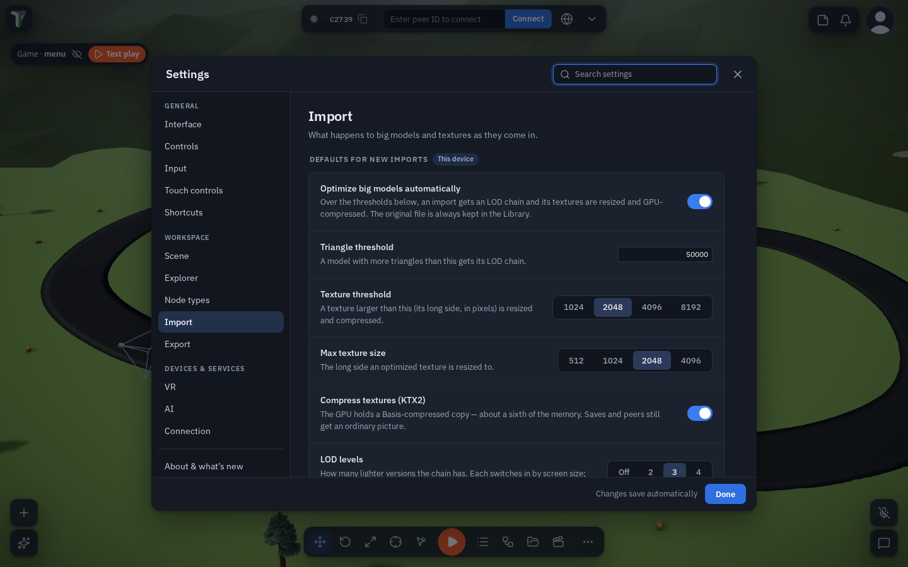

# Importing Big Models

*New in 1.37.* A model straight out of a scanner, a marketplace or a CAD tool is often far heavier than a phone or a
headset can draw. ThePrototype now optimizes such a model **as it comes in**, the way a game engine's importer does, and
keeps your original next to it.

## What happens on import

When you import a model with **more than 50,000 triangles** or a **texture larger than 2048 px**:

- **Textures** are resized to at most 2048 px and given a **GPU-compressed copy (KTX2 / Basis)**. Your scene, saves and
  peers still get an ordinary picture; the graphics card holds the compressed copy — about a sixth to an eighth of the
  memory (on a Quest, 0.5–1 byte per pixel instead of 4).
- A **level-of-detail chain** is added: lighter versions of the model (by default 50 %, 25 % and 10 % of the triangles)
  that take over as the model gets smaller on screen. Up close you always see the full model. See
  [Levels of Detail](lod.md).
- The **original file stays in the Library** next to the optimized copy (*Name (optimized).glb*). The toast that reports
  the numbers offers **Keep original only**, which puts the original back in the scene (one undo step) and removes the
  optimized copy.

The work runs in the background (a few seconds for a big model); the window stays usable meanwhile.

A model **under both thresholds** is placed straight away (since 1.39): the optimizer is not even loaded. An asset
whose [Import settings](#per-file-import-settings-and-reimport) say **Always** is still optimized whatever its size.

Measured on a test model (65,024 triangles, one 4096 px JPEG texture):

| | Original | Optimized |
|---|---|---|
| Texture | 4096 × 4096 | 2048 × 2048 + KTX2 |
| Texture memory on the GPU | 85.3 MB | ≈ 2.8 MB on a Quest (−97 %); 5.6 MB on a desktop GPU (−93 %) |
| File in the Library | 2.43 MB | 1.63 MB (plain picture + KTX2 copy) |
| Triangles as it gets smaller on screen | 65,024 | 32,512 / 16,255 / 6,502 (LOD 1 / 2 / 3) |

Texture resize and compression need a `.glb` or `.gltf`; OBJ, STL and FBX imports get the LOD chain only. Skinned
(animated character) models keep full detail — a lighter level cannot carry its bone weights — and get the texture
work.

A model that is *far* too heavy for this device still [asks before it lands](explorer.md#when-a-model-is-too-heavy).

## Settings ▸ Import (this device)

The defaults for every new import, under **Settings ▸ Import ▸ Import defaults**:

| Setting | Default | What it does |
|---|---|---|
| Optimize big models automatically | on | off = imports arrive exactly as they are |
| Triangle threshold | 50,000 | a model above this gets its LOD chain |
| Texture threshold | 2048 | a texture above this (long side, px) is resized and compressed |
| Max texture size | 2048 | 512 / 1024 / 2048 / 4096 — the long side a resized texture gets |
| Compress textures (KTX2) | on | the GPU-compressed copy |
| LOD levels | 3 | Off / 2 / 3 / 4, with **LOD 1 keeps**, **LOD 2 keeps**… for each level's share of the triangles |

**Reset** puts the shipped defaults back.

## Per file: Import settings and Reimport

Select the **original** file in the [Explorer](explorer.md) and open its **Properties** (ⓘ): **Import settings** has
**Optimize** (Auto / Always / Never), **LOD levels**, **Max texture size** and **Compress textures (KTX2)** for that
file only; **Use defaults** forgets them. **Reimport** runs the original again with these settings and updates every
placed copy (one undo step each). An optimized copy's Properties show what was saved and link back to its original.

## The scene's LOD distance

**Configure Scene ▸ Level of detail ▸ LOD distance** is one slider for the whole scene, shared with everyone in it:
above 1 keeps full detail further away, below 1 switches to the lighter levels sooner. It applies to every model with an
LOD chain.

## Exporting for Quest / web

The other half of the pipeline is on the way out: **Optimize for: For Quest / web** in
[Save options](saving.md#save-options) and **Settings ▸ Export** writes compressed textures, compressed geometry and the
LOD chain into a GLTF or a Scene file — see [Publish & Export](publish-export.md#optimize-for-quest-web).

## Limits

- After an undo, or opening a `.tpscene` saved with **Full quality**, a texture is the plain (resized) picture again —
  the size saving stays; the GPU compression comes back on the next import or a **For Quest / web** save.
- The original is kept in the Library even when it is larger than the 25 MB sharing limit; it is not shared with peers
  in that case.
