# The Interface

Since 1.30 every window, menu, dialog, the main HUD and the phone layout are built from one small kit of parts and
one set of colours. This page is the map: where things are and what the shapes mean. Nothing you can *do* changed —
every shortcut, setting, scrub field and panel works as before; only the look and a few placements moved.

## One accent colour

**Blue** marks what you can act on or have selected: the armed tool, a switch that is on, the chosen chip, a primary
button, the focus ring. **Orange** is kept for things that are live — **Play**, recording, streaming — so it stands out
where it matters. A **Shared** or **This device** badge beside a heading says who a setting affects, instead of a
paragraph explaining it.

The light theme and every custom `.theme.json` restyle all of it; see [Themes & Appearance](appearance.md).

## The main HUD

- **The toolbar** at the bottom is one glass bar: Move, Rotate, Scale, Interact, **Play** (the only orange button), then
  the windows you keep there (Objects, Node editor, Explorer, Animation…). The accent fill marks the armed tool or an open
  window. It is still yours to arrange — right-click any button (or press and hold it) ▸ **Edit positions** to drag the
  buttons into place; see [The toolbar](controls.md#the-toolbar). The two **corner stacks** — bottom-left (the AI
  assistant and **+**) and bottom-right (Chat and the microphone) — are arranged the same way. Buttons that do not fit
  fold into a **»** button at the end of the bar — see [When the buttons do not fit](controls.md#when-the-buttons-do-not-fit).
  Since 1.35 the whole bar, each corner stack, the buttons beside the logo, the top-right group and the Connect bar can
  be dragged anywhere on the screen, and the bar turned vertical — see [Edit positions](controls.md#edit-positions).
- **The logo** (top-left) opens the main menu, grouped as Project · Scene · Collaborate · App — see
  [The main menu's Project actions](#the-main-menus-project-actions). A press anywhere outside the menu closes it;
  pressing another button (a bottom-bar tab, the bell, Play) closes it and does that button's job in the same press,
  and pressing the 3D view only closes it — nothing gets selected or deselected.
- **The Connect bar** (top centre) shows your ID — click it to copy your invite link — and the field to join someone,
  with the **status dot** at its left end. Once you are connected it **collapses to a chip**: the dot, the avatars of who
  is here and your mic. Click the chip to open the full bar again. On a computer the dot has no words beside it — point
  at it to read them; see [The status dot](connection.md#the-status-dot). It is either **pinned** along the top row or
  **floats** as a pill (its drawer chooses, or right-click it — press and hold on a touch screen — for Move, Pin to top
  row / Float, Reset position and Reset all); a floating bar with no room turns compact, and you can move or hide it —
  see [The Connect bar](controls.md#the-connect-bar).
- **Top right**: scene notes, the notification bell (with a count) and the [peers panel](connection.md#who-is-here-the-peers-panel)
  sit in one group beside your picture, which opens your profile menu (**Customize character**, **Profile settings**).
  Since 1.33 that group is arranged with [Edit positions](controls.md#edit-positions) too; emptied, it leaves no box
  behind. Since 1.36 the profile menu opens under the profile button wherever it is, beside a pinned right sidebar too.
- **Toasts** are calm cards under the Connect bar, at most three at a time; more collect behind **+N more**. See
  [Toasts](notifications.md#toasts).
- Someone who is **speaking** in voice chat gets a soft green ring on their avatar.
- Buttons are 36–38 px with a mouse and grow to **44 px on a touch screen**.

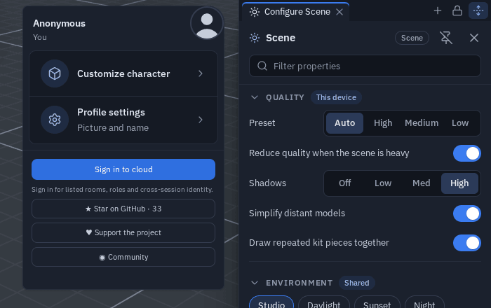{ width="700" }

## The command palette (Ctrl+K)

<kbd>Ctrl</kbd>+<kbd>K</kbd> opens one search box over everything: **tools** (Move, Scale, Interact…), **windows**
(Explorer, Objects, the Profiler…), **menu items** and **every setting**. Type a few letters, move with
<kbd>↑</kbd> <kbd>↓</kbd>, press <kbd>Enter</kbd> to run it; <kbd>Esc</kbd> or a click outside closes it. Picking a
setting opens Settings already searching for that row. The palette is listed in the shortcut sheet (<kbd>?</kbd>) and
can be rebound there like any shortcut.

## Windows and tabs

Every docked or floating window — Explorer, Objects, Chat, AI assistant, Notes, the Notification centre, the node
editor, Flow code, Animation, UV, Shader, HUD editor, Profiler, the Code workspace — has the same header: icon, title,
the window's own actions, then pin and close in the same places. Windows in one group, and the views in the bottom dock,
share **one tab strip**: pill tabs with the view's icon and their own **✕** to close that view. More tabs than fit
scroll sideways (the wheel or a swipe; the strip fades where more tabs are hidden) while **+** stays in place, and the
strip **keeps its scroll** when you pick a tab. Moving, docking and tabbing are described in
[Floating windows](controls.md#floating-windows).

**Long names** — an object or file name in a window header — stay on one line and end in "…", so they never push the
window's buttons out of place. Point at the name (or press and hold it on a touch screen) to read it whole. On a narrow
phone the [Animation](animation.md) window puts the name on its own line above its controls.

### Sidebars

On a computer or a tablet-width window, each side of the screen holds **one sidebar**. Every panel docked to that side
is a **tab** of it: Configure Scene / Properties, the Objects list and any window you dock to the edge (the Node editor,
the Explorer…). Only the tab in front is shown, so opening a panel on a side that already has a sidebar brings its tab
forward instead of opening a second column. The sidebar's header strip holds one tab per panel, a **+** after the tabs
and, at its far end, the **Full height** button (↕) and the **hide** button.

- **Switch** by clicking a tab (or <kbd>←</kbd> / <kbd>→</kbd> with a tab focused).
- **Close** a panel with the **×** on its tab. It leaves the sidebar, and its side is remembered for next time. Since
  1.35 closing (or moving away) the **last** tab leaves the sidebar **open and empty**, with its **+** and *Press + or
  drag a tab here* — drag a tab or a floating window onto it, or hide it.
- **Add a window** with the sidebar's **+**: it lists every window. One that is closed opens as a tab of this sidebar;
  one that is already open is ticked, says where it is and comes to the front there (see
  [The "+" menus](#the-menus)). On a touch screen windows do not join the side columns yet, so there the **+** opens the
  window as it would anywhere.
- **Show or hide** a sidebar with <kbd>Ctrl</kbd>+<kbd>B</kbd> (left) and <kbd>Ctrl</kbd>+<kbd>Alt</kbd>+<kbd>B</kbd>
  (right) — <kbd>⌘</kbd> on a Mac, the same keys as VS Code — or its hide button. Hiding keeps every tab open: showing
  it again brings them back, and opening a panel onto a hidden sidebar shows it again. A sidebar that had nothing in
  it opens empty with its **+**. Rebind both in **Settings ▸ Shortcuts** (*Panels*); inside the
  [code workspace](code-workspace.md#sidebars) the same keys toggle its own sidebars. A hidden sidebar comes back after
  a reload; an emptied one stays empty.
- **Right-click a tab** (press and hold on a touch screen) for its menu: **Close**, **Close others**, **Undock into a
  floating window**, **Move to the other side** and **Move to the bottom dock**. Configure Scene and Properties live only
  in a sidebar, so their *Undock* and *bottom dock* rows are greyed out with the reason.
- **More tabs than fit** scroll sideways (the mouse wheel or a swipe), like the bottom dock's tabs; the tab in front is
  kept in view.
- **Drag a tab anywhere** — see [Dragging a tab](#dragging-a-tab) below.
- **Dock a floating window**: drag it — by its header or any empty part of it — to a screen edge, or onto a sidebar
  (*Add as tab* lights up), or right-click its header ▸ **Move to the left / right sidebar** — it becomes a tab of that
  side. Hold <kbd>Ctrl</kbd> (<kbd>Cmd</kbd> on a Mac) while you drag to place it floating over the sidebar instead —
  see [Moving a floating window](controls.md#moving-a-floating-window).
- **Resize** by dragging the sidebar's inner edge; a double-click resets it. All tabs of a side share the width. The
  logo and the profile button move with the edge as you drag. On a touch screen the edge is easy to grab, the sidebar
  stops at its minimum width (250 px), and its content never scrolls sideways — rows that do not fit wrap onto a second
  line.
- **Full height**: press **↕** and the sidebar runs from the top edge to the bottom edge. The buttons in that top corner
  (the logo and menu on the left; notes, notifications and your profile on the right) move inward at once — since 1.36
  they jump to their new place instead of sliding, the Connect bar too — and the bottom dock
  gets narrower so it sits beside the sidebar, never under it — every docked view, Statistics, Chat, Objects, the Live
  profiler, the AI assistant and the Shader editor included. Press it again to fit the sidebar under the top buttons.
  The main menu always opens above sidebars. With one or both sides at full height the Connect bar stays a pill,
  centred between the logo and the corner buttons. The toolbar never slides under a full-height sidebar — see
  [The toolbar and sidebars](controls.md#the-toolbar-and-sidebars).
- **The header lock** of Configure Scene and Properties sits beside **Full height** in the tab row while that panel is
  the tab in front — see [Panel headers](#panel-headers).
- **A pinned Properties** (the pin in its header) follows your selection without pulling its tab over the Objects list
  when the two share a side; double-click an object (or pick **Properties** in its menu) to bring it forward.

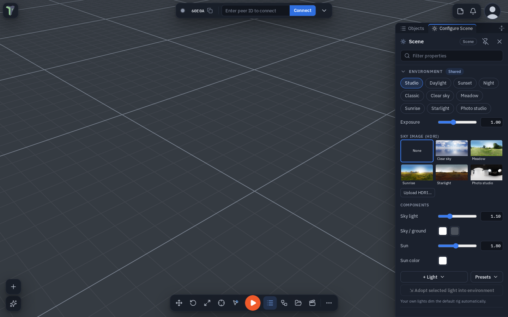

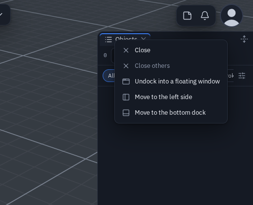{ width="360" }

#### Dragging a tab

Drag a sidebar tab and a highlight shows what will happen before you let go — there is never a silent drop:

| Let go over | Highlight | What happens |
|---|---|---|
| the **other side** | *Move to the left / right side*, or *Add as tab* when a sidebar is already open there | the panel docks on that side |
| the **bottom dock** or the bottom edge | *Move to dock* (on the dock's tab bar a marker shows the spot) | the panel becomes a dock tab |
| anywhere else in the **3D view** | *Float here* | the panel becomes a floating window where you dropped it |
| its **own sidebar** | *Stays here* | nothing |

Dragging a floating window onto a sidebar (or a screen edge), or a bottom-dock tab onto a sidebar, shows the same
highlights, painted above every panel; the window you drag turns see-through so the highlight stays readable.

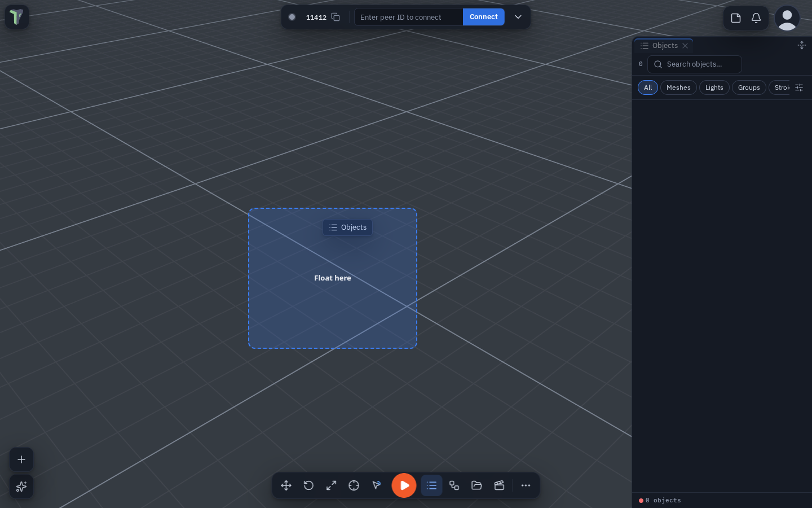

#### Any window in a sidebar

Every window that can be docked at the bottom can also be a sidebar tab — the Node editor, Flow Code, Animation, UV,
Shader and HUD editors, the Explorer, the Profiler, Code, the Image editor, Objects, Statistics, the Live profiler, Chat
and the AI assistant:

- **Into a sidebar**: drag the floating window (by its header or any empty part) to the left or right edge or onto an
  open sidebar, drag its bottom-dock tab onto a sidebar, right-click its dock tab or its floating header ▸ **Move to the
  left / right sidebar**, or pick it in the sidebar's **+** while it is closed.
- **Back to the bottom**: right-click its sidebar tab ▸ **Move to the bottom dock**, or drag the tab onto the dock.

**No second header.** A window in a sidebar shows no window header of its own: the sidebar tab is its header (name, ×,
menu). Windows whose header carries tools keep a slim tools row without the title, ×, Dock or **+**: Objects (search),
the Explorer (search and filters; its search hides when the sidebar is narrower than about 520 px, as in a narrow
floating window), the Shader editor, Code, the Profiler, the Image editor (the file name) and Statistics (the budget dot
and re-read).

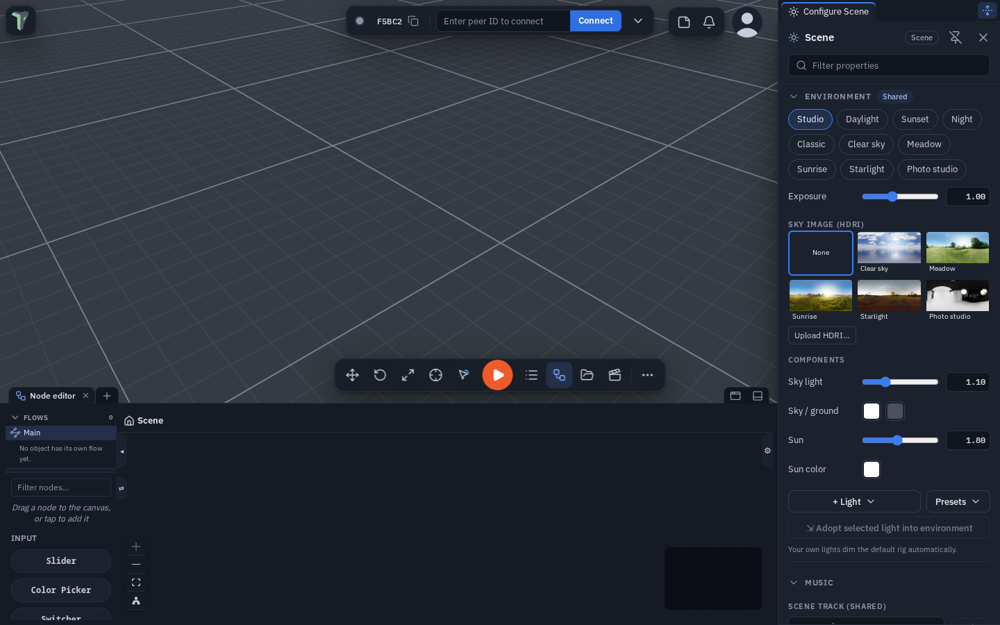

Which side Configure Scene and Properties dock to, each side's width and Full height, the tab order and the tab in front
are kept on this device and saved in [workspace layouts](controls.md#workspace-layouts). A phone keeps its
[bottom dock](#the-dock-on-a-phone) instead.

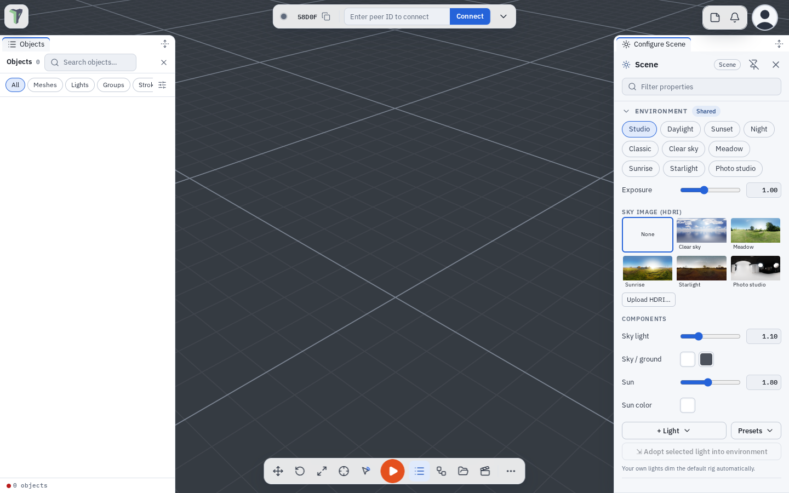

#### Panel headers

The Properties and Configure Scene headers — the panel's name and the **Filter properties** box — have a **lock**
button. On a computer or an unfolded phone it sits in the sidebar's tab row, next to **Full height**, while that panel
is the tab in front; on a phone it stays in the panel header, beside the pin.

- **Locked** (the default): the header stays on top while you scroll the properties.
- **Unlocked**: the header scrolls away with the properties, giving the whole panel to them — handy on a phone.

Each of the two panels remembers its own choice on this device, in a sidebar and in the phone's dock alike.
**Settings ▸ Interface ▸ Windows & chrome ▸ Sticky panel headers** sets both at once (it shows a mixed state while they
differ); searching Settings for *sticky header* finds it.

Every value in these two panels can be copied, pasted and reset from a right-click — see
[Copy, paste and reset values](controls.md#copy-paste-and-reset-values).

### Docked windows

Since 1.32 a window in the bottom dock has no **✕** or undock button of its own:

- **Close it from its tab.** Every tab carries its **✕**.
- **Undock** sits at the right end of the dock's tab strip, just left of **Minimize the dock**. It takes the window you
  are looking at out of the dock as a floating window. To have it take **every** docked window out as one floating
  window with tabs instead, set **Settings ▸ Interface ▸ Windows & chrome ▸ Undock button** to *All as one tabbed
  group* (the default is *Active window*).
- You can also drag a tab out of the strip — or right-click it ▸ **Undock into a floating window** — to undock that one
  window. A docked window moves by its tab, not by its header. The same menu has **Move to the left / right sidebar**
  (see [Any window in a sidebar](#any-window-in-a-sidebar)).
- **The dock's +** lists every window that can live in the dock — the [Node editor](node-editor.md) and the
  [Image editor](image-editor.md#in-the-dock) included, and since 1.33 also **Objects**, **Statistics**, the **Live
  profiler**, **Chat** and the **AI assistant** — the same list as the phone's **Windows** sheet. See
  [The "+" menus](#the-menus) for what a pick does.
- **An empty dock**: with nothing docked, <kbd>T</kbd> opens the dock **empty** — its tab strip with only **+** and the
  line *Press + or drag a tab here*. Drop a floating window on its strip or its body to dock it there; <kbd>T</kbd>
  again closes it.

#### The "+" menus

Every **+** — the dock's, a sidebar's, the floating Node editor's — lists every window, and since 1.35 it never makes a
second copy:

- A window that is **already open** — in the dock, in a sidebar or floating — is **ticked** and says where it is (*In
  dock*, *Left sidebar*, *Right sidebar*, *Floating*). Picking it brings it to the front **where it is**: it is not
  moved, docked or closed.
- Only a **closed** window opens, into the **+** you pressed.
- **Pick several at once**: hold <kbd>Ctrl</kbd> (<kbd>⌘</kbd> on a Mac) or <kbd>Shift</kbd> while you click rows — each
  window opens and the menu stays open for the next pick. From the keyboard, type to filter and press
  <kbd>Ctrl</kbd>+<kbd>Enter</kbd>. A plain click opens one window and closes the menu.

To close a docked window use its tab's **×**; to bring a floating window into the dock, drag it onto the dock or use its
[window menu](controls.md#the-window-menu) (**Dock to bottom**).

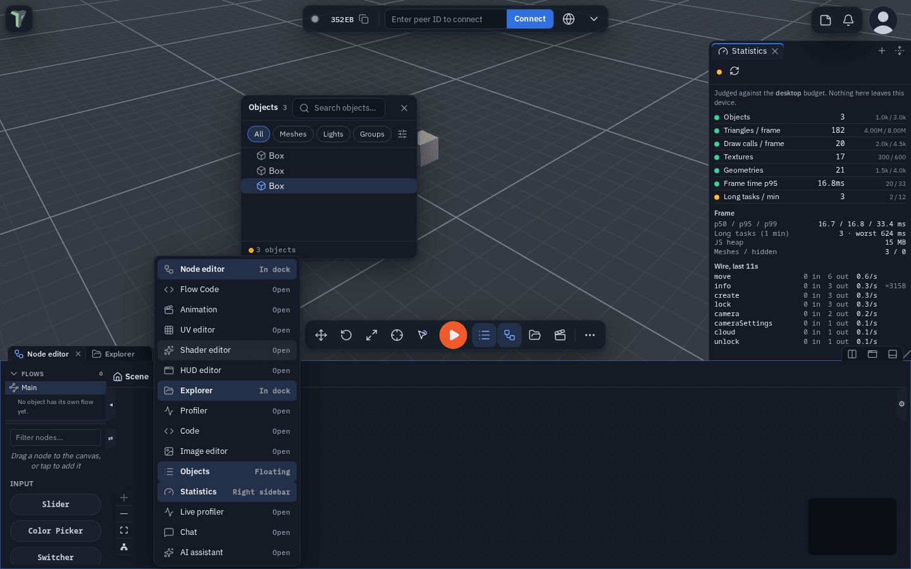

**Dock any window exactly where you want it**: drag a floating window by its header or any empty part of it — or tear
a tab out of a tabbed window, or drag a whole tabbed window by its tab bar — onto the **dock's tab bar**. The window turns
see-through, the tab bar is outlined and a **caret** shows the slot between the docked tabs where it will land; let go
and it docks exactly there. This works for every editor and for Objects, Statistics, the Live profiler, Chat and the AI
assistant; file and model previews, the text viewer, What's new and the tool palettes stay floating. The bottom edge of
the screen still docks a window at the end of the tabs (and is the only target while the dock is minimized; an
[empty dock](#docked-windows) opened with <kbd>T</kbd> takes a drop anywhere on it). Since 1.35 this works by touch too,
on an unfolded phone or a tablet.
Everywhere else a floating window simply moves — over the open dock, over the sidebars, partly off screen — and stays
under the cursor the whole way; a header that ends up under the Controls bar is nudged above it when you let go.

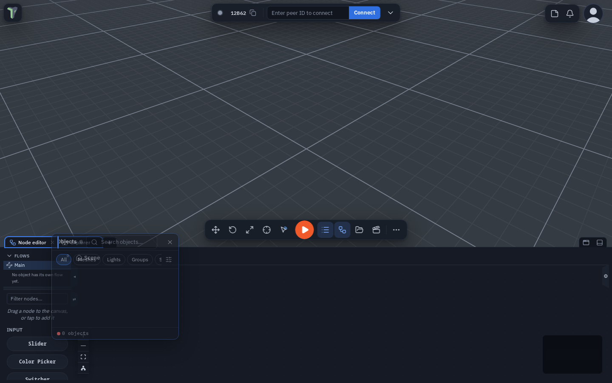

**Floating windows can overlap the dock**: move them over it and resize them past its top edge — only the screen edge
stops the resize corner. The Objects list remembers whether you last had it docked, and the toolbar button and
<kbd>O</kbd> open it there.

### Splitting the dock

The bottom dock can show **two windows side by side** — the Node editor beside the Explorer, the Shader editor beside
Statistics — with a divider between them. The pair is one tab in the dock's strip, named with a slash: **Node editor /
Explorer**.

- Press **Split** (the two-columns button left of *Undock* and *Minimize*): the tab in front is shown beside the next
  tab in the strip. If it is the last tab, the right pane starts empty — press its **+** (or drag a tab onto it) to
  choose its window. Press **Split** again (it shows pressed) to **unsplit**: the two windows become two tabs again.
- **Drag the divider** to give one side more room (mouse, pen or touch); double-click it to centre it. With the divider
  focused, the arrow keys move it (<kbd>Shift</kbd> for bigger steps). Each pane keeps at least 15 % of the dock's width.
- **Click inside a pane** to work in it — its name is bold in the pair's tab, and *Undock*, the tab menu and the
  shortcuts act on it.
- **Drag a tab onto a pane** to show it there instead; the window it replaces stays a tab.
- **Drop a floating window onto a pane** (since 1.39): drag it over one of the two panes — the pane lights up with
  *Show in this pane* — and release. The window docks and shows in that pane; the view it replaced stays a tab.
- **The tab menu** (right-click or long-press a dock tab) has **Split right** and **Split with ▸** (pick the partner),
  and on a pair **Swap sides** and **Unsplit**. Closing the pair's tab (**×**) closes both windows.

Splits and the divider's position are kept on this device and in [workspace layouts](controls.md#workspace-layouts). If
the app closes one window of a pair for a while, the other fills the dock until it comes back. Splitting needs a wider
screen — a computer or an unfolded phone; on a folded phone the dock is one column and a pair shows as its two ordinary
tabs.

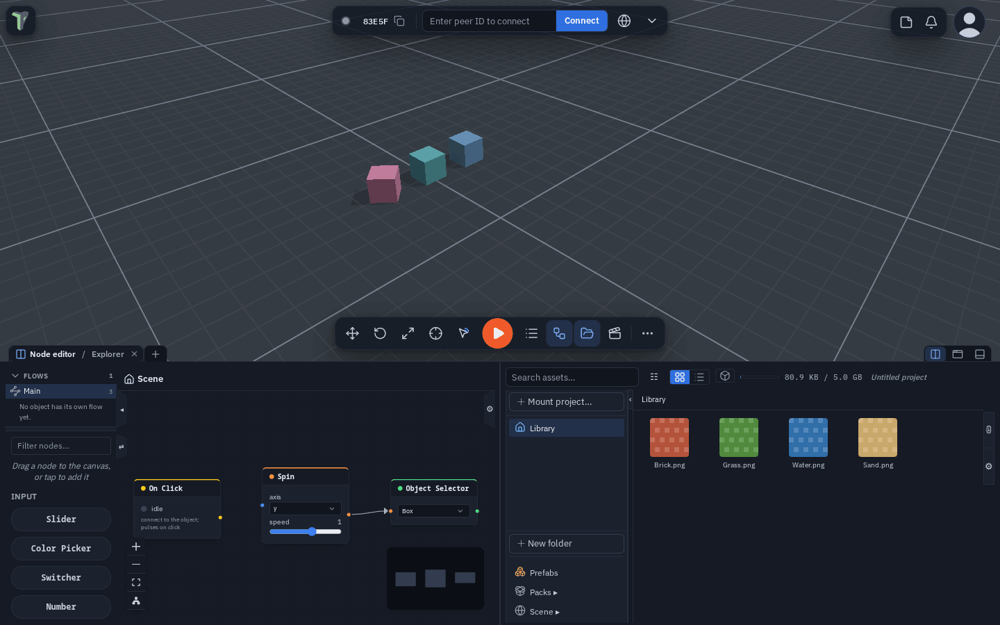

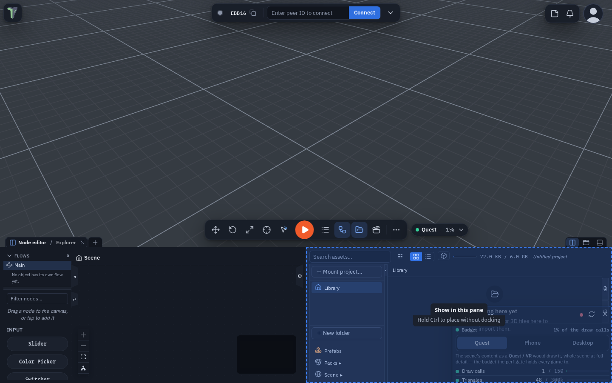

### Floating windows with tabs

- **Statistics groups too** (since 1.39): its header menu ▸ **Group with…**, another window's **Group with…** ▸
  Statistics, or drag its header onto another window's header.
- **Join a window as a tab:** drag a tab out of the dock and drop it onto a floating window. It joins that window as a
  tab instead of opening a second window.
- **Dock all tabs:** a floating window with tabs has a dock button just left of **Close all tabs**. It puts every tab
  back in the dock. For a window with one tab, drag its tab to the dock, or use the window's **Dock** button.
- **Move it by touch:** drag its tab bar — or any of its tab names — and the whole window follows your finger, on a phone
  or an unfolded foldable alike. A tap on a tab still switches to it.
- **Hold a tab** (press and hold; right-click with a mouse) for that window's [window menu](controls.md#the-window-menu):
  **Float (undock)** takes it out of the group, just beside it; **Dock to bottom** and **Move to the left / right
  sidebar** move only that view (greyed out for windows that always float, such as a file preview); **Close** closes
  that view and the rest of the group stays.

**Layouts…** (**Menu ▸ Layouts**) opens a regular dialog for your saved arrangements — on a folded phone, a
[tab of the bottom dock](#the-dock-on-a-phone) — see [Workspace layouts](controls.md#workspace-layouts).

Lists scroll with a thin scrollbar that appears only while you scroll or point at them; there are no chunky native
scrollbars anywhere.

## Windows on several monitors

Since 1.46 any panel — or a whole dock — can live in its **own browser window**. Drag it to a second monitor and keep
the 3D view full-size in the app. Everything stays live: it is the same app in a second window, not a copy.

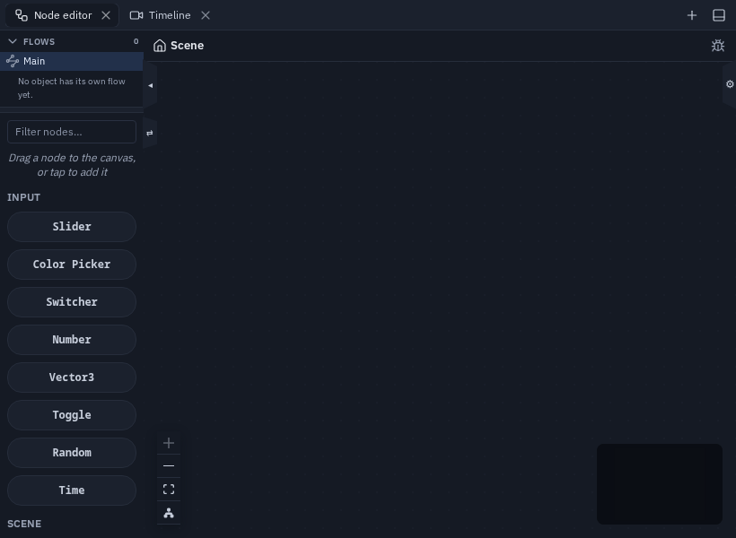

- **Pop out a panel:** right-click a dock tab, a sidebar tab or a floating window's header ▸ **Pop out into a new
  window**. Or drag a tab out of the browser window and let go. Panels that pop out: the Explorer, Properties /
  Configure Scene, the Node editor, Timeline, Animation, UV, Shader and HUD editors, the Profiler, the Debugger, Chat,
  the AI assistant and [Code](code-workspace.md#pop-out-to-its-own-window).
- **Pop out a whole dock:** **Pop out the whole dock** (dock tab menu) or **Pop out this sidebar** (sidebar tab menu)
  opens one window with every tab in it.
- **One panel, one tab:** a window with a single panel shows no tab strip — its header shows the panel's name, and
  that name *is* the tab. Drag it to move the panel; right-click it for **Dock back**, **Move to…**, **Always show tab
  strip in windows** and **Close**. Hover shows it can be grabbed.
- **More tabs:** drop a second panel on a window's header (or use the header's **+**) and a tab strip appears; the
  title becomes the first tab. Back to one panel, the strip goes again. A popped-out *dock* always shows its tabs, and
  Settings ▸ Interface ▸ **Always show tab strip in windows** shows them everywhere.
- **One panel, one place:** a panel is only ever open in one spot. Adding it somewhere else — another window, a dock
  or a sidebar — moves it there. While you drag a tab, every window and dock that can take it shows a drop zone on its
  header. Drag a popped tab back into the app (left sidebar, right sidebar, bottom dock — or anywhere else to put it
  back where it was), or right-click ▸ **Dock back**. Closing a window docks its panels back.
- **Your windows come back:** the windows you had open are remembered per monitor setup and reopen when you come back.
  Browsers open one pop-up per click, so if pop-ups are blocked a bar offers **Open 2 windows** — each click opens the
  next one (or allow pop-ups for the site). Settings ▸ Interface ▸ **Remember windows per screen setup** (Chromium asks
  to see every screen for this).
- **Bring all windows back** (command palette, or any tab menu) puts every panel back in the app. Closing or reloading
  the app's tab closes its windows.
- **Keys** in a popped-out window are the panel's own; undo and redo still reach the scene.
- **Not for pop-out:** the Objects list, file previews, the Image editor and phone tabs. Phones, touch screens and VR
  keep one window — the pop-out entries are hidden there.

## Focus mode

Press <kbd>Ctrl</kbd>+<kbd>Space</kbd> to maximize the area under the mouse pointer:

- over the **3D view** (or a toolbar or a floating window): every panel, window and dock is hidden and the 3D view fills
  the screen;
- over a **docked window** (the Code window, the Node editor, the Explorer…): since 1.34 that window fills the **whole
  browser window**. Its tab row runs along the top edge, so you can still switch tabs, and the window reaches every
  edge. The **sidebars step aside** while it lasts and come back exactly as they were — open, pinned, width and side —
  when you leave. You can still drag the window's top edge down to see the 3D view behind it.

Press <kbd>Esc</kbd> or <kbd>Ctrl</kbd>+<kbd>Space</kbd> again — or click **Exit focus** (in the tab row for a docked
window, at the top for the 3D view) — and everything comes back exactly as it was; nothing is closed. Beside **Exit
focus** on a docked window, a **Viewport** button shows or hides the
[viewport picture-in-picture](#the-viewport-picture-in-picture) without leaving focus mode. Focus mode also
ends when a dialog opens or you press Play.

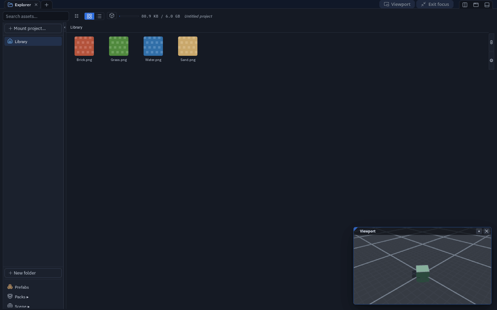

Without a keyboard: **View ▸ Focus mode** in the 3D view's right-click menu, right-click a dock tab ▸ **Maximize (focus
mode)**, or on a phone **More ▸ Tools & View ▸ Focus mode** (which you can also drag onto the
[phone bar](#the-phone-bar-and-more)).

Inside the UV editor and the Animation timeline <kbd>Ctrl</kbd>+<kbd>Space</kbd> keeps its own meaning (keyboard
selection) while you work there; use the menu entries, or rebind focus mode in **Settings ▸ Shortcuts**.

### The viewport picture-in-picture

While a docked window fills the whole window, the 3D view shows as a small **picture-in-picture** (PiP) in the
bottom-right corner, on top of the docked window. It is a live second view of the scene with **its own camera** —
moving it never moves your main view.

- **Navigate**: left-drag orbits, right-drag pans, the wheel zooms; on a touch screen one finger orbits and two fingers
  pinch and pan.
- **Edit**: click (or tap) an object to select it (<kbd>Shift</kbd> adds). With the pointer over the PiP,
  <kbd>W</kbd> / <kbd>E</kbd> / <kbd>R</kbd> pick Move / Rotate / Scale (<kbd>1</kbd> / <kbd>2</kbd> / <kbd>3</kbd> and
  <kbd>G</kbd> work too), drag the gizmo to transform, <kbd>F</kbd> frames the selection in the PiP, <kbd>Delete</kbd>
  deletes and <kbd>Ctrl</kbd>+<kbd>Z</kbd> undoes.
- **Move** it by its title bar and **resize** it by the grip in its top-left corner; double-click the grip for the
  default size (the size is remembered); it starts in the bottom-right corner each time. **⌖** puts its camera back on
  your main view.
- **Show or hide it** with the **Viewport** button beside **Exit focus** — filled while the picture-in-picture shows,
  outlined while it is hidden. Its **×** hides it the same way. Since 1.35 the choice is **remembered** for the next
  time you enter focus mode, and after a reload; it starts shown. The button is there only while the picture-in-picture
  can show — not once you have dragged the window down, and not on a folded phone.
- It shows only while the docked window covers the whole window: drag the window down and the real 3D view is back.
- While the 3D view is covered it is not drawn at all, so a maximized window with the PiP costs less than the normal
  editor.

The PiP's keys are listed in **Settings ▸ Shortcuts ▸ Viewport picture-in-picture**, where they can be rebound.

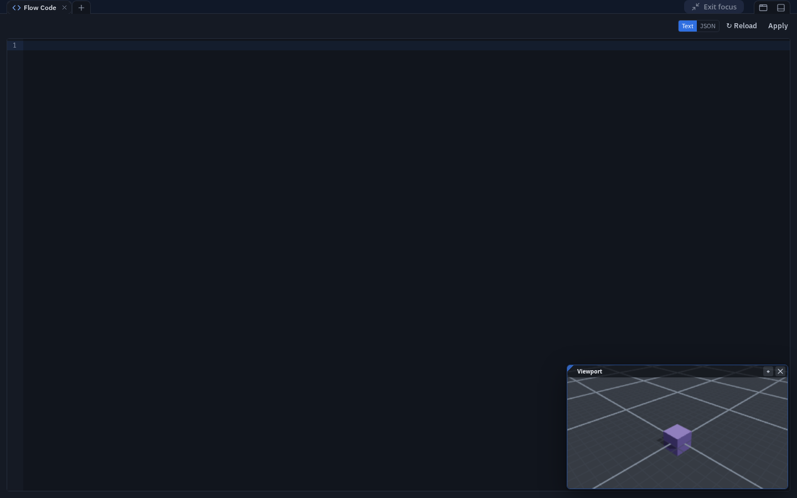

## Menus

The right-click, Add (<kbd>Shift</kbd>+<kbd>A</kbd>) and viewport menus share one style: 32 px rows, an icon per row,
shortcuts right-aligned, quiet section labels.

**Right-click an object** and the everyday actions come first — **Properties**, **Rename**, **Duplicate**, **Delete** —
then **Focus**, **Ping** and **Add note**, then the editing modes. Rarer work is one level down: **Transform ▸**
(align to ground, origin, pivot…), **Mesh ▸** (convert, boolean…), **Physics & effects ▸** (joints, particles, flow
effects), **Prefab ▸** on a placed prefab copy, and **Save as… ▸**. Every action and its shortcut is still there.

### The main menu's Project actions

The **Project** section at the top of the main menu has two layouts, picked in **Settings ▸ Interface ▸ Lists & menus ▸
Project actions**:

- **Compact** (the default on a computer and an unfolded phone) is a two-column grid: **New from template…** across the
  top, then **Load** | **Save ▾**, then **Import** | **Export…**. **Save** saves straight away with your last-used
  options; its **▾** opens [Save options](saving.md#save-options) — what to save and what the file includes.
  **Export…** opens Publish / Export.
- **List** (the default on a folded phone) is one row per action — Templates, Import, Load, Save, Publish / Export —
  with the **Project | Scene | ⚙** switch under Save; the **⚙** opens the same Save options.
- **Auto** is List on a phone and Compact everywhere else. Searching the settings for *burger* or *compact* finds it.

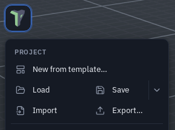{ width="290" }

## Dialogs

Modules, Sessions, Checkpoints, Templates, Storage, Publish / Export, Import and every confirmation share one dialog
style: a header with the title and close, tabs directly under it where a dialog has them, one scrolling body and the
answers bottom-right. Each view has **one** emphasised action; a destructive answer is red. Escape, a click outside and
the close button behave as before. **Customize character** is a drawer you can resize by its edge — see
[Your Character](avatars.md#customize-character).

Since 1.32 every dialog — Modules, Sessions, Templates, confirmations — **covers the whole screen**, the logo and its
menu button included; close it with its own ✕, **Done**, <kbd>Esc</kbd> or a click outside. **Settings** is a window
beside your work: since 1.35 opening it no longer closes an open sidebar, the docked windows or the Node editor (on a
folded phone it is a full-screen sheet, and the dock comes back when you close it). **What's new**
opens above everything else: the logo, undo and redo, the connection pill, notifications, your profile and the bottom
bar.

**Questions are dialogs, outcomes are toasts.** Anything that asks you to decide something destructive or blocking is a
dialog: *Delete flow*, *Restore previous session?*, deleting a group or a prefab, rebuilding a mesh or terrain that
discards your edits, leaving a session to join another, exporting everything when nothing is selected, a scene too large
for this device. Passive results — *Saved*, *Copied*, *Exported…* — stay [toasts](notifications.md#toasts) and are kept
in the notification centre. Requests from other people (to load a session, to take control, to see your private scene)
stay cards in the corner, like connection requests: a dialog would take over your screen from afar.

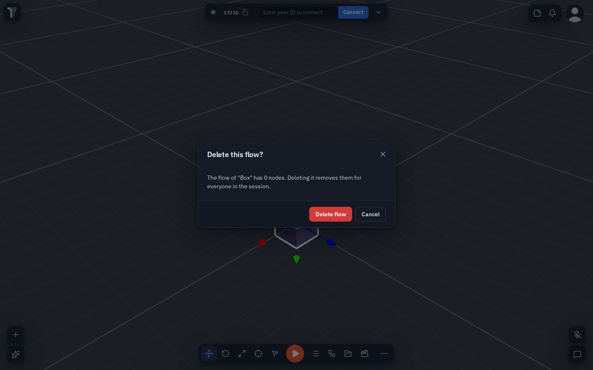

## On a phone

Below 640 px wide — a folded phone — the app switches to a phone layout with less on screen and nothing missing. An
unfolded phone and a computer share the desktop layout.

- **Top**: the logo (main menu) on the left, a **Connect chip** in the middle and, on the right, the notification bell,
  the peers button (while someone is connected) and your picture. The chip shows the
  [status dot](connection.md#the-status-dot) with the state beside it — **Connected**, **Connecting…** or **Offline** —
  whenever the top bar has room; when the bar is crowded (people are connected and you are in a call, so the peers
  button and the microphone take the space) it shrinks to the dot and ▾. Tap it for your invite link, the join field,
  Info and Toasts.
- **Bottom bar**: **Add · Objects · Play · Explorer · More** by default. Play stays the only orange control. **More**
  holds the rest: Chat, the AI assistant, Notes, Scene, the node editor and every other window, the edit tools,
  Statistics and Tools & View. You arrange the bar from More — see [The phone bar and More](#the-phone-bar-and-more).
- **A bar button toggles its view.** Tapping Objects, Explorer or any view you put on the bar while its tab is on
  screen **minimizes** the dock — every tab stays open and the 3D view clears; tap it again to bring it back. With
  **Settings ▸ Interface ▸ Windows & chrome ▸ Allow undocking on touch screens** on and that window floating, the button
  opens and closes the floating window instead.
- **Play plays on the screen** on a phone or tablet until you choose otherwise (a headset still enters VR). **Press and
  hold Play** for its menu: *Play as* (Play, Enter VR, Enter AR passthrough), *Test play* in a game scene, **Move left /
  Move right** (Play moves along the bar, and this device remembers where) and **Arrange the bar…**. Choosing *Enter VR*
  or *Enter AR passthrough* turns Play's icon into the headset (with *A R* for passthrough), as on a computer;
  **Settings ▸ VR ▸ Play on the screen, even in a headset** is the same choice.
- **The selection toolbar** appears only while something is selected — see
  [The selection toolbar](#the-selection-toolbar). With nothing selected — just looking around — there is no toolbar;
  **More ▸ Edit** has Inspect, Move, Rotate, Scale, Undo, Redo, Select multiple and Interact mode, and any of them can go
  on the bar.
- **Panels are tabs of the bottom dock.** Properties, Objects, Notes, Configure Scene, Layouts and Statistics sit in the
  dock beside the Explorer and the node editor — see [The dock on a phone](#the-dock-on-a-phone).
- **Menus are sheets** that open over the dock from the bottom: the main menu, More, the profile menu, notifications, the
  peers panel, the Connection sheet, Add and the press-and-hold action sheets, Chat, the AI assistant, the tool palettes
  (mesh edit, sculpt, spline) and Customize character — see [Sheets on a phone](#sheets-on-a-phone). The bar with Play
  stays visible and tappable. Above the dock, the Add list and the other sheets that work on the selection, the
  selection toolbar rides just above the top edge — never on top of it — and follows that edge in the same frame while
  you drag a grab bar, so you can pick an object in Objects and move or undo without closing it. While a **menu** is
  open — the main menu, the profile menu, notifications, Connection, More, an object's or the viewport's action sheet,
  Customize character, Settings or any dialog — the selection toolbar hides, and it comes back when the menu closes.
- **Docked windows open with their sidebars hidden**: the Explorer, Node editor, UV editor, HUD editor, Profiler, Image
  editor and Code workspace give the screen to their work area (folded or unfolded). Open a side panel with its edge
  button or tab; it stays open next time, for that window.
- **The dock's +** at the end of its tab strip opens a **Windows** sheet: every window — the six dock panels included —
  with a show/hide switch. With floating windows allowed on the phone (**Settings ▸ Interface ▸ Windows & chrome ▸ Allow
  undocking on touch screens**), **+** works as on a computer — a menu that adds a window to the dock.
- **Editors fit a phone**: the [Animation](animation.md#on-a-phone) window shows one pane at a time, the [Shader
  editor](shader-graph.md#on-a-phone) gives the canvas the whole screen with the palette and properties as sheets,
  and every toolbar that does not fit — UV editor tools, Profiler controls — scrolls sideways (with a fade where
  more is hidden); nothing is out of reach.
- **Settings** is a list you tap into, with ‹ Back on every page; Settings and dialogs open full-screen and cover the
  logo while they are open.

Touch targets are at least 44 px, switches 51 × 31, and text fields use 16 px text so the browser never zooms.

### The phone bar and More

You choose what is on the bottom bar, and in what order, from **More** itself — there is no separate editor:

- **Press and hold** any item in More, then **drag it onto the bar**; it lands where you let go.
- Press and hold an item **on the bar** and drag it **along the bar** to move it, or **up into More** to take it off.
- **Play** works the same way: drag it anywhere on the bar, or into More. While Play is off the bar it waits at the
  start of **More ▸ Windows**, ready to be dragged back.

The tip at the bottom of More says it: *Hold and drag items to or from the bar.* It goes away by itself once you have
added, moved or removed an item on the bar, and stays away; **Settings ▸ Interface ▸ Reset tips** brings it back. A dot
on an item in More means it is already on the bar, and **Reset bar** (at the end of More) brings back the default. With More closed nothing moves by
accident: a long press on a bar item opens More and picks that item up in one gesture.

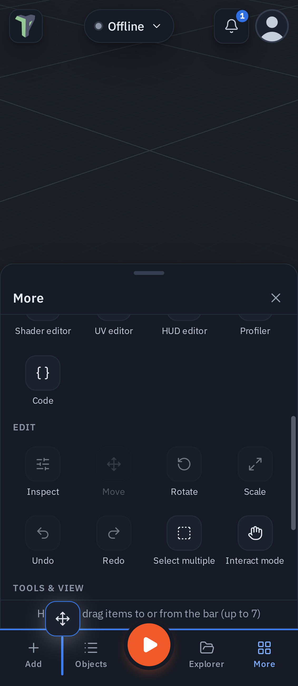{ width="320" }

**What can go on the bar** — everything in More:

- **Windows**: Add, More, Objects, Statistics, Chat, Explorer, Node editor, Animation, Scene, AI assistant, Notes, Flow
  Code, Shader editor, UV editor, HUD editor, Profiler, Code;
- **Edit**: Inspect, Move, Rotate, Scale, Undo, Redo, Select multiple, Interact mode. Move, Rotate, Scale and Inspect work
  on the selection and look pressed while active;
- **Tools & View**: snapping, view and camera, and **Focus mode** (see [Focus mode](#focus-mode)).

**How many**: up to **seven**, Play included. Up to five items show their names; with six or seven on a narrow phone the
bar shows icons only (each still at least 44 px wide, with its name as the tooltip and for screen readers). An eighth is
refused, and the last item cannot leave — the bar is how you get back to More. If you take **More** itself off the bar,
the app tells you once: press and hold any item on the bar to get More back.

**Show switches** sit at the bottom of More (and in **Settings ▸ Interface**). All are on by default:

| Switch | Off means |
|---|---|
| **Selection toolbar** | no floating Move / Rotate / Scale / Inspect strip over a selection — handy once those tools are on your bar |
| **Dock tab row** | the row of tabs above docked windows is hidden; the bar and More still switch views |
| **Grab handle** | no grab bar on docked windows and sheets (and no tap to step the size); drag the top edge to resize |

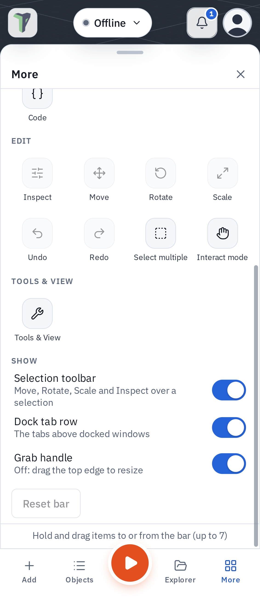{ width="320" }

The bar and the switches are kept on this device; they are never shared with peers or saved in scenes, but a
[workspace layout](controls.md#workspace-layouts) saved on the phone keeps the bar. On a wider screen — an unfolded
phone, a tablet, a computer — the desktop toolbar is used instead, and your phone bar is waiting for the next fold. A bar
you customised in 1.32 carries over.

### The dock on a phone

On a folded phone the panels you work in are **tabs of the bottom dock**, in the same strip as the Explorer, the node
editor and the other editors:

| Tab | What it shows | Opens from |
|---|---|---|
| **Properties** | the selected object's properties | **Inspect** in the selection toolbar |
| **Objects** | the object list | the bar's **Objects** |
| **Notes** | the scene's notes; opening a note shows it as a page of the tab, closing it returns to the list | **More ▸ Notes** |
| **Configure Scene** | the scene's settings | **More ▸ Scene**, or the main menu's **Configure Scene** |
| **Layouts** | save and switch [workspace layouts](controls.md#workspace-layouts) | the main menu's **Layouts**, or the dock's **+** |
| **Statistics** | the scene's [budgets](performance.md#what-the-statistics-window-counts) | **More ▸ Statistics** (since 1.34; before, a floating window) |

- **All tabs share one height.** Drag the dock's grab bar to resize it; swipe it down to minimize the dock.
- **A tab's ✕** closes that panel. The dock's **+** lists every window, these six included, with a show/hide switch.
- **More ▸ Statistics** (or Statistics on your bar) toggles like any bar button: tapped while its tab is in front, it
  minimizes the dock. With **Settings ▸ Interface ▸ Windows & chrome ▸ Allow undocking on touch screens** on, Statistics
  floats as before.
- **Several can be open at once** — the properties no longer close when you open the notes.
- **Play stays on top** of whatever is open.
- **The main menu closes** as Configure Scene opens, since its tab is underneath the menu. On a computer the menu stays
  open, above the sidebar.

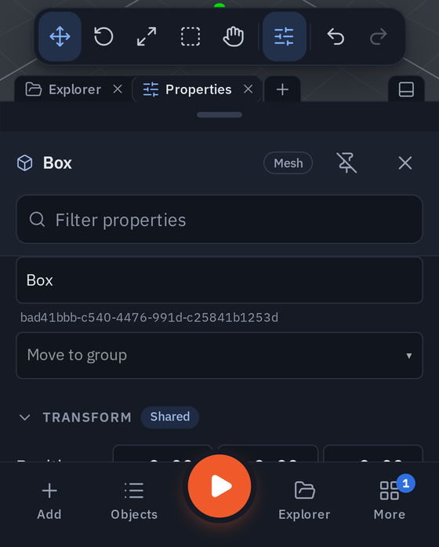{ width="360" }

**Folding and unfolding.** Unfold the phone (or widen the window past 640 px) and each tab goes back to its place on the
bigger screen: Properties and Configure Scene to their [sidebar](#sidebars) (the right side unless you moved them),
Objects to its window or sidebar, Notes to the notes drawer, Layouts to the Layouts dialog. Fold it again and the same
tabs come back, with the one you were looking at in front. What you open or close on the bigger screen carries over. A
reload starts with a clean slate.

### Sheets on a phone

Since 1.32 every sheet works the same way:

- **One grab bar** sits at the top of each sheet. It never scrolls away with the sheet's contents. (The **Grab handle**
  switch at the bottom of [More](#the-phone-bar-and-more) hides it; the sheet's top edge still resizes it.)
- **Drag the bar** to make the sheet taller or shorter. It stops at a minimum and a maximum height, and each sheet
  **remembers** its height on this device.
- **Swipe the bar down to the bottom** to close the sheet; a tap on the bar steps its size.
- **No sheet covers Play** or the selection toolbar, and none rises into the top bar.

Since the 1.32 review a sheet also **moves by its body**, the way a phone's own sheets do — Add, the main menu, the
notification centre, the profile menu, More and Chat:

- A list inside the sheet **scrolls** as usual. When the list is at its top, **pulling down** moves the sheet, and
  letting go far enough — or **flicking** down — closes it.
- A drag that started as a scroll stays a scroll: scrolling up and back down in one movement never closes the sheet.
  Pulled down and then back up, the sheet stops at its height and the list carries on scrolling.
- A quick flick closes the sheet from any height; a gentle one steps down to the next size. Past its tallest size the
  sheet stretches with resistance and springs back.
- Sideways strips, sliders, number fields and canvases inside a sheet keep their own gestures.
- **The dock minimizes instead of closing.** Its grab bar — or a pull down from the top of a tab's list — minimizes the
  dock with every tab still open (Properties, Objects, Notes, the Explorer, the node editor and the rest). The bottom
  bar's buttons bring it back.
- **Your profile menu** — tap your picture — is a sheet too, without a second copy of your picture in its header (it is
  already at the top right). **Customize character** and **Profile settings** open from it with a tap.
- **The peers panel** — the peers button in the top bar — opens as a sheet like the notifications: grab bar, swipe down
  to close. See [Who is here](connection.md#who-is-here-the-peers-panel).

For the Explorer's long-press actions on a phone, see [Explorer: on a phone](explorer.md#on-a-phone).

### The selection toolbar

When something is selected, a toolbar floats above the bottom bar — or above the dock or sheet that is open, moving
with its top edge in the same frame while you resize it:

| Button | What it does |
|---|---|
| **Move / Rotate / Scale** | the gizmo mode (keys <kbd>1</kbd> / <kbd>2</kbd> / <kbd>3</kbd>) |
| **Select multiple** | a toggle: while it is on, every tap adds or removes an object (there is no <kbd>Shift</kbd> on a phone) |
| **Interact** | a toggle: tap the scene to play with it instead of editing (<kbd>I</kbd>) — see [Edit and Interact](controls.md#edit-and-interact) |
| **Inspect** (the sliders icon) | opens the object's properties as the dock's **Properties** tab, or brings that tab to the front when another tab is in front; tap it again to close it. It looks pressed only while Properties is the tab on screen |
| **Undo / Redo** | |

Every toggle shows its state: a filled (tinted) button is on. Tapping a selected object deselects it — see
[Tapping to select](controls.md#tapping-to-select-on-a-touch-screen).

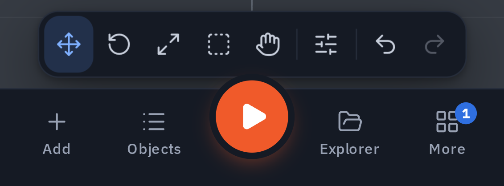{ width="360" }

## For module authors

Every part shown here is on the **/kit** page of the app, in every state, and module panels can use the same parts — see
[The UI kit](ui-kit.md).
