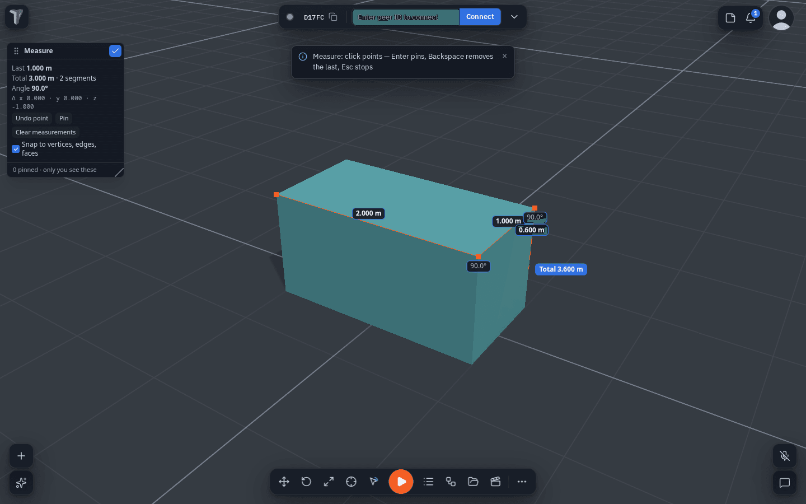
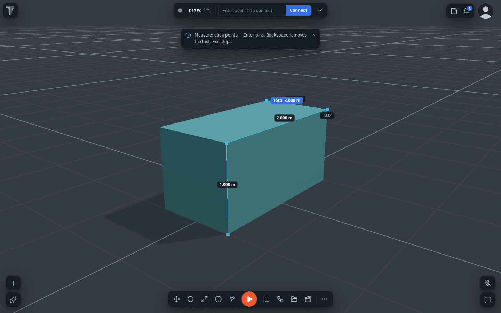
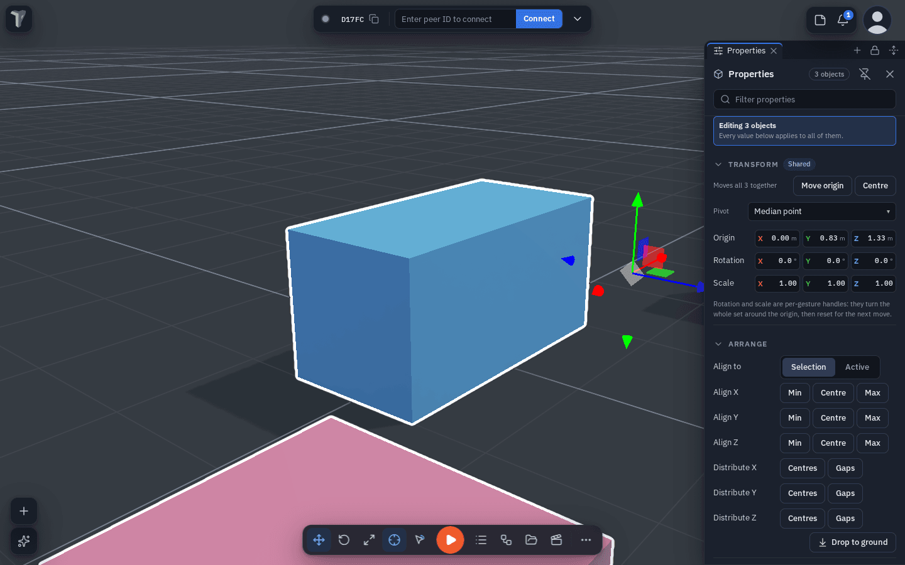

# Measure, Align & Distribute

Since 1.38 the Measure tool snaps to the geometry and chains segments, and a selection can be lined up, spaced out
and dropped onto the ground in one click.

## Measure

**Where:** right-click the viewport ▸ **Measure distance** (the row reads *Stop measuring* while it is on). A small
**Measure** window opens — a bottom sheet on a phone.

- **Click (or tap) points.** Each point **snaps** to the corner, edge or face under the pointer — a small orange dot
  shows where the next click will land, and a dashed line runs to it from the last point.
- **Keep clicking to chain segments.** Every segment shows its length, every corner the **angle** between its two
  segments, and the end of the chain the **total**. The window also shows the last segment's Δ x / y / z.
- **Pin it:** <kbd>Enter</kbd>, the **Pin** button, or clicking the last point again keeps the measurement on screen
  as dimension labels after you stop measuring; they follow the camera.
- <kbd>Backspace</kbd> / **Undo point** removes the last point. <kbd>Esc</kbd> / **Done** stops measuring (pinned
  ones stay).
- **Clear measurements** — in the Measure window, or in the viewport menu while any are pinned — removes them all.

**Snap to vertices, edges, faces** (in the Measure window, remembered on this device) can be switched off to measure
the exact point under the pointer.

!!! note "Measurements are yours"
    Measurements are not sent to other people, not saved in the scene and not part of undo — a reload clears them.
    They are drawn as screen labels, so they do not show in a VR headset yet.

## Align, distribute and drop to ground

**Where:** select two or more objects ▸ Properties ▸ **Arrange**; or right-click a selected object ▸ **Transform ▸**
(*Drop to ground*, *Align ▸*, *Align to active ▸*, *Distribute ▸*).

| Control | What it does |
|---|---|
| **Align X / Y / Z — Min / Centre / Max** | Lines every object's lowest edge, centre or highest edge up on that axis. |
| **Align to: Selection / Active** | *Selection* uses the bounds of the whole selection; *Active* uses the last object you picked, which stays where it is. |
| **Distribute X / Y / Z — Centres** | Spaces the centres evenly (three or more objects; the two outermost stay). |
| **Distribute X / Y / Z — Gaps** | Makes the empty space between neighbours equal — better when the objects are different sizes. |
| **Drop to ground** | Each object rests its bottom on the surface below it, or on the ground (y = 0) when there is nothing under it. A stack settles from the bottom up. |

Every button is **one undo step** for the whole selection, and everyone in the session sees the result. Objects
another person is editing are left where they are. (*Drop to ground* replaces the old *Align to ground* row.)
