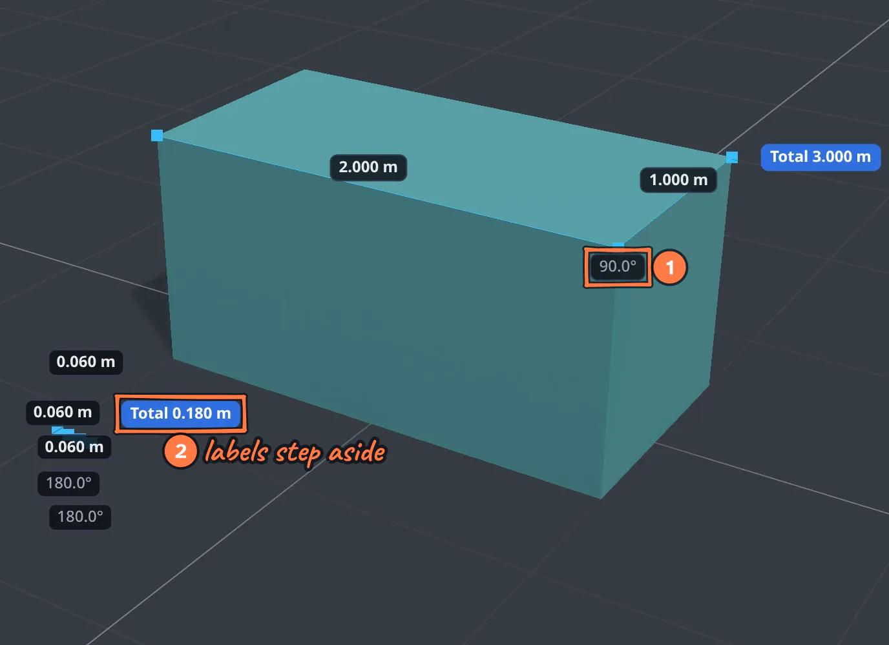
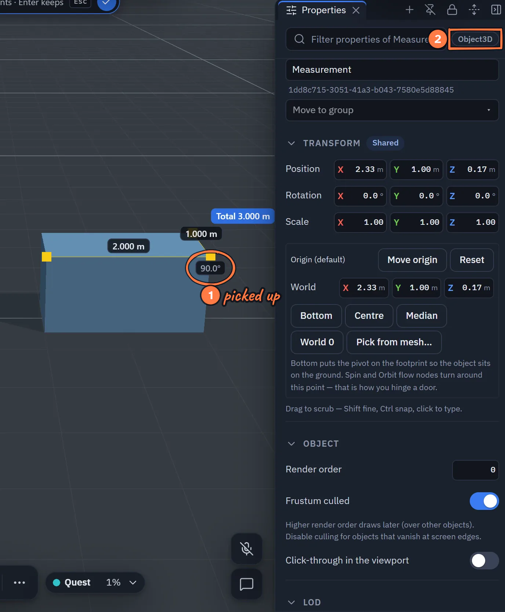
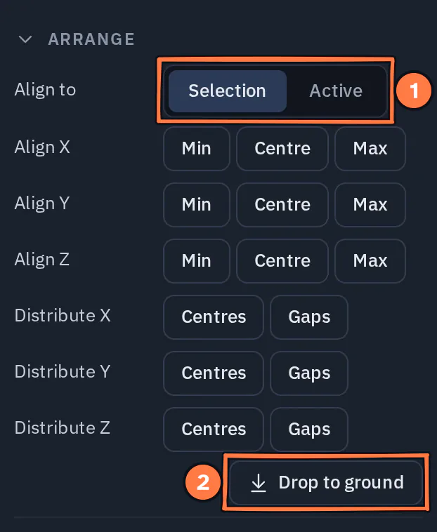

# Measure, Align & Distribute

Since 1.38 the Measure tool snaps to the geometry and chains segments, and a selection can be lined up, spaced out
and dropped onto the ground in one click. Since 1.39 the measurements you keep are scene items everyone sees.

## Measure

**Where:** right-click the viewport ▸ **Measure distance** (the row reads *Stop measuring* while it is on). A small
**Measure** window opens — a bottom sheet on a phone.

!!! note "Changed in 1.39"
    A measurement you keep is now an **object in the scene**, like a drawn stroke: it is in the object list, every
    person in the session sees it, it is saved with the scene and it undoes like any object. This replaces 1.38's
    pinned measurements, which only you could see and a reload cleared.

{ .shot .fade-l .fade-r .fade-t .fade-b width="688" height="500" loading=lazy }
/// caption
A chain of three measured segments with lengths.
///

1. Every **segment** shows its length.
2. Every corner shows the **angle** between its two segments.
3. The end of the chain shows the **total**.

- **Click (or tap) points.** Each point **snaps** to the corner, edge or face under the pointer — a small orange dot
  shows where the next click will land, and a dashed line runs to it from the last point.
- **Keep clicking to chain segments.** Every segment shows its length, every corner the **angle** between its two
  segments, and the end of the chain the **total**. The window also shows the last segment's Δ x / y / z.
- **Keep it:** **✓** (Done) or <kbd>Enter</kbd> keeps the measurement; **Keep** in the window keeps it and starts the
  next one; a quick second click on the last point does the same.
- <kbd>Backspace</kbd> removes the last point. <kbd>Esc</kbd> cancels the one being drawn; **Discard** drops it.

**Snap to vertices, edges, faces** (in the Measure window, remembered on this device) can be switched off to measure
the exact point under the pointer.

### Kept measurements

A kept measurement appears in the [object list](controls.md#selection) with a ruler icon, named **Measurement**. Move,
rename, hide, delete and undo it like any object.

{ .shot .fade-l .fade-r .fade-t .fade-b width="688" height="500" loading=lazy }
/// caption
Two kept measurements.
///

1. A kept measurement shows the same lengths, angles and total, for everyone.
2. Labels of **short segments** step aside so they never overlap.

- **Select** one by clicking its line (or its row in the object list). Properties shows a **Measurement** section with
  each segment's length, the angle at each joint and the total.
- **Edit its points:** select it and press <kbd>Tab</kbd> (or Properties ▸ *Edit points*, or the object menu ▸ *Edit
  measurement*). Click a point to pick it up, click again to put it down — it snaps exactly like drawing. Click
  anywhere else to add a point at the end. <kbd>Backspace</kbd> / <kbd>Delete</kbd> removes the picked (or last)
  point. <kbd>Tab</kbd>, <kbd>Esc</kbd> or ✓ finishes. Each placed point is one undo step.
- **Delete them all:** viewport menu ▸ **Delete measurements (N)** removes every measurement in the scene in one undo
  step.

{ .shot .fade-l width="688" height="833" loading=lazy }
/// caption
Editing a measurement.
///

1. A click on a point **picks it up**; the next click puts it down (it snaps).
2. The measurement is an object: **Properties** shows it like any other.

**Labels do not pile up.** On short segments, the lengths, angles and total step aside; a label with no room left is
not drawn. The Measure window and the Properties section still show every number.

!!! note "Limits"
    Measurements are an editing aid: they are hidden in Play and in VR (their labels are drawn on the screen), they have
    no physics body and an export draws nothing for them.

## Align, distribute and drop to ground

**Where:** select two or more objects ▸ Properties ▸ **Arrange**; or right-click a selected object ▸ **Transform ▸**
(*Drop to ground*, *Align ▸*, *Align to active ▸*, *Distribute ▸*).

{ .shot width="311" height="379" loading=lazy }
/// caption
The Properties Arrange section for three selected objects.
///

1. **Align to**: the whole selection's bounds, or the active (last picked) object.
2. **Drop to ground**: each object rests on the surface below it.

| Control | What it does |
|---|---|
| **Align X / Y / Z — Min / Centre / Max** | Lines every object's lowest edge, centre or highest edge up on that axis. |
| **Align to: Selection / Active** | *Selection* uses the bounds of the whole selection; *Active* uses the last object you picked, which stays where it is. |
| **Distribute X / Y / Z — Centres** | Spaces the centres evenly (three or more objects; the two outermost stay). |
| **Distribute X / Y / Z — Gaps** | Makes the empty space between neighbours equal — better when the objects are different sizes. |
| **Drop to ground** | Each object rests its bottom on the surface below it, or on the ground (y = 0) when there is nothing under it. A stack settles from the bottom up. |

Every button is **one undo step** for the whole selection, and everyone in the session sees the result. Objects
another person is editing are left where they are. (*Drop to ground* replaces the old *Align to ground* row.)
