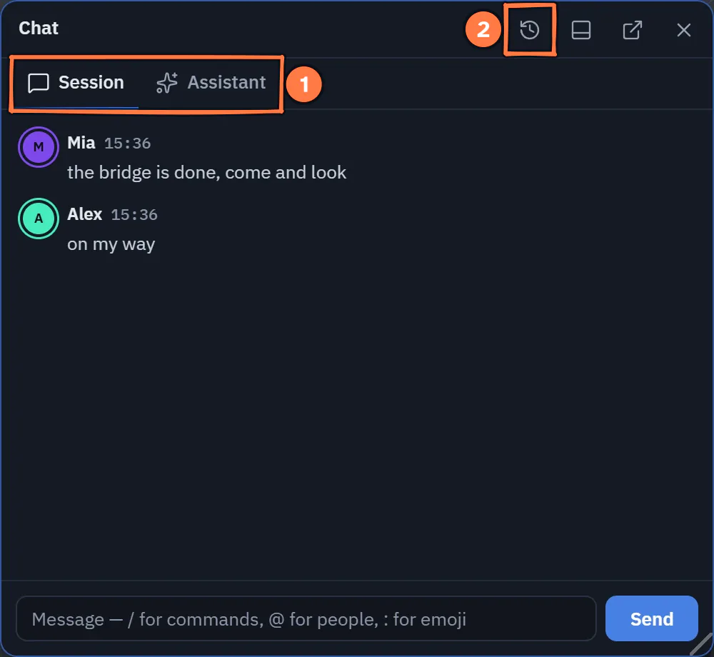
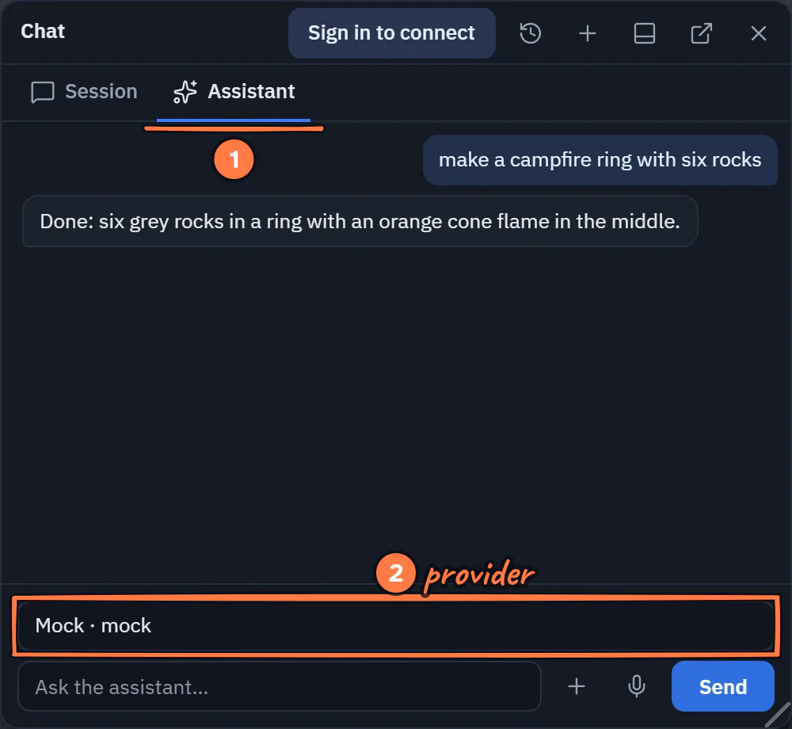
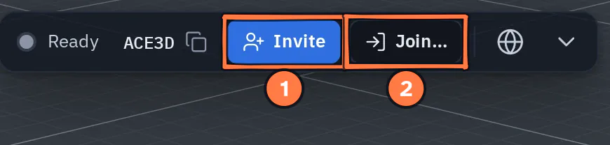
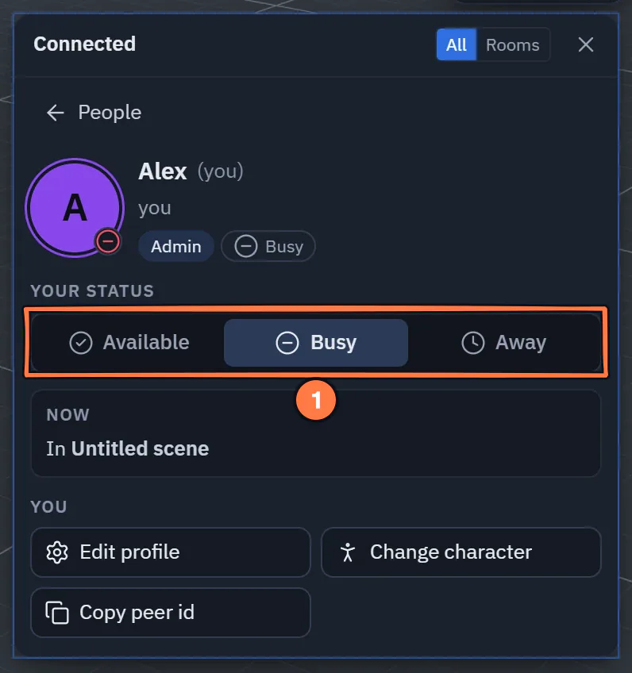
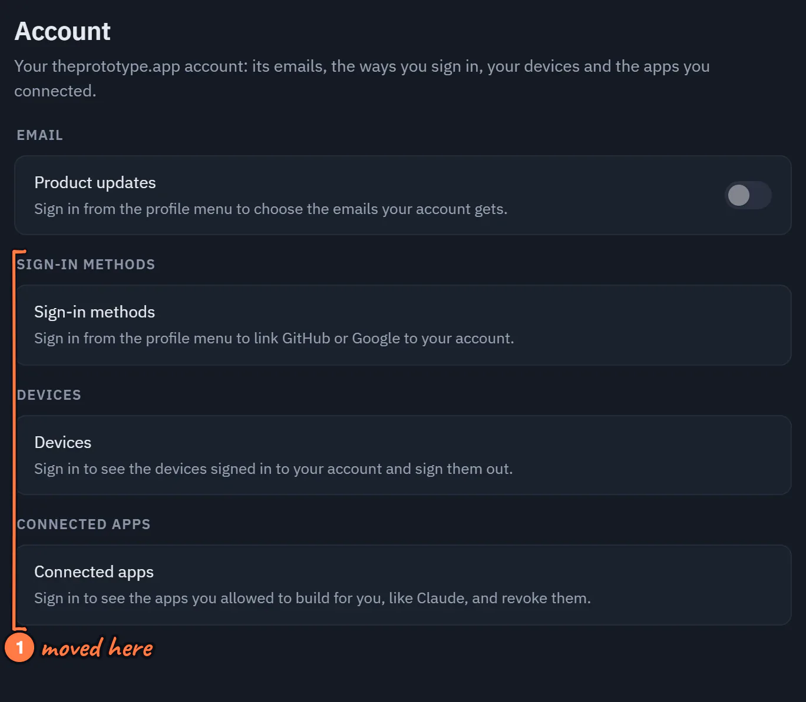

# New menus and panels

*New in 1.65.* Several windows and menus were rebuilt so that related things sit together: Chat and the AI assistant
share one window, everyone in the session has a card, the file preview docks and edits images, the Timeline has panes,
Generate 3D is a window, and your account has one page in Settings.

Layouts and window positions saved by an earlier version open the new windows: a docked or placed AI assistant opens
Chat on its **Assistant** tab, and an Image editor tab opens the **Preview**.

## Chat and the AI assistant

Chat and the AI assistant are one window with two tabs: **Session** for the people in this session, and **Assistant**
for your own AI provider or an AI agent that joined. The Chat button (or <kbd>C</kbd>) opens it on **Session**, the AI
button on **Assistant**. If the window is on the other tab, the button switches tabs; if its own tab is showing, it
closes the window. A dot on a tab means something new arrived there. The clock button opens one **History** for both
kinds of chat (**All | People | AI**, and a search), and chats come back after a reload. Your own provider's chats stay
on this device. More: [Chat](notifications.md#chat) and [AI Assistant](ai/assistant.md#the-assistant-tab-of-the-chat-window).

{ .shot width="500" height="460" loading=lazy }
/// caption
Chat and the AI assistant share one window, here on its Session tab.
///

1. **Session** is the chat with the people in this session, **Assistant** your AI provider or an agent that joined. The Chat button (or <kbd>C</kbd>) opens Session, the AI button Assistant.
2. The clock opens **History**: every chat of both kinds, kept on this device.

{ .shot width="500" height="460" loading=lazy }
/// caption
The Assistant tab of the Chat window.
///

1. The **Assistant** tab: the window the AI button opens.
2. **Talk to**: your own **provider**, or an AI agent in the session.

{ .shot width="500" height="460" loading=lazy }
/// caption
One History for both kinds of chat.
///

1. **All**, **People** or **AI**; the search above looks through every chat.
2. The chat of a **past scene**: it opens read-only on the Session tab.

## People

### The Person card

Press anyone in the People list for their **Person card**: who they are (role, status, device, how long they have
been here), what they are doing now, their connection over the last minute, and every action of the peer menu as
buttons. The **People** arrow goes back to the list. See [The Person card](people.md#the-person-card).

{ .shot width="398" height="618" loading=lazy }
/// caption
A Person card in the People popover.
///

1. The **People** arrow goes back to the list.
2. **Now** (what they hold, or where they are) and their **Connection** over the last minute; the action buttons follow.

### Invite and Join…

The Connect bar leads with **Invite** and **Join…**. **Invite** opens the invite sheet on **Person**, with **AI agent**
as its second tab (it replaces the *Request AI* button). **Join…** opens the field that takes a pasted invite link or
a peer id. Someone who joins with your invite is announced by name (*Guest 2 joined with your invite*), not by an id.
See [The Connect panel](connection.md#the-connect-panel) and [Invite people and agents](invites.md).

{ .shot width="435" height="104" loading=lazy }
/// caption
The Connect bar leads with Invite and Join….
///

1. **Invite** opens the invite sheet: **Person** or **AI agent**.
2. **Join…** opens the field for an invite link or a peer id.

### Show my status

Let others see whether you are **Available**, **Busy** or **Away**: switch on **Settings ▸ Interface ▸ Show my
status** (off by default), then pick your status on your own card. See [Show my status](people.md#show-my-status).

{ .shot width="398" height="424" loading=lazy }
/// caption
Your own card, with Show my status switched on.
///

1. **Your status**: **Available**, **Busy** or **Away**, shown beside your name for everyone.

## Preview and the image editor

The file preview can pin to the dock: the **pin** in its header makes it the **Preview** tab, which shows whatever you
select in the Explorer. **View | Edit** in the header switches an image in your Library into the image editor, in the
same window, with a filmstrip of the folder's images on the left. The separate Image editor window and its dock tab
are gone. Unsaved edits are never dropped without asking. See [The preview window](explorer.md#the-preview-window)
and [Image Editor](image-editor.md).

{ .shot width="688" height="381" loading=lazy }
/// caption
The Preview pinned to the dock beside the Explorer, in a small window.
///

1. Pinned, the preview is the **Preview** tab; with the Explorer docked too, the dock splits.
2. It **follows** the file you select in the Explorer.
3. The pin again unpins it.

{ .shot width="680" height="600" loading=lazy }
/// caption
The Preview on Edit.
///

1. **View | Edit**: on an image in your Library, **Edit** turns the preview into the image editor.
2. The filmstrip: the images in **this folder**; press one to edit it.
3. **Pin to dock** makes it the **Preview** tab.

## Timeline and Generate 3D

The [Timeline](timeline.md#sequences-tracks-and-properties) has three panes: **Sequences** on the left, the tracks in
the middle, and **Properties** on the right with a **Sequence** tab (with its frame rate) and an **Item** tab. Each
side pane hides with its edge tab.

{ .shot width="680" height="303" loading=lazy }
/// caption
The Timeline's three panes, in a small window.
///

1. The **Sequences** pane: pick, add, rename, duplicate or delete one.
2. **Properties**: **Sequence** (with its frame rate) and **Item**, the selected item's fields. Each side pane hides with its edge tab.

**Generate 3D model** is a window now, not a dialog: dock it like any other. Its **Jobs** and **History** survive a
reload, and a running job carries on after a reload without being sent again, so it is not charged twice. See
[The Generate window](ai/generation.md#the-generate-window).

{ .shot width="420" height="738" loading=lazy }
/// caption
The Generate window, with a job running in Jobs.
///

1. **Jobs** and **History** (the prompts you asked for) survive a reload.
2. A running job **carries on** after a reload without being sent again, so it is not charged twice.

## Settings ▸ Account

On theprototype.app, **Sign-in methods**, **Devices** and **Connected apps** moved into **Settings ▸ Account**, beside
**Email**. The profile menu keeps the email-updates question and **Sign out**, with a **Manage** link to the new page.
Settings search finds every row. **Revoke** for an AI app you connected now lives in **Settings ▸ Account ▸ Connected
apps**. See [Settings ▸ Account](settings.md#account).

{ .shot width="684" height="597" loading=lazy }
/// caption
Settings ▸ Account, signed out.
///

1. **Sign-in methods**, **Devices** and **Connected apps** **moved here** from the profile menu; signed in, each lists yours.

