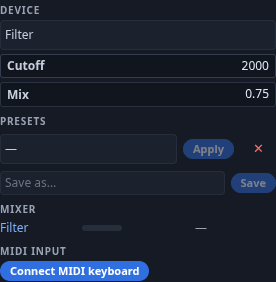
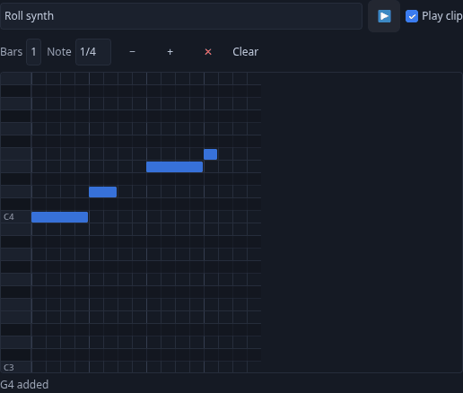

# Music Playground

Instruments, effects and speakers are **devices**: ordinary scene objects that carry a device
document (`userData.device = {kind, params}`) and a WebAudio subgraph the engine builds for
them. Because a device is an object, it replicates, saves, undoes and duplicates like any other
object - move it and it sounds from where it stands.

## Devices come from modules

Core ships the engine, the clock, the cables and the interfaces; the instruments come from
modules. Install **Music Lab** (a Piano, a Speaker, a Transport, a Drum machine, Sampler pads),
**Music FX** (a mixer and five pedals), **Music DJ** (two decks and a crossfader) and
**Music Voice** (a mic, a looper, a synth, a theremin) from the Modules manager; every player
in a room needs the module a scene uses, and a scene asks for them by name when you load it.
The sidebar's module rows add demo rigs; the viewport's Add menu lists every device kind
under **Add ▸ Devices** (a module that groups its kinds gets its own row, *Devices: Music
Voice*).

A scene remembers which module each device came from. Open one on a machine that lacks the
module and a dialog, **This scene uses modules**, lists what is *Not installed* or
*Switched off* and offers **Install (n)**, **Enable (n)** or **Load anyway** — installing is
per machine, so every player does it once. Load anyway keeps the devices as silent
placeholders with their settings intact; they wake up the moment the module is installed.

## Cables

Sound goes nowhere until it is **cabled**. Every device has plugs on its back; click an output
plug, then an input plug (desktop, in Play mode or the editor) or drag with the trigger (VR)
to run a cable. A speaker is the only thing that reaches the room: cable an instrument into a
speaker, or through a pedal chain and a mixer into a speaker. Unplug it and it is silent.

**Moving or unplugging a cable.** On the desktop, click an input that already has a cable: you pick that cable up (a
toast reminds you of the three ways out). Click another input to move it there, click the same input again to unplug
it, or press <kbd>Esc</kbd> to put it back. In VR, press on a plugged input to pick its cable up; drop it on another
input to move it, or on nothing to unplug it.
Cables are part of the scene - they replicate, undo, save with the scene, and a prefab of a rig
brings its cables with it.

## Knobs, the toolbox and the Inspector

Every device declares its parameters; they show as knobs in VR (grab and turn), in the
**Music** toolbox and in the Inspector's **Device** section. A knob turn or a fader drag is
one undo step, however long the gesture, and peers hear it move while you turn it.
Frequency knobs such as the filter **Cutoff** (Music FX, the Music Voice synth) move evenly through the low, middle and
high ranges — each octave gets the same travel — instead of crowding the low end into the first few pixels.

The **Music** toolbox appears in the sidebar under **Modules** as soon as any device kind
is registered (also on the viewport menu under **Module tools**). It has three parts:

- **Device** — pick any device in the scene and edit its parameters.
- **Presets** — **Save as…** the current settings under a name, **Apply** one later, **✕**
  deletes. Presets are kept per device kind in *your* browser; applying one is what
  replicates.
- **Mixer** — one row per device with a level meter, a fader, **M** (mute) and **S**
  (solo). A device with no level parameter and no outgoing cable shows a dash. Mute and
  solo are yours alone; the level they set is shared.

The Inspector's **Device** section shows the same parameters for the selection. With
several devices selected it says *Applies to N selected devices* and a change fans across
all of them as one undo step; a device that lacks that parameter is skipped. **Open in
Music toolbox** jumps across — presets and the mixer live there.

## The shared transport

One **transport** per scene - tempo, play/stop, swing, bars per loop - shared by every peer.
The Transport device is its face; the drum machine, the looper and anything scheduled on it
run from the same beat, so every peer's kick lands on the same beat and a late joiner starts
on the next one. Nothing is streamed during playback: each peer schedules the same pattern
from the same document through a look-ahead scheduler.

## Play from a MIDI keyboard

A USB or Bluetooth MIDI keyboard or pad controller plays the devices in your scene — the piano, the synth, sampler
pads, drum pads — and **everyone in the session hears it**, through the same notes a click on a key sends. Web MIDI
works in Chrome and Edge (desktop and Android); other browsers say so in the row.

1. Open the **Music** toolbox and scroll to **MIDI input** at the bottom.
2. Press **Connect MIDI keyboard**. The row says what will happen, then **Allow MIDI** asks your browser. Nothing is
   asked until you press it, and the browser asks only once; the next time you open the app it reconnects quietly.
3. Play. The row lists your connected keyboards and the last note.

**Play on** picks the device your keys play; by default it is the last music device you selected. The choice is yours
alone, so two people with two keyboards can play two instruments. On the piano and the synth a key **holds its note
while you hold it down**, and the **sustain pedal** works; other devices play their usual note length.
**Disconnect** stops listening, and the app remembers it. If you said no to the browser, the row explains how to allow
MIDI again in the site settings (the icon at the left of the address bar); then press **Try again**.

## The piano roll

Every device that plays notes has a **piano roll**: a looping clip of **1, 2, 4 or 8 bars** drawn on a grid. Open it
from the Inspector (select the device ▸ **Device** ▸ **Piano roll**) or from the Music toolbox (**Piano roll…**); on a
phone it opens as a bottom sheet.

- **Click** an empty cell to add a note of the length in **Note**. **Drag** a note to move it, drag its **right
  edge** to make it longer, and **double-click** or **right-click** it to remove it. On a phone, tap to add; a swipe
  scrolls without adding.
- From the keyboard: <kbd>Enter</kbd> adds a note (after the selected one, or middle C on beat 1), the **arrow keys**
  move the selection (<kbd>Shift</kbd> moves a beat or an octave, <kbd>Alt</kbd>+<kbd>←</kbd>/<kbd>→</kbd> changes
  its length) and <kbd>Delete</kbd> removes it.
- **Bars** sets the clip length, **−** / **+** shift the visible octave, **Clear** empties the clip and **Play clip**
  switches it on or off without deleting it. **▶** starts the shared transport.

The clip plays with the [shared transport](#the-shared-transport): every screen plays it in time on its own, nothing is
streamed while it plays. It belongs to the device, so it saves with the scene, comes back with a prefab, reaches someone
who joins later, and every edit is one undo step that everyone sees.

## Automation from the flow graph

The **Music** group of flow nodes drives devices from graphs: *Device Param* writes a
parameter every frame (an LFO on a filter), *Device Level* reads a live level, *Transport*
reads the beat, and *Note Trigger* plays a note per pulse - so an On Impact sensor can fire a
drum, or a Time node can sweep a cutoff. The rule behind all of it: anything a graph computes
or the transport schedules must be a **pure** function of its inputs, because every peer
computes it alone; an impure callback desyncs silently, with no error anywhere. See
[Flow Nodes](nodes.md) for the full list.

## Recording and samples

**Record.** The Mic device (Music Voice) captures the raw microphone — a separate capture
from voice chat, with no noise suppression and never gated by push-to-talk — so the browser
asks for the microphone once more the first time (*Microphone permission denied* if you
refuse). Click the red button on the Mic to record a take of its **Take length**; click again
to stop early. The take lands at the root of your Explorer as an audio item (`mic-…`), shared
to every peer by content hash, with a *Recorded …* toast. A take is at most 120 s, and one
that would exceed the sharing limit is refused before it starts.

**Sample.** Drag any audio item from the Explorer — a take, a file you imported, a one-shot
from the **Music Lab Kit** pack — onto a sampler pad or a DJ deck to load it there; the toast
names the pad it landed on. The **Music Lab Kit** pack in Packs is a CC0 starting library of
drum one-shots and loops.

**Bounce.** The Looper records whatever is cabled into it, quantized to bar boundaries: click
its red button and the take starts on the next bar and runs for **Bars**. The loop is an
audio item like a take (`loop-…`), and because the looper references it by hash the Scene
manifest carries it — an exported `.tpscene` bundles its samples along with everything else.

## Building a room

The **Jam Room** game in **Templates ▸ Games** — a piano into a speaker, a beat lab and a
pedal chain into a mixer, all cabled — offers to install Music Lab and Music FX when you load
it. Press **Start**, then ▶ on the Transport, and keep the band going for eight bars; your best
tempo is saved on this device. To build your own, add devices from the module rows and cable
them yourself. Save any rig as a **prefab** - it comes back cabled - and drop it into the next
scene.
