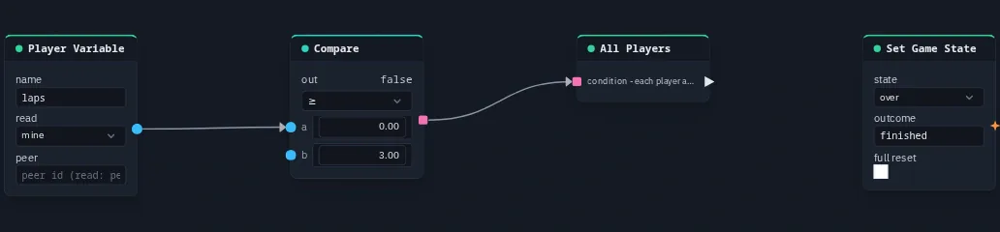

# All Players

Fires a pulse once **every player in Play** answers yes to a condition — the group gate that
makes sure nobody is left behind ("everyone is at the portal", "everyone has three laps").

**Output:** event — wire it into a [Travel to scene](travel.md) node's trigger,
a [Set Game State](setgamestate.md), or anything else a pulse drives

## Inputs

| Handle | Type | Meaning |
|---|---|---|
| condition | boolean | each player answers for themselves — a [Compare](compare.md), a [Latch](latch.md), anything true/false |

Unwired, the answer is no, and the node never fires.

## Who counts

- Each player's copy of the graph works out the condition **for that player** and shares only
  the yes/no answer. When every player in Play says yes, every copy fires the node on its own
  (nothing extra is sent, so the pulse is not doubled).
- **Only players in Play count.** Someone sitting in the editor is a spectator: they never hold
  the group up. If nobody is in Play, nobody is ready and the node does not fire.
- It fires on the change from "not everyone" to "everyone". If one player drops back to no and
  then says yes again, it fires again.

The answer is only as personal as the condition you wire in. A per-player value such as
[Player Variable](peervariable.md) `mine` gives a real per-player answer; a shared value (a
[Get Variable](getvariable.md), a [Counter](counter.md)) is the same for everyone, so the gate then
simply fires when that shared condition comes true while somebody is playing.

## Practical example

End the race when every player has done three laps:

1. Add a **Player Variable** (name `laps`, read `mine`).
2. Add a **Compare** (op `gte`, b = 3); wire Player Variable → its **a**.
3. Add an **All Players**; wire Compare → its **condition**.
4. Add a **Set Game State** (state `over`, outcome `finished`); wire All Players → its **trigger**.

Each player's own `laps` comes from a [Set Variable](setvariable.md) with scope `player`.

{ .shot width="688" height="160" loading=lazy }
/// caption
A Player Variable (laps.
///

!!! tip
    All Players also works as a "this just came true" detector for a shared condition: a
    Compare cannot drive a trigger input directly, but Compare → All Players → Set Game State
    can (as long as someone is in Play).
