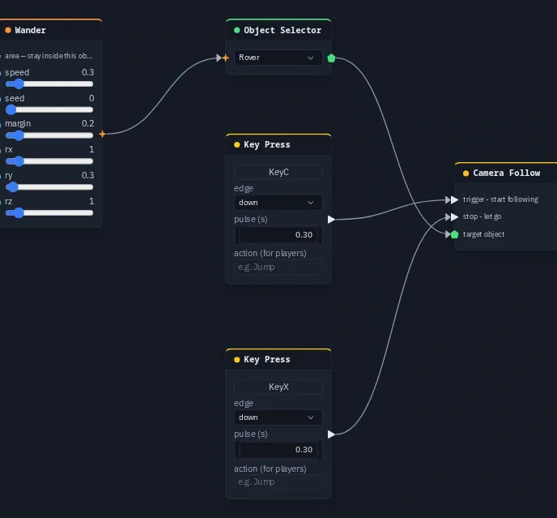

# Camera Follow

Makes your view follow an object from behind and above, as a third-person or chase view. Something else moves the
object, and the camera just keeps up.

**Output:** effect (optionally wire into an [Object Selector](objectselector.md) to pick the object)

## Inputs

| Handle | Type | Meaning |
|---|---|---|
| trigger | event | start following the target |
| stop | event | let go |
| target | object | the object to follow, from an [Object Selector](objectselector.md) |

The object is found in this order: the **target** input, then an Object Selector the node's output is wired into, then
the owner of the [object flow](../object-flows.md) the node sits in.

## Parameters

None. The framing is fixed: the view sits about 4.5 m behind the object and 2.2 m above it, turns with the object's
facing, eases after it and keeps looking at it. This is the same chase view [Possess Object](possessnode.md) uses.

## How it behaves

- It moves **your** view only. The trigger is shared, so every player's copy reacts to it and each player's view
  follows on their own screen. Nothing else is sent.
- It doesn't take the controls and doesn't move the object. Use it when something else moves the object: physics, an
  animation, a path, another player.
- While it follows, dragging to orbit the view is switched off. On **stop**, orbiting comes back, centred on where the
  object ended up.
- A new **trigger** for another object switches to that one. Following stops if the object is deleted or when you
  enter VR.
- A pulse that happened before the node was added doesn't start it.

## Practical example

Follow a wandering box with <kbd>C</kbd> and stop with <kbd>X</kbd>:

1. Create a box and name it *Rover*.
2. Add a **Wander** and an **Object Selector** that picks *Rover*. Wire Wander → Object Selector so the box drifts
   around.
3. Add a **Camera Follow** and wire the same Object Selector into its **target**.
4. Add a **Key Press** on <kbd>C</kbd> into **trigger** and a **Key Press** on <kbd>X</kbd> into **stop**.
5. Press <kbd>C</kbd>: the view swings in behind the rover and follows it. Press <kbd>X</kbd> to let go.

{ .shot .fade-l .fade-r width="688" height="639" loading=lazy }
/// caption
A Wander moving the Rover through an Object Selector.
///

!!! tip
    Camera Follow moves the player's own view. To move a camera **object** (a chase camera you can cut to, with an
    offset and damping you choose), use [Camera Rig](camerarig.md).
