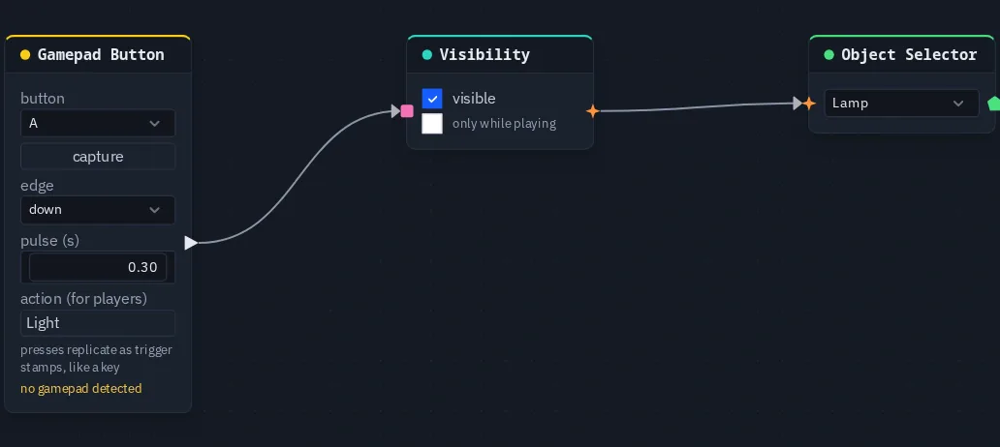

# Gamepad Button

Fires a pulse, or holds a level, while a gamepad button is pressed. It's the gamepad's counterpart of
[Key Press](keypress.md).

**Output:** event (1 while the button is held, a short pulse per press; 0 otherwise)

## Inputs

None.

## Parameters

| Parameter | Default | Options |
|---|---|---|
| button | A | the button to watch (see below). Pick it from the list, or press **capture** on the card and then the button |
| edge | down | `down`: pulses on press, and stays at 1 while held. `up`: pulses on release. `held`: the same as down, read as a level |
| pulse | 0.3 s | how long a single press keeps the output at 1 |
| action (for players) | empty | a name such as `Jump`. The button appears under it in the player's **Controls** list |

The buttons follow the standard gamepad layout:

| Button | Where it is |
|---|---|
| A, B, X, Y | the four face buttons: bottom, right, left, top (Cross, Circle, Square, Triangle on a PlayStation pad) |
| L1, R1 | the shoulder buttons |
| L2, R2 | the triggers. They count as pressed past halfway |
| Select, Start | the two small centre buttons |
| L3, R3 | pressing a stick in |
| Up, Down, Left, Right | the d-pad |

The card shows **no gamepad detected** while no pad is connected. You can still pick a button from the list without a
pad.

## How it behaves

It works the way Key Press does. Each press travels as one small shared message, so every player's graph sees the same
pulse, and **anyone's** button press fires the node. Holding the button re-pulses it, so the output stays at 1 for as
long as it is down (except with edge `up`, which waits for the release).

A gamepad and the keyboard never fire each other's nodes: a Key Press can't be fired by a pad, and a Gamepad Button
can't be fired by a key. To accept both, wire a Key Press and a Gamepad Button into the same input. Two event wires into
one input fire on either.

The pad goes quiet when it is switched off under **Settings ▸ Input**, when it is unplugged, and while an app dialog is
open.

A gamepad already works in a scene with no gamepad nodes: the left stick moves, the right stick looks, and the d-pad and
**A** move through and press HUD buttons. Gamepad Button is for a game that wants buttons of its own. Stick deadzone,
look sensitivity, invert-Y and swapping the sticks are the player's own settings under **Settings ▸ Input** (see
[A character that walks](../build-a-game.md#3-a-character-that-walks)).

### Players can move it

Fill in **action (for players)** and the button appears under that name in the game menu's Accessibility ▸
**Controls** list. A player can move it to any other button there, and the node follows their choice. See
[Making your game accessible](../making-your-game-accessible.md#controls).

## Practical example

A lamp that shows while <kbd>A</kbd> is held:

1. Create a sphere and name it *Lamp*.
2. Add a **Gamepad Button** (button **A**, action `Light`).
3. Wire it into a **Visibility** node's **on** input, and wire Visibility → an **Object Selector** that picks *Lamp*.
4. Hold **A** on the pad: the lamp appears on every player's screen, and it hides again when you let go.

{ .shot width="688" height="308" loading=lazy }
/// caption
A Gamepad Button on A wired into the on input of a Visibility node.
///

!!! tip
    For a stick, use [Gamepad Axis](gamepadaxis.md). It gives a number instead of a pulse.
