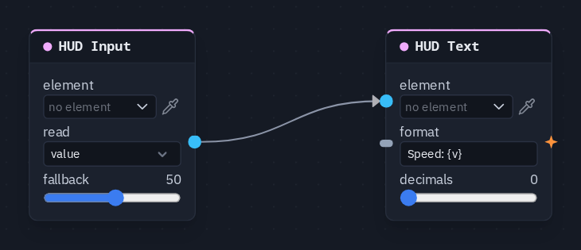

# HUD Input

Reads a HUD input element — what the player typed, picked, dragged or switched — as a value for the graph.

**Output:** number (or text, when **read** is `text`)

## Inputs

None — it reads its element.

## Parameters

| Parameter | Default | Options |
|---|---|---|
| element | (none) | the Slider, Toggle, Dropdown, Text field or Tabs to read — see below |
| read | value | what to read from it — see the table below |
| fallback | 0 | −1000 to 1000 — what it reads while the control has no value yet |

| read | Gives |
|---|---|
| `value` | the control's number: a slider's position, a toggle as 1 or 0, the selected tab |
| `index` | a dropdown's position in its option list, counting from 0 (a Tabs element gives its selected tab); a choice that is not in the list reads **fallback** |
| `text` | the value as text: what was typed into a text field, a dropdown's chosen option |
| `on` | 1 when on (a toggle that is on, or any number above 0), else 0 |

`index` is what a [Switcher](switcher.md) wants; `on` can feed a [Gate](gate.md) or a Visibility node.

## The fallback

The node reads **fallback** until the control actually holds a value — until the player first moves it, or a
[HUD Set Input](hudset.md) writes it. The start value set on the element in the HUD editor is what the player *sees*,
but it is not what this node reads before then. Set **fallback** to the same number as the control's start value.
Loading a scene clears every control's value, so the fallback applies again.

## Mine or everyone's

Each input element has a **shared** switch in the HUD editor:

- **off** (the default) — the value is each player's own. Every player's HUD Input reads their own control, so anything
  it drives can differ per player: a volume slider changes only your volume.
- **on** — one value for everyone; a change by any player reaches all of them, including players who join later. Use
  it for a host setting such as the difficulty.

## Picking the element

The control is made, placed and styled in the [HUD editor](../hud-editor.md#element-kinds). On the card, **element**
opens the scene HUD's elements grouped by screen; the pipette button lets you click the element on the HUD editor's
stage instead, and **Enter id manually...** takes a typed id. A name that matches no element shows amber.

Quicker: select the control in the HUD editor and choose **Actions ▸ Read its value**, **Read which option** or **Read
its text** — each adds this node, already pointing at it, with **read** set to match.

## Practical example

A speed slider with a readout:

1. In the HUD editor, add a **Slider** (min 0, max 100, start value 50) and a **Text** element.
2. Add a **HUD Input** picking the slider, read `value`, **fallback** 50.
3. Add a **HUD Text** picking the text, format `Speed: {v}`; wire HUD Input → HUD Text's **value**.
4. Press Play and drag the slider: the text follows — on your screen only, because the slider is not shared.

!!! tip
    To let a press read the control at that moment, wire the HUD Input into the **value** of the node the press drives
    — a [Store Value](storevalue.md) behind a **Save** button keeps the player's setting on their device.
