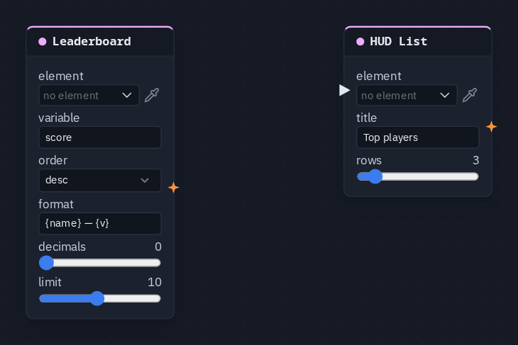

# HUD List

Names a HUD List element and sets its title and how many rows it shows — an inventory, objectives, the players. The
rows themselves are written into the list by a [HUD Rows](hudrows.md) node, a [Leaderboard](leaderboard.md), a module,
or typed on the element in the HUD editor.

**Output:** none (it writes into its element)

## Inputs

| Handle | Type | Meaning |
|---|---|---|
| trigger | event | on the card, but the node does not use it — the title and row count apply all the time |

## Parameters

| Parameter | Default | Options |
|---|---|---|
| element | (none) | the List element — see below |
| title | (empty) | a line shown above the rows; empty shows no title |
| rows | 5 | 1–20 — how many rows the list shows |

## Where the rows come from

A list is written **into**, it is not a value that flows along a wire — there is no list socket. The rows on screen are,
in order of preference:

1. rows pushed in by a [HUD Rows](hudrows.md) node, a [Leaderboard](leaderboard.md) or a module;
2. otherwise the rows typed on the element in the HUD editor (one per line).

The list shows the **first** rows it holds, up to **rows**. Without a HUD List node naming the element, the element's
own **max rows** setting is the limit instead.

## Picking the element

The **List** element is made, placed and styled in the [HUD editor](../hud-editor.md#element-kinds). On the card,
**element** opens the scene HUD's elements grouped by screen; the pipette button lets you click the element on the HUD
editor's stage instead, and **Enter id manually...** takes a typed id. A name that matches no element shows amber.

## Practical example

A titled top-three:

1. In the HUD editor, add a **List** element.
2. Add a **Leaderboard** picking the list (variable `score`) — it fills the rows, one per player.
3. Add a **HUD List** picking the same list, title `Top players`, rows 3.
4. Press Play: the list shows *Top players* and the three highest scores. Nothing needs wiring between the two nodes;
   they meet at the element.

