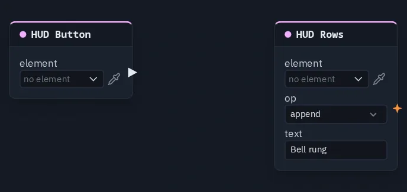

# HUD Rows

Appends, replaces or clears rows in a HUD List element on a pulse — a log, a chat, a scoreboard feed.

**Output:** none (it writes into its element)

## Inputs

| Handle | Type | Meaning |
|---|---|---|
| trigger | event | each pulse applies **op** once |
| text | number | the row to write — a number, or text from a source that gives text (a player's name). Unwired, the card's **text** is used |

## Parameters

| Parameter | Default | Options |
|---|---|---|
| element | (none) | the List element to write into — see below |
| op | append | `append` (add the row at the end), `set` (replace every row with this one), `clear` (empty the list) |
| text | (empty) | the row when nothing is wired into **text** — a fixed line such as `GAME OVER` |

!!! warning "Known problem in 1.42"
    The card does not draw its **trigger** and **text** sockets yet, so this node cannot be wired in the node editor.
    For a list that fills itself from per-player numbers, use a [Leaderboard](leaderboard.md); for fixed rows, type them
    on the List element in the HUD editor.

## How the rows behave

- **Once per pulse.** The node acts when a new pulse arrives, never every frame, so `append` adds one row per press.
- **Everyone holds the same rows** with nothing extra sent: every player's machine runs the same pulses in the same order.
- **Late joiners** do not see rows appended before they arrived — they start from the rows typed on the element. A
  list that must be right for a joiner should be rebuilt with `set`, or be a [Leaderboard](leaderboard.md).
- **The list shows its first rows.** It holds up to 64, but shows only as many as its row limit (the
  [HUD List](hudlist.md) node's **rows**, else the element's **max rows**). Once the list is full, newer appends are
  kept but not shown — `clear` or `set` to start over.
- **`clear` empties the pushed rows**, so an element with rows typed on it in the HUD editor shows those again.

## Picking the element

The **List** element is made, placed and styled in the [HUD editor](../hud-editor.md#element-kinds). On the card,
**element** opens the scene HUD's elements grouped by screen; the pipette button lets you click the element on the HUD
editor's stage instead, and **Enter id manually...** takes a typed id. A name that matches no element shows amber.

## Practical example

A press log:

1. In the HUD editor, add a **Button** and a **List** element.
2. Add a **HUD Button** picking the button, and a **HUD Rows** picking the list, op `append`, text `Bell rung`.
3. Wire HUD Button → HUD Rows' **trigger**.
4. Each press adds a *Bell rung* row to the list, on every player's screen.

{ .shot width="688" height="325" loading=lazy }
/// caption
The example's nodes.
///
