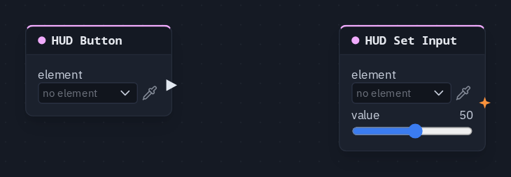

# HUD Set Input

Writes a value into a HUD input element when a pulse arrives — to prefill, clear or correct it: a **Reset** button
that puts the volume back, a difficulty the host sets.

**Output:** none (it writes into its element)

## Inputs

| Handle | Type | Meaning |
|---|---|---|
| trigger | event | each pulse writes the value once |
| value | number | the value to write — wired, it replaces the card's **value**; text works too, for a text field |
| options | number | a comma-separated list (`Easy, Normal, Hard`) that replaces a dropdown's own options while it is wired |

## Parameters

| Parameter | Default | Options |
|---|---|---|
| element | (none) | the Slider, Toggle, Dropdown, Text field or Tabs to write into — see below |
| value | 0 | −1000 to 1000 |

!!! warning "Known problem in 1.42"
    The card does not draw its **trigger**, **value** and **options** sockets yet, so this node cannot be wired in the
    node editor.

## How the write behaves

- **Once per pulse**, never every frame — so it never fights the player's own hand on the control.
- **As if the player had set it.** A [HUD Input](hudinput.md) reading the control sees the new value, and the element's
  **shared** switch decides whether it travels: shared, everyone gets the value; not shared, it stays on each machine.
- **The pulse decides who.** The node runs on every player's machine when its pulse arrives, and a HUD Button press or
  a Key Press is a shared pulse — so a Reset button resets the control on **every** player's screen, even a control
  that is not shared.
- **Late joiners** are not re-sent a press from before they arrived; a shared control's current value reaches them on
  its own.
- The pulse also **pokes** the element: aimed at a **Damage flash**, it makes the screen flash.

## Live dropdown options

With something wired into **options**, the dropdown offers that list instead of the options typed in the HUD editor,
and it follows the list as it changes — no pulse needed. A HUD Input reading `index` counts in the live list. Delete
the node and the typed options come back.

## Picking the element

The control is made, placed and styled in the [HUD editor](../hud-editor.md#element-kinds). On the card, **element**
opens the scene HUD's elements grouped by screen; the pipette button lets you click the element on the HUD editor's
stage instead, and **Enter id manually...** takes a typed id. A name that matches no element shows amber.

## Practical example

A Reset button for a volume slider:

1. In the HUD editor, add a **Slider** (start value 50) and a **Button** labelled *Reset*.
2. Add a **HUD Button** picking the button, and a **HUD Set Input** picking the slider, value 50.
3. Wire HUD Button → HUD Set Input's **trigger**.
4. Drag the slider, then press *Reset*: it jumps back to 50.

