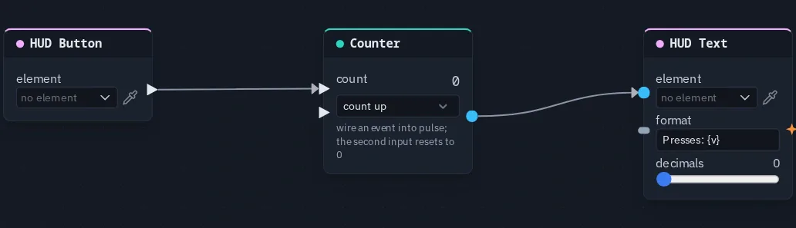

# HUD Text

Writes a number into a HUD text element through a format such as `Gems: {v}` — a score, a count, a readout.

**Output:** none (it writes into its element)

## Inputs

| Handle | Type | Meaning |
|---|---|---|
| value | number | the number to show — wire a [Counter](counter.md), a [Get Variable](getvariable.md), a Math node |
| format | any | wire text here to replace the whole format — a Behaviour's status line, a [Stored Value](storedvalue.md) read as text |

## Parameters

| Parameter | Default | Options |
|---|---|---|
| element | (none) | the HUD element to write into — see below |
| format | `{v}` | the text to show; `{v}` is replaced by the number, so `Gems: {v}` reads *Gems: 3*. Text without `{v}` is shown as typed; an empty format shows just the number |
| decimals | 0 | 0–4 digits after the point |

The score display needs nothing else: **Counter → HUD Text** is a live score, because the Counter already counts the
shared pulses.

## Picking the element

The node does not draw anything itself. The element — a **Text**, or anything else that shows a line of text (Rich
text, Key hint, Scroll panel, a Timer) — is made, placed and styled in the [HUD editor](../hud-editor.md#element-kinds).
On the card, **element** opens the scene HUD's elements grouped by screen; the pipette button lets you click the
element on the HUD editor's stage instead, and **Enter id manually...** takes a typed id. A name that matches no
element shows amber.

The quicker route is the other way round: select a Text element in the HUD editor and use **Actions** — **Show a
variable**, **Show a counter** or **Just show text** each build this node already pointing at it.

The text the node writes replaces the element's own label while the game runs; the label typed in the HUD editor is the
preview. The card shows what the element is showing right now. Updates reach the screen about ten times a second.

## Who sees what

Every player's machine works the text out from the same graph, so a shared source (a Counter, a Get Variable) shows the
same text to everyone, including players who join later. A per-player source — a [HUD Input](hudinput.md) on a local
control, a [Player Variable](peervariable.md) reading `mine` — shows each player their own number.

## Practical example

A button that counts its own presses:

1. In the HUD editor, add a **Button** and a **Text** element.
2. Add a **HUD Button** picking the button, a **Counter** and a **HUD Text** picking the text.
3. Wire HUD Button → Counter's **pulse**, and Counter → HUD Text's **value**.
4. Set the format to `Presses: {v}`. Press Play and click the button: the text counts up, for every player.

{ .shot width="688" height="198" loading=lazy }
/// caption
A HUD Button wired into a Counter.
///

!!! tip
    One HUD Text per element. Two nodes writing the same element fight over it, and the last one in the graph wins.
