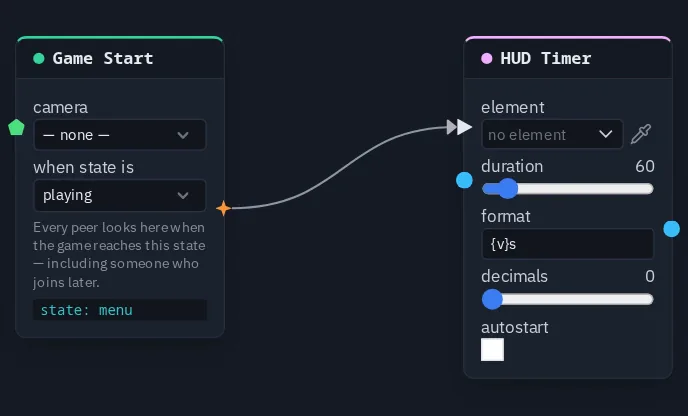

# HUD Timer

Runs a countdown in a HUD Timer element from its duration, formatted like `{v}s` — it starts by itself or on a pulse.

**Output:** number (the seconds left)

## Inputs

| Handle | Type | Meaning |
|---|---|---|
| start | event | a pulse starts (or restarts) the countdown from the full duration |
| duration | number | the length in seconds — wired, it replaces the card's **duration** |

## Parameters

| Parameter | Default | Options |
|---|---|---|
| element | (none) | the Timer element to write into — see below |
| duration | 60 | 1–600 seconds |
| format | `{v}` | `{v}` is replaced by the seconds left, so `{v}s` reads *42s* |
| decimals | 0 | 0–2 digits after the point |
| autostart | on | count down with no pulse; off, the timer holds at the full duration until a pulse arrives on **start** |

The countdown is worked out from the shared time stamp of the pulse that started it, so every player reads the same
time left with nothing extra sent, and it stops at 0. The output is the same number, so a
[Compare](compare.md) on it can end the round when it reaches 0.

## Picking the element

The **Timer** element is made, placed and styled in the [HUD editor](../hud-editor.md#element-kinds); the **duration**
on the element is only a preview, this node owns the real one. On the card, **element** opens the scene HUD's elements
grouped by screen; the pipette button lets you click the element on the HUD editor's stage instead, and **Enter id
manually...** takes a typed id. A name that matches no element shows amber.

!!! warning "Known problem in 1.42"
    A pulse wired into **start** is not picked up yet. A timer with **autostart** off therefore stays at its full
    duration, and one with **autostart** on reads 0. Until that is fixed, show a round clock with a
    [Game Time](gametime.md) node (read `remaining`, length 60) wired into the **value** of a [HUD Text](hudtext.md)
    that points at the same Timer element — HUD Text takes the same `{v}s` format.

## Practical example

A one-minute round clock, as the node is meant to be used:

1. In the HUD editor, add a **Timer** element to the playing screen.
2. Add a **Game Start** and a **HUD Timer** picking the Timer element; wire Game Start → HUD Timer's **start**.
3. Set duration 60, format `{v}s`, and turn **autostart** off.
4. Every round, the clock counts down from 60s on every player's screen.

{ .shot width="688" height="416" loading=lazy }
/// caption
A Game Start wired into a HUD Timer's start.
///
