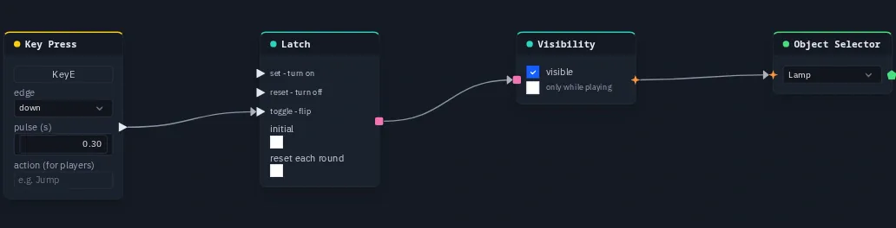

# Latch

Holds a boolean until told otherwise — **set**, **reset** and **toggle** pulses make it a memory bit. Every trigger in
the graph is a short pulse; a Latch is how a pulse becomes something that *stays*: a door that stays open, a gem that
stays collected, a light that stays on.

**Output:** boolean (true after a set, false after a reset)

## Inputs

| Handle | Type | Meaning |
|---|---|---|
| set | event | a pulse turns it on (true) |
| reset | event | a pulse turns it off (false) |
| toggle | event | a pulse flips it |

## Parameters

| Parameter | Default | Options |
|---|---|---|
| initial | off | what it reads before anything has set or reset it (toggles flip from this value) |
| reset each round | off | forget every set, reset and toggle from earlier rounds — see below |

## How it decides

- **Set and reset: the most recent one wins.** The Latch compares *when* its last set and its last reset arrived. If both
  arrive at the same instant it reads as set.
- **Toggle** flips whatever set/reset says. A set or reset starts the flipping over, so `set` after any number of
  toggles always reads true.

The pulses come from the shared trigger log every player already has, so all players read the same value with nothing
extra sent. A player who **joins later** is caught up on that log: set and reset are exact for them. Toggle is the one
part that can be off — the number of flips is copied from another player rather than worked out — until the next set
or reset puts everyone back in step. Prefer **set** / **reset** in a multiplayer game when it matters.

## Reset each round

With **reset each round** on, a set, reset or toggle from an earlier round counts as never having happened, so the
Latch falls back to **initial** when a new round starts — and also while the game is on its menu or the round is over.
That is how a collected gem comes back next round with no reset wire to draw and nothing to send.

It only takes effect once the scene's game has been started at least once (see
[Build a game](../build-a-game.md)); in a scene without a game the Latch behaves as if the option were off. Off is the
default, so a Latch in a graph without a game never changes because somebody pressed Start.

## Practical example

A lamp you switch with a key:

1. Add a **Key Press** (capture <kbd>E</kbd>) and a **Latch**; wire Key Press → Latch's **toggle**.
2. Add a **Visibility** node; wire Latch → its **on**.
3. Add an **Object Selector** picking the lamp; wire Visibility → Object Selector.
4. Press Play and tap <kbd>E</kbd>: the lamp appears, tap again and it is gone — for every player.

{ .shot width="688" height="176" loading=lazy }
/// caption
A Key Press wired into a Latch's toggle.
///

!!! tip
    For "hide it once it is picked up", wire the pickup's pulse into **reset** with **initial** on, and turn on
    **reset each round** so the pickup returns every round. A [Store Value](storevalue.md) keeps a result after the
    round ends — a round-scoped Latch reads **initial** again the moment the round is over.
