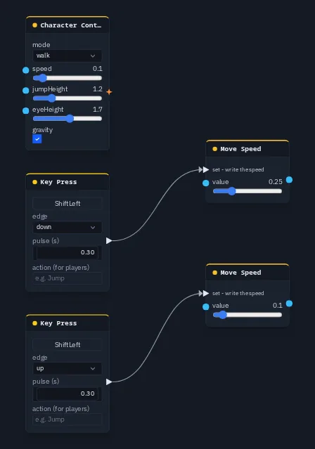

# Move Speed

Reads the player's movement speed, and sets a new one when a pulse arrives. Use it for sprint, mud or slow motion.

**Output:** number (the movement speed in force right now)

## Inputs

| Handle | Type | Meaning |
|---|---|---|
| set | event | on each pulse, write **value** as the new movement speed |
| value | number | the speed to write; overrides the card slider when wired |

## Parameters

| Parameter | Default | Options |
|---|---|---|
| value | 0.1 | 0.01 – 1: distance per frame (0.1 is about 6 m/s at 60 fps) |

## Which speed is in force

One speed moves the player, and every Move Speed node reads that same number:

1. the last speed **written**, by a Move Speed's **set** pulse or by the scroll wheel in Play;
2. otherwise the [Character Controller](charcontroller.md)'s **speed**;
3. otherwise this card's **value**.

A written speed stays until something writes again. Nothing on the card has to stay wired. Changing the Character
Controller's **speed**, or deleting the controller, clears the written speed. Written speeds are kept between 0.001 and
100.

The units are the Character Controller's: distance per frame, the number the scroll wheel has always changed. Each
scroll notch multiplies the speed by a fixed step, so the readout follows the wheel.

### Multiplayer

The **set** pulse is shared, so a set changes the speed for every player, each on their own machine. The scroll wheel
is local: it changes only your own speed, and only your own Move Speed readouts show it.

## Practical example

Hold <kbd>Shift</kbd> to sprint:

1. Add a [Character Controller](charcontroller.md) and set **mode** to `walk`.
2. Add a **Key Press** (capture <kbd>Shift</kbd>, edge `down`) and a **Move Speed** with **value** 0.25. Wire the Key
   Press into Move Speed's **set**.
3. Add a second **Key Press** (capture <kbd>Shift</kbd>, edge `up`) and a second **Move Speed** with **value** 0.1.
   Wire them the same way.
4. Press **Play**: holding <kbd>Shift</kbd> walks fast, and letting go walks at the normal speed.

{ .shot width="448" height="639" loading=lazy }
/// caption
Two Key Press nodes on Shift.
///

!!! tip
    A Key Press fires for **anyone's** key, so in a multiplayer game this sprint is shared: one player's <kbd>Shift</kbd>
    speeds everybody up. For a per-player sprint, use the controller's
    [Player code](../code-workspace.md#the-players-code), which reads each player's own keys.
