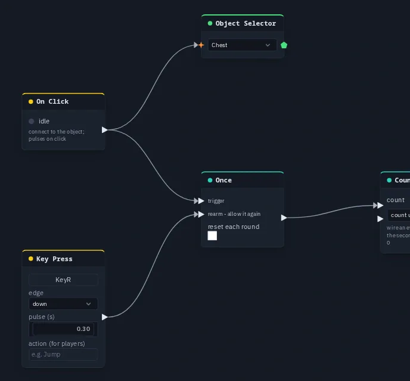

# Once

Lets exactly one pulse through until it is re-armed — a checkpoint, a pickup, a first-time event.

**Output:** event (one pulse, at the moment of the first trigger)

## Inputs

| Handle | Type | Meaning |
|---|---|---|
| trigger | event | the first pulse here passes; every later one is ignored |
| rearm | event | lets the next trigger through again |

## Parameters

| Parameter | Default | Options |
|---|---|---|
| reset each round | off | re-arm by itself at the start of every round — see below |
| pulse | 0.3 | how long the output pulse lasts, in seconds (in the **ⓘ Params** tab, not on the card) |

## How it behaves

- The **first** trigger is remembered and comes out as one pulse. Every trigger after that — from anyone — is ignored
  while the Once is spent.
- **Rearm** forgets that first trigger: the Once is ready again and the next trigger passes.
- All players work this out from the same shared trigger, so they agree on which press was first with nothing extra
  sent. A player who **joins later** is told the Once is already spent, so a door opened before they arrived stays open
  for them and does not fire again.

## Reset each round

With **reset each round** on, a Once spent in an earlier round counts as armed again when a new round starts — a
collectible counts once **per round**. Between rounds (game menu, round over) a round-scoped Once lets nothing through,
and a press there does not re-arm it.

It only takes effect once the scene's game has been started at least once (see [Build a game](../build-a-game.md)); in a
scene without a game it behaves as if the option were off.

## Practical example

A treasure chest that pays out only once:

1. Add an **On Click** and an **Object Selector** picking the chest; wire On Click → Object Selector.
2. Add a **Once**; wire On Click → Once's **trigger**.
3. Add a **Counter**; wire Once → Counter's **pulse**.
4. Add a **Key Press** (capture <kbd>R</kbd>); wire it → Once's **rearm**.
5. Press Play and click the chest a few times: the Counter reads 1. Press <kbd>R</kbd> and the next click counts again.

{ .shot .fade-r width="688" height="639" loading=lazy }
/// caption
On Click on the chest feeding a Once.
///

!!! tip
    Once is the opposite of a [Latch](latch.md): a Latch *holds* a value, a Once *passes* a single pulse. For a pickup
    that should both count once and disappear, wire the same pulse into a Once (for the score) and a Latch (for the
    visibility).
