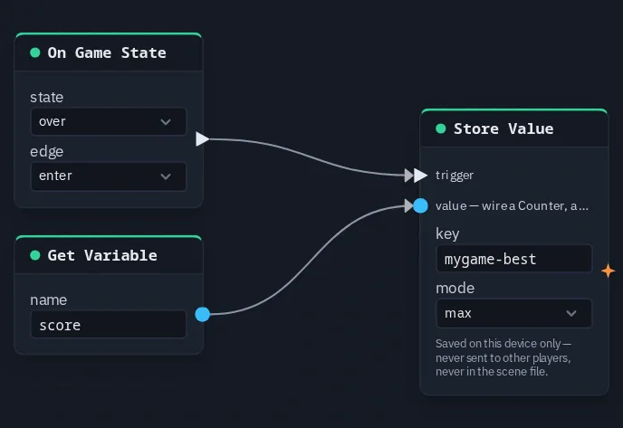

# On Game State

Fires a pulse when the shared game state becomes the one you pick — the hook for "when the round
starts" or "when the game is over". With **edge** `exit` it fires when the game *leaves* that
state instead.

**Output:** event — 1 for a short moment (0.3 s) after the change, otherwise 0

## Parameters

| Parameter | Default | Options |
|---|---|---|
| state | playing | `menu`, `playing`, `paused`, `over` |
| edge | enter | `enter` (the game switched **to** this state), `exit` (it switched **away** from it) |

## How it fires

The game state itself is shared (see [Set Game State](setgamestate.md)). Each player's copy of the
graph watches it and pulses this node on its own when the state changes. The pulse itself is
never sent over the network, so each player gets exactly one pulse per change.

- **Resuming counts as entering `playing`.** `paused` → `playing` fires `playing` / `enter` just
  like a fresh start does. If something must happen only at the start of a new round, drive it
  from the Start button's own pulse instead.
- **It is not a replay.** A player who joins mid-round receives the current state, not the
  pulses they missed. Anything that has to be right for a late arrival — which screen shows,
  which camera you look through — is better bound to the state itself: a HUD screen's **while**
  setting ([HUD Editor](../hud-editor.md)), a [Game Start](gamestart.md) node, or
  [Game Time](gametime.md) `playing`.

## Practical example

Keep each player's best score when a game ends:

1. Add an **On Game State** with state `over`, edge `enter`.
2. Add a **Store Value** (key `mygame-best`, mode `max`); wire On Game State → its **trigger**.
3. Add a **Get Variable** (name `score`); wire it → Store Value's **value**.
4. Every time the game reaches `over`, each player's device keeps the higher of its saved best
   and the final score.

{ .shot width="688" height="473" loading=lazy }
/// caption
On Game State (over) pulses a Store Value whose value comes from Get Variable score.
///

!!! tip
    Wired into a number input, On Game State reads 1 for the moment after the change and 0
    otherwise, just like [On Click](onclick.md).
