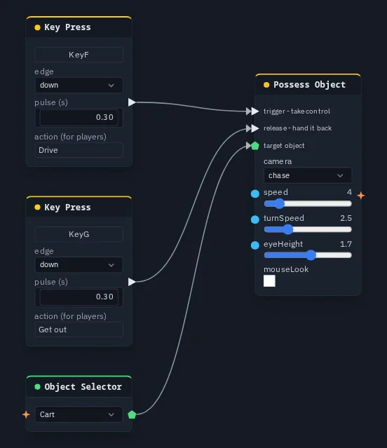

# Possess Object

Puts the player in control of an object when a pulse arrives: a vehicle, a turret, a ball. A second input hands it
back.

**Output:** effect (optionally wire into an [Object Selector](objectselector.md) to pick the object)

## Inputs

| Handle | Type | Meaning |
|---|---|---|
| trigger | event | take control of the target |
| release | event | hand it back |
| target | object | the object to drive, from an [Object Selector](objectselector.md) |
| speed, turnSpeed, eyeHeight | number | override the card sliders when wired |

The object is found in this order: the **target** input, then an Object Selector the node's output is wired into, then
the owner of the [object flow](../object-flows.md) the node sits in.

## Parameters

| Parameter | Default | Options |
|---|---|---|
| camera | chase | `chase`, `orbit`, `first`, `none` |
| speed | 4 | 0.1 – 30 m/s driving forward or back |
| turnSpeed | 2.5 | 0.1 – 10: how fast it turns, in radians per second |
| eyeHeight | 1.7 | 0.2 – 3 m above the object: the eye for the `first` camera |
| mouseLook | off | `first` camera only: the mouse turns the object and tilts the view |

| camera | What the view does |
|---|---|
| chase | sits behind and above the object, eases after it and looks at it |
| orbit | keeps orbiting around the object as it moves; drag and zoom as usual |
| first | looks out from the object, **eyeHeight** above it, facing where it faces |
| none | stays where it is |

## Driving

While you hold an object, the keys drive **it** instead of you. The controls are tank-style:
<kbd>W</kbd> / <kbd>S</kbd> (or <kbd>↑</kbd> / <kbd>↓</kbd>) drive forward and back along the way it faces, and
<kbd>A</kbd> / <kbd>D</kbd> (or <kbd>←</kbd> / <kbd>→</kbd>) turn it. In VR the left stick does the same. Your own
movement pauses until you let go.

You let go when the **release** input pulses, or when you press <kbd>Esc</kbd>. With **mouseLook** on, leaving the
pointer lock also lets go. Entering VR lets go too. If **trigger** and **release** pulse in the same moment, the
release wins. A new **trigger** while you already hold something lets go of it first.

Things worth knowing:

- Holding an object **selects** it, so other players see the usual lock highlight and can't grab it. If another
  player already has it, a message says who.
- If the object can't be found, a message says there is nothing to possess.
- The object's movement is sent to the other players about ten times a second. A physics object follows your driving
  during a running simulation and becomes physical again when you let go.
- An animation on the object pauses during the ride and carries on from where you left it.
- Letting go records the whole ride as **one** undo step.
- **mouseLook** needs a click in the page first. Without one, a message says so and you steer with
  <kbd>A</kbd> / <kbd>D</kbd> instead.

The **trigger** is shared like every pulse, so in a multiplayer session each player's copy of the graph reacts to it,
and the player who locks the object first ends up holding it. Possess Object is simplest in single-player games, or
with a trigger only one player can reach.

## Practical example

Drive a box with <kbd>F</kbd> and let go with <kbd>G</kbd>:

1. Create a box and name it *Cart*.
2. Add an **Object Selector** that picks *Cart*, and a **Possess Object**. Wire the selector into Possess Object's
   **target**.
3. Add a **Key Press** on <kbd>F</kbd> and wire it into **trigger**. Add a **Key Press** on <kbd>G</kbd> and wire it
   into **release**.
4. Press <kbd>F</kbd>: the view moves behind the cart and <kbd>W</kbd><kbd>A</kbd><kbd>S</kbd><kbd>D</kbd> drive it.
   Press <kbd>G</kbd> to hand it back.

{ .shot width="552" height="639" loading=lazy }
/// caption
Two Key Press nodes wired into the trigger and release inputs of a Possess Object.
///

!!! tip
    To have the camera follow something that moves **by itself**, such as a physics car, an animation or another
    player, use [Camera Follow](camerafollow.md) instead. It moves the view without taking the controls.
