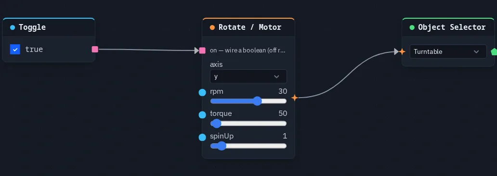

# Rotate / Motor

Turns the connected object about its own local axis — and about its [origin](../controls.md#each-objects-origin), so a
wheel turns on its hub — at a set rpm. Paddles and scoops it turns carry water from [Fluid](../fluids.md) emitters. On a
dynamic physics body during a simulation it becomes a real motor: torque-limited, so a load slows it.

**Output:** effect (wire into an [Object Selector](objectselector.md))

## Inputs

| Handle | Type | Meaning |
|---|---|---|
| on | boolean | true turns it, false stops it — off rests the object at its placed pose |
| rpm, torque, spinUp | number | override the card sliders when wired |

Unwired, **on** is true; you can also switch it in the **ⓘ Params** tab.

## Parameters

| Parameter | Default | Options |
|---|---|---|
| axis | x | `x`, `y`, `z` — the object's **own** axis, so a tilted wheel still turns about its axle |
| rpm | 10 | −120 to 120 turns per minute; negative turns the other way |
| torque | 50 | 0 to 2000 N·m — how strong the motor is (motor mode only) |
| spinUp | 1 | 0 to 10 seconds of ramp from standstill to full speed (see below) |

## Two ways of turning

**Turning (the usual case).** When the object is not a dynamic body in a running simulation, its angle comes straight
from the shared clock and the rpm. Every player sees the same angle without anything being sent, and a late joiner sees
it at the right angle at once. During a simulation the turning object still pushes the dynamic bodies it touches, and
its paddles carry particle water.

**Motor.** When the object is a **dynamic** body and a simulation is running (<kbd>P</kbd>, see
[Physics](../physics.md#running-a-simulation)), physics owns its pose, so the node pushes instead: every frame it applies
a twist about the axle toward the target rpm, never more than **torque** allows. A heavy wheel, or water piling into
its scoops, slows it down; raise **torque** to make it stronger. The push is applied by the player running the
simulation. With **on** false the motor stops pushing and the wheel turns freely.

Unlike [Spin](spin.md), Rotate / Motor keeps turning about the object's own axle when the object is tilted, and has the
motor mode. To power the hinge joints on a body, use [Motor](motor.md).

## Practical example

A turntable you can switch off:

1. Add a cylinder for the turntable.
2. Add a **Rotate / Motor** (axis `y`, rpm 30) and an **Object Selector** picking the cylinder; wire Rotate / Motor →
   Object Selector. It starts turning.
3. Add a **Toggle** (on) and wire it → Rotate / Motor's **on**. Untick the Toggle: the turntable goes back to its
   placed pose; tick it and it turns again, for every player.

{ .shot width="688" height="244" loading=lazy }
/// caption
A Toggle wired into a Rotate / Motor's on input.
///

!!! note "Spin-up"
    The spin-up ramp is measured on the shared clock, which every player shares from its daily start, not from the
    moment the node is switched on. In practice the object is already at full speed when you look, and switching **on**
    back to true jumps to the clock's angle instead of ramping up.
