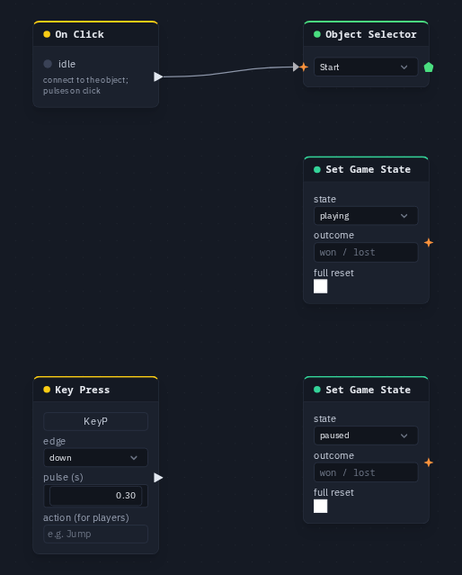

# Set Game State

Switches the shared game state — `menu`, `playing`, `paused` or `over` — when a pulse arrives.
Every player follows the same state: it is the one switch a Start, Pause or Game Over button
writes to.

**Output:** none (an action)

## Inputs

| Handle | Type | Meaning |
|---|---|---|
| trigger | event | each pulse makes the switch once — a [HUD Button](hudbutton.md), an [On Click](onclick.md), a [Delay](delay.md), [All Players](allplayers.md) |

The trigger needs a **pulse**. A true/false value (a [Compare](compare.md)) wired straight in
does nothing; put an event node such as [All Players](allplayers.md) between them.

!!! warning "Known problem in 1.42"
    The card does not draw its **trigger** socket yet, so this node cannot be wired by hand in the node editor. Until
    that is fixed, let the HUD editor build it: select a button and pick one of the game actions (see the tip at the end
    of this page) — the action adds a Set Game State already wired to the button.

## Parameters

| Parameter | Default | Options |
|---|---|---|
| state | playing | `menu`, `playing`, `paused`, `over` |
| outcome | (empty) | a short word stored with the state, up to 40 characters — `won`, `lost` — meant for `over` |
| full reset | off | on: back to `menu` **and** the round clock to zero, whatever `state` says |

## What each state does

- **playing** from `menu` or `over` starts a **new round**: the round number goes up by one and
  the round clock ([Game Time](gametime.md)) starts again from 0. From `paused` it **resumes**
  the same round, and the clock carries on where it stopped.
- **paused** stops physics, animations and the round clock for everybody. Flow logic and the HUD
  keep running, so a pause menu still works.
- **over** ends the round with the `outcome` text. The clock is not zeroed.
- **menu** goes back to the menu. Only **full reset** also zeroes the round clock, so a Game Time
  readout on the menu shows 0 instead of the last round's time. A reset keeps the round count and
  the variables.

HUD screens set to show **while** a state (see [HUD Editor](../hud-editor.md)) and
[Game Start](gamestart.md) nodes react to the state by themselves; [On Game State](ongamestate.md)
pulses when it changes.

## In multiplayer

The pulse is shared, so every player's copy of the graph makes the same switch at the same
moment, and the newest write wins. It does not matter who pressed the button. A player who joins
later receives the current state, round, clock and outcome on arrival. A Set Game State node you
add only acts on pulses that come **after** it was placed: an old click never starts a game.

The state is saved with the scene. Leaving Play on your own puts the game back on its menu; with
other people in the session, the game resets once the last player has been out of Play for ten
seconds.

## Practical example

A start button and a pause key:

1. Add an **On Click** and an **Object Selector** picking a `Start` box; wire On Click → Object Selector.
2. Add a **Set Game State** (state `playing`); wire On Click → its **trigger**.
3. Add a **Key Press** (capture <kbd>P</kbd>) and a second **Set Game State** (state `paused`);
   wire Key Press → its **trigger**.
4. Press Play and click the box: the round starts for everyone. <kbd>P</kbd> pauses it, and a
   click on the box resumes it.

!!! tip
    The HUD editor builds these for you: select a button and pick **Actions ▸ Start the game**,
    **Pause**, **Resume**, **End the game**, **Back to the menu** or **Reset the game**.
