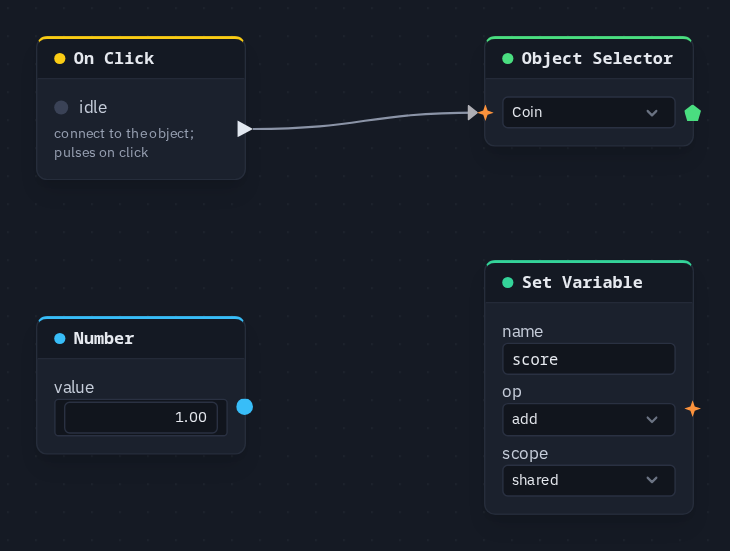

# Set Variable

Writes a named number when a pulse arrives — a score, lives, a difficulty. With scope `shared` it
is one number the whole game shares, with no object needed to hold it; with scope `player` it is
**your own** number, one per player.

**Output:** none (an action)

## Inputs

| Handle | Type | Meaning |
|---|---|---|
| trigger | event | each pulse writes once — an [On Click](onclick.md), a [HUD Button](hudbutton.md), an [On Hit](onhit.md), [On Game State](ongamestate.md) |
| value | number | the amount to set, add or subtract — wire a [Number](number.md), a [Counter](counter.md), a [Math](math.md) result (unwired: 0) |

The card has no field for the value: wire one in. The HUD editor's **Actions ▸ Set a variable**
builds a Set Variable that adds 1 to `score`.

## Parameters

| Parameter | Default | Options |
|---|---|---|
| name | `score` | the variable's name, up to 40 characters |
| op | set | `set` (replace), `add`, `subtract` |
| scope | shared | `shared` (one number for the game), `player` (this player's own row) |

## Shared or per player

| | `shared` | `player` |
|---|---|---|
| Read it with | [Get Variable](getvariable.md) | [Player Variable](peervariable.md), [Leaderboard](leaderboard.md) |
| Who writes it | every player's copy of the graph, newest write wins | only the player it belongs to |
| A player who joins later | gets it with the game state | gets every player's row when they connect |
| Kept | with the scene when it is saved, and across [Travel to scene](travel.md) | while the player is connected, across Travel too; leaving Play keeps it, and when they disconnect the others drop it. Not saved with the scene |

Neither kind is reset by a new round. A game that wants a fresh start writes it: a Set Variable with
op `set` and nothing wired into **value** (0), driven by the Start button's pulse.

**The trigger decides who acts, the scope decides whose number.** A shared pulse (an ordinary
On Click) runs the node on every player's copy of the graph. Into a `player`-scope Set Variable,
that adds to **everybody's** own number ("everyone scores when the boss falls"). A pulse only one
player sees — an [On Hit](onhit.md) with who `me` — adds to that player's number alone.

!!! warning "`add` on a shared variable can count twice"
    Every player's copy works out *current + value* for itself. When their timing differs a
    little, one pickup can be counted twice. For a number that must be exact, count the pulses
    with a [Counter](counter.md) (every player holds the same count), or use the
    [game kit](../game-kit.md)'s **Kit: Score**, which counts every point once. A `player`-scope
    variable has only one writer, so it cannot double up.

A player can hold up to 64 per-player names. Variables are separate from
[Store Value](storevalue.md), which keeps a number on one device across reloads and never shares
it.

## Practical example

Add a point to the shared score with each click on a coin:

1. Add an **On Click** and an **Object Selector** picking the `Coin`; wire On Click → Object Selector.
2. Add a **Set Variable** (name `score`, op `add`, scope `shared`); wire On Click → its **trigger**.
3. Add a **Number** (value 1); wire it → Set Variable's **value**.
4. Read the score with a [Get Variable](getvariable.md) named `score`, or show it on screen with
   the HUD editor's **Actions ▸ Show a variable**.

