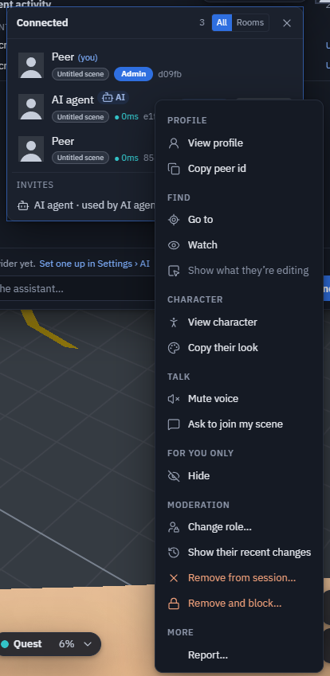

# Users and moderation

Everyone in your session is listed in the **Connected** panel (the people button, top right). Each person has a menu:
find them, look at their character, mute or hide them for yourself — and, if you run the session, remove them.

!!! info "New in 1.48"
    The peer menu, Hide, and Remove / Remove and block with Allow back.

## Open the peer menu

- **Right-click** a person's row,
- **long-press** it on a touch screen,
- or focus it (<kbd>Tab</kbd>) and press the context-menu key or <kbd>Shift</kbd>+<kbd>F10</kbd>.
- In a headset: radial menu ▸ **Tools ▸ People**.

{ width="414" }

## What is in it

| group | entries |
|---|---|
| **Profile** | **View profile** — picture, name, peer id, role, device (desktop / phone / VR), app version, connection quality, how they joined (host / invite / approval / guest) and their character on a small turntable · **Copy peer id** |
| **Find** | **Go to** flies your camera to their avatar (in another scene: travels there) · **Watch** follows their view · **Show what they're editing** selects (read-only) and frames the object they have selected |
| **Character** | **View character** · **Copy their look** puts on their character and colours (change it back in Change character) |
| **Talk** | **Mute voice** (for you) · **Request access** (someone in a private scene) · **Ask to join my scene** (rooms on theprototype.app) |
| **For you only** | **Hide** — their avatar, node-editor cursor and voice disappear on your screen. They are not told, their edits still arrive, and **Show again** undoes it. Nothing is saved |
| **Moderation** | **Change role** · **Show their recent changes** (what they did this session, newest first; click a line to select the object) · **Remove from session** · **Remove and block** |

An **AI agent** also shows **Revoke invite** when it came by one. Your own row has **Edit profile**, **Change
character** and **Copy peer id**. On theprototype.app, **Report…** sits at the end of the menu.

## Remove someone

**Remove from session** takes them out; they can knock again. **Remove and block** also refuses them for the rest of
this session — they see "You were removed from this session". Blocked people are listed in the Connected panel with
**Allow back**.

**Who can remove:**

| build | who |
|---|---|
| theprototype.app (accounts and roles) | admins |
| the open-source build (no roles) | the session host — whoever the others joined |

A remove sent by anyone else is ignored by everyone.

**How it works:** a session is a mesh — everyone holds a connection to everyone. Removing someone sends one message;
every person's app checks that it came from the host or an admin and closes its own connection to that peer. A
modified app that ignores the message is still disconnected by everybody else. Removing someone who came by an
[invite](invites.md) uses that invite up.

The automatic-join notice's **Remove** (see [Public rooms](connection.md#public-rooms-theprototypeapp)) keeps someone
out of your own door while your tab stays open; the peer menu's **Remove and block** closes every door in the session.

## Limits

- The block list lasts for the session: leaving the session forgets it.
- Hide is per screen and per session.
- "Recent changes" covers what arrived on this device since you joined.
