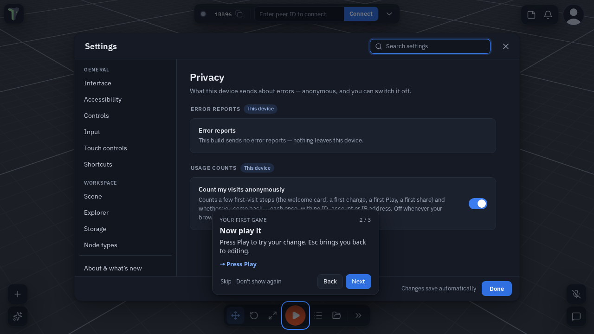

# Privacy & Error Reports

In a session your scene goes from your browser straight to the people you connect to (peer-to-peer); our servers
introduce you, relay the encrypted traffic when a direct link is impossible, and serve accounts, cloud saves, assets
and community pages ([how it works](index.md#how-it-works)). This page covers what the app sends about itself —
**anonymous error reports** and **first-visit usage counts**, and how to switch them off — and the anonymous counters. For accounts,
cloud saves and the community, see the site's [privacy page](https://theprototype.app/privacy).

## Anonymous error reports

*New in 1.39.* When something in the app breaks — an error, a crash, the 3D view losing its graphics context, running
out of memory — the app sends a short **anonymous report** so the team can find and fix it. It is **on by default**, and
one switch turns it off.

**Where:** **Settings ▸ Privacy ▸ Send anonymous error reports** (in the *Devices & services* group). The settings
search finds it under *privacy*, *crash*, *telemetry* or *error reports*.

### What a report holds

- The **kind** of failure: error, rejected promise, WebGL context lost, out of memory, or crash.
- The **error message** — with anything that could name you or your work removed **on your device first**: web
  addresses, server names, IP addresses, file paths, emails, ids and quoted names become placeholders (server names
  and IP addresses since 1.40).
- The lines of the **app's own code** where it happened.
- The **app version**, the **device type** (desktop / phone / tablet / headset), the **browser and OS** family and major
  version, **WebGL / WebGPU**, the **app area** (editing / playing / VR) and whether it was the live site or a preview (a preview reports under its own label, such as `1.40.0-preview`).

### What it never holds

No account, no IP address, no scene content, no names, no cookie — and nothing that links two reports to one person.

- At most **five reports per visit**.
- Reports **expire** after about three months.
- A crash that kills the tab — common when a phone or headset runs out of memory — is reported on the tab's **next
  load**, as kind *crash*.

## Anonymous counters

theprototype.app also counts things in aggregate — page visits and plays of a published scene. These are totals:
no cookie, no account, nothing that links one visit to another or to you.

## Usage counts (first visits)

To learn whether a first visit works, theprototype.app counts a few steps of a visit that met the Welcome card: the card
shown and which answer was picked, a first change, a first Play (with roughly how many minutes after the card), a first
invite, finishing or skipping the [first-game quest](tours.md#the-first-game-quest). A count carries only the app version
and the kind of device (desktop, touch screen or headset) — **no account, no IP address, no cookie, no identifier**.

**By default nothing is stored in your browser**, and each step counts once per page, so a reload can count it again.

**After your first Play** a small card asks:

- **Agree** keeps a small note in your browser, so each step counts once per browser and we can also count whether the browser
  comes back the next day, a week later or in a later week. The note never leaves your browser.
- **No thanks** stops the counting and remembers only that answer.

**Where:** **Settings ▸ Privacy ▸ Count my visits anonymously**. Off also deletes the note. Nothing is counted while your browser
sends *Do Not Track* or *Global Privacy Control*.

**Performance reports** are separate and **off** unless you switch them on (**Settings ▸ Interface ▸ Send
performance reports**): frame-time numbers and versions, no account and no scene content.

!!! note "Other builds send nothing"
    The engine is [open source](https://github.com/theprototype-app/core). A build of it that is not ours has no report
    address, sends nothing, and the Privacy row says so.
