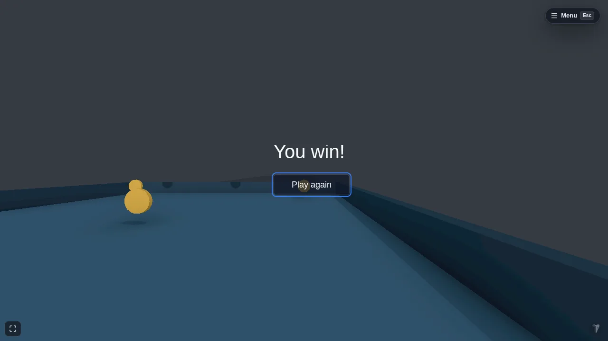
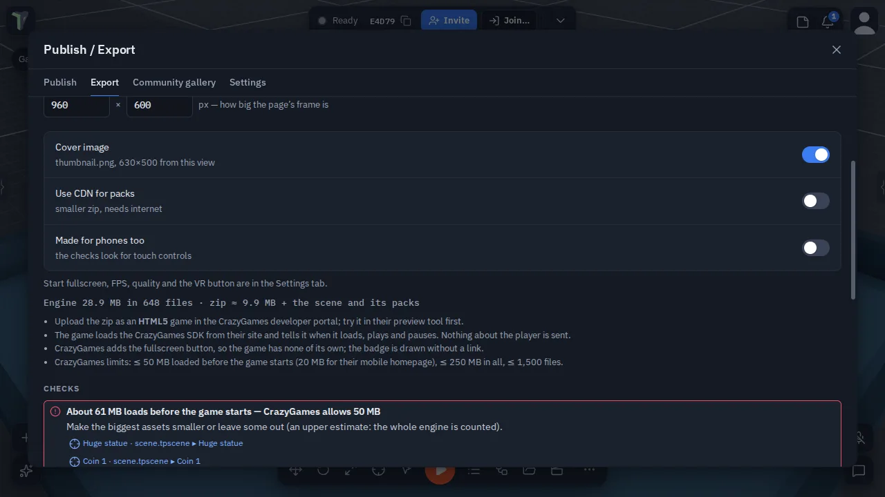

# Publish your game

A game you made here can go three places, and this page walks through each one:

| Where | What you get | Needs |
|---|---|---|
| **theprototype.app** ([Publish](#before-you-publish)) | a play link, a scene page with likes and comments, remixes | signing in on theprototype.app |
| **itch.io** ([step by step](#itchio-step-by-step)) | an HTML game page on itch.io | an itch.io account |
| **CrazyGames** ([step by step](#crazygames-step-by-step)) | a game on the CrazyGames portal | a CrazyGames developer account |

Everything starts at **Menu ▸ Publish / Export**. The first time you open it, a short note above the tabs says which tab
does what and links this page; it goes once you close the window (**Settings ▸ Interface ▸ Reset tips** brings it back).
The same link sits under the preset notes on the **Export** tab. *1.XX*

!!! tip "No game yet?"
    **Starter Dash** (**Templates ▸ Games**) is the smallest complete game: a run, a goal, a win screen and touch
    controls. Export it once before your own game, to see the whole path end to end.

## Before you publish

The **Publish** tab opens with **Before you publish**: a short list of what a visitor would trip over, each with a
button that fixes it where one exists. **Warnings never block** — the Publish button below the list works whatever it
says. **Check again** runs the list again after you change something. *1.XX*

The **Export** tab shows the same scene rows, plus the rows of the preset you picked.

### What the check rows mean

| Row | What it means | The button |
|---|---|---|
| *The scene is … MB; publishing takes up to 25 MB* (red) | the upload would be refused; the biggest parts are listed under the row — press one to select it | **Shrink large textures** when textures are the reason |
| *A texture is larger than 2048 px* | big textures are slow to download and can run out of memory on a phone or a headset | **Shrink to 2048 px** (one undo puts it back) |
| *This game has no spawn point* | players start where your editor camera was at the last save | **Start players here** (the centre of your view) |
| *The spawn point is outside the play area* | players would start where they cannot move | **Start players here** |
| *Phone players cannot press every control* | a key the game listens to has no on-screen button | **Edit touch controls** |
| *Visitors will not have the module …* | the module was installed from a file or a private link, so its nodes do nothing for visitors | **Open Modules** |
| *A file the scene uses is not on this device* | it is left out of what you publish: visitors get silence or a blank | **Ask connected people for them** |
| *A Script node reads random / the clock / storage* | every player gets a different answer; use the node's seeded random or the session clock | **Show the node** |
| *… will not show for players* | the object sits on an editor-only layer, or is drawn in one eye only in a headset | — select it and add it again, or delete it |

Each fix is one step you can undo with <kbd>Ctrl</kbd>+<kbd>Z</kbd>. An AI app connected to your scene sees the same list
(in `save_scene`'s answer) and can tell you about it, but publishing and every fix stay your press.

## The offline zip

**Export** builds a zip that is the whole game: the player (the slim one, not the editor), your scene, every pack piece
it places, the modules it uses, the sky in every size its options offer, and the fonts. **Nothing is fetched from the
internet while it plays** — only a portal's own SDK, in that portal's preset. *1.XX*

{ .shot width="688" height="387" loading=lazy }
/// caption
Starter Dash from an itch.io zip: it plays with no internet.
///

1. Open the game, then **Menu ▸ Publish / Export ▸ Export**.
2. Pick a preset: **itch.io**, **CrazyGames** or **Static host** (any web host: Netlify, Cloudflare Pages, GitHub Pages).
3. Set the **Title** (the page title and the zip's name) and, for itch.io, the **Viewport size**.
4. For a game meant for phones, turn on **Made for phones too**: the checks then look for touch controls.
5. Look at **Checks**. A **red** row stops the download and says why; a **yellow** row is a warning.
6. Press **Build & download zip**.

The checks run twice: once on the plan, before anything is fetched, and once on the finished zip, before it downloads.
After a build, the result lists the **15 biggest files and what uses them** (an object, a pack piece, the sky, a
module); press a row to select that object in the editor. A refused build lists them too, so you can see what to shrink.

{ .shot width="688" height="387" loading=lazy }
/// caption
Too big for CrazyGames: the check names the limit and lists what weighs what.
///

**Use CDN for packs** makes a smaller zip, but then the game needs the internet to start, and the checks say so.

## itch.io step by step

1. Export with the **itch.io** preset and download the zip.
2. On [itch.io](https://itch.io), open **Upload new project** (the menu under your name, or *Dashboard*).
3. Give it a title and set **Kind of project** to **HTML**.
4. Under **Uploads**, upload the zip **as it is** and tick **This file will be played in the browser**.
5. Under **Embed options**: **Embed in page** with the Export tab's viewport size in *Viewport dimensions* (or *Click to
   launch in fullscreen*), tick **Fullscreen button**, and tick **Mobile friendly** for a game with
   [touch controls](touch-controls.md). Leave **SharedArrayBuffer support** off; the engine does not use it.
6. Save as a **Draft**, open the page and play it once, then set **Visibility** to *Public*.

itch.io's limits, checked before anything downloads: at most 1,000 files, 500 MB unzipped, 200 MB per file, and paths
of at most 240 characters. A typical game is well inside them: the engine is about 13 MB of every zip.

## CrazyGames step by step

1. Export with the **CrazyGames** preset. The zip loads the CrazyGames SDK from their site and tells it when the game
   loads, starts, pauses (menus, the pause screen, game over) and moves to the next level. Nothing about the player is
   sent.
2. In the CrazyGames developer portal, add a new game and upload the zip as an **HTML5** game.
3. Try it in their **preview tool** before you submit it.

CrazyGames adds its own fullscreen button, so the game shows none, and the *Made with ThePrototype* badge is drawn
without a link. Their limits, checked before the download: at most **50 MB loaded before the game starts** (the Export
tab shows an upper estimate; 20 MB for their mobile homepage), 250 MB in all, and 1,500 files.

## Updating a game you already uploaded

- **itch.io / CrazyGames / a web host**: export the same scene again with the same preset. The zip keeps its **name and
  export id**, so uploading it over the old build replaces it — the result line says *Same name and export id as your
  last export*. Nothing is uploaded for you.
- **theprototype.app**: publish again from the Publish tab; the play link and the scene page stay the same.

## Take a game down

You can take a game you published on theprototype.app down, and put it back later: *1.XX*

- **Your games** (Menu ▸ Your games & stats): **Unpublish** on the game's row,
- the **Publish** window, right after publishing,
- or the game's own scene page, while you are signed in as its owner.

Unpublish asks twice. Its links (`/s/…`, `/p/…`, embeds) then show a plain *No longer published* page; a cached copy can
take up to a minute to change. Remixes made earlier stay, and keep their credit line (*Remix of … (no longer
published)*). **Republish** (in Your games, or the Publish window when you update it) puts it back **on the same link**.

If staff hid a game for a rule, its owner cannot republish it.

A game on itch.io or CrazyGames is taken down on that site: delete or unpublish the upload there.

## Phones and iPhone

- The zip plays in phone browsers; turn on **Made for phones too** and add [touch controls](touch-controls.md).
- On **iPhone Safari** there is no fullscreen button and no VR. Keep the sky at **Auto** for phones (a Max sky decodes
  an 8K image).

See also: [Publish & Export](publish-export.md) for every Export option, and [Community](community.md) for play links,
likes and remixes.
