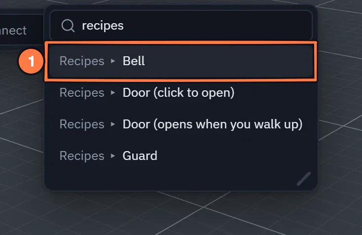

# Starter recipes

*New in 1.64.* A **recipe** turns the selected object into something that works when you press Play, in one click, built
only from ordinary nodes you can open, read and change afterwards.

## Where they are

Select the object, open the [node editor](node-system.md) on its flow, then **right-click the pane** (or open the node
search) ▸ **Recipes**:

| Recipe | What you get |
|---|---|
| [Door (click to open)](recipe-door.md) | On Click opens and closes it: a quarter turn, shared and saved |
| [Door (opens when you walk up)](recipe-walk-up-door.md) | a sensor zone around the door: walking in opens it, walking out closes it |
| [Bell](recipe-bell.md) | click, point at or knock it: it swings and rings for everyone |
| [Guard](recipe-guard.md) | walks a loop path around where it stands; says "Spotted!" when a player steps into its sight |

The entries are greyed out on the **Main** graph: a recipe goes into an object's **own** flow, so select the object
first. A toast confirms what was added — *Added the door recipe — press Play to try it*.

{ .shot width="360" height="238" loading=lazy }
/// caption
The node search on a selected object, searched for "recipes".
///

1. A **Recipes** row: pick it to put the whole recipe in the selected object's flow.

To see all four at work first, open **Templates ▸ Doors, a bell and a guard**: a yard with a door you click, a gate that
opens when you walk up, a bell and a guard on its round. Press Play and try them, then open each object's flow to see
what its recipe made.

## What a recipe does

- The nodes go into the selected object's own flow (a flow is made if it has none), below whatever it already holds.
- Anything else the recipe needs — the walk-up door's sensor zone, the guard's Path — is added to the scene beside the
  object.
- **Everything it makes is one undo step**: <kbd>Ctrl</kbd>+<kbd>Z</kbd> takes the nodes and the extra objects away
  together.
- It is **shared** like any other edit: everyone in the session sees the nodes and the objects at once, and the result
  works the same for all of them.
- The selection stays on your object.

Nothing about a recipe is special afterwards: the nodes are normal nodes. Change a sound, a speed or a radius on their
cards, or delete what you do not want.

{ .shot width="512" height="269" loading=lazy }
/// caption
What the Guard recipe puts in the guard's flow.
///

1. **On Enter** fires when a player steps into the guard's sight; Announce and the whistle follow.

More recipes made by hand: [a furnished room](furnished-room.md) and [a gem arena](gem-arena.md).
