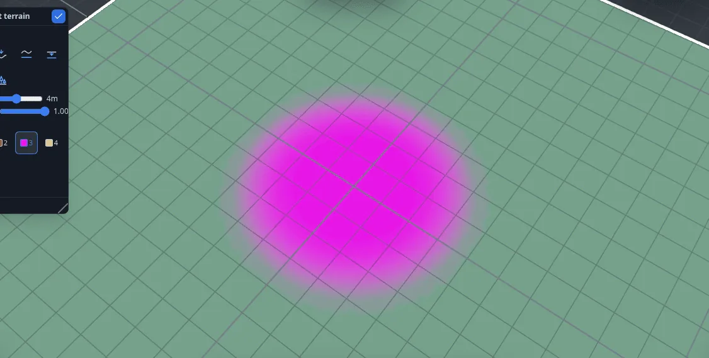
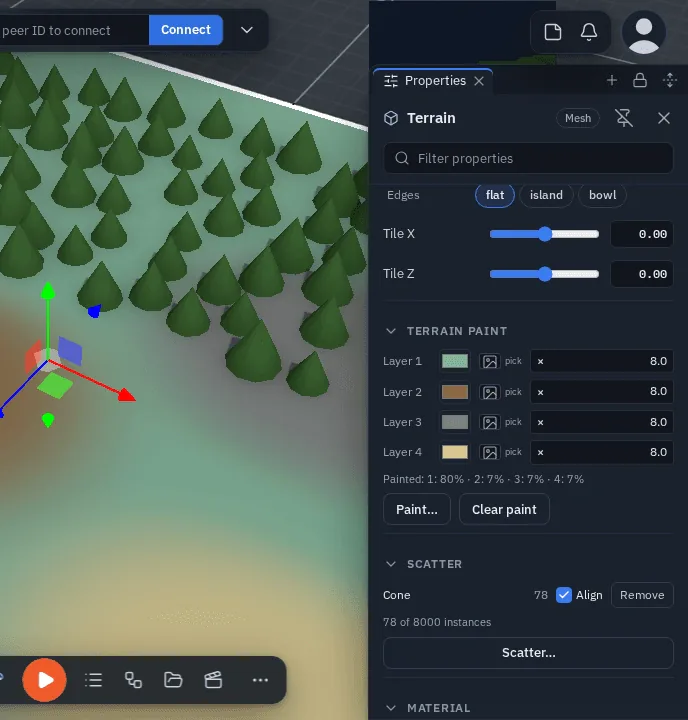
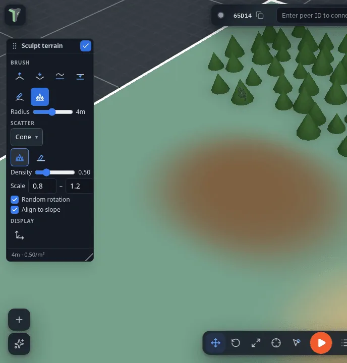
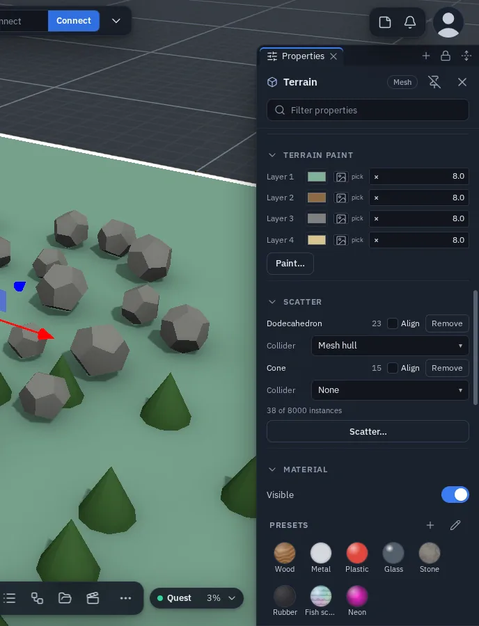

# Terrain & Sculpting

Add ground and shape it two ways: **procedurally**, by dialling in hills from a handful of numbers, and **by hand**, with a brush that raises, lowers, smooths and flattens. Every edit replicates to your peers.

## Adding terrain

Right-click the viewport ▸ **Add ▸ Ground ▸ Terrain** (or the Add menu, <kbd>Shift</kbd>+<kbd>A</kbd>). This drops a flat **24 m × 24 m plane** at the point you click, subdivided into a 48×48 grid and tinted a soft sage green.

The 48-segment resolution is deliberate: it's the densest grid that still fits the limit for streaming edited geometry, so a fully sculpted terrain always replicates cleanly. For bigger worlds, **tile** several terrains rather than asking for one huge one — see [Bigger worlds](#bigger-worlds) below.

Terrain is a normal scene object: it selects, transforms and replicates like anything else.

## Procedural hills

A fresh terrain starts flat, and its shape is **parametric** — select it and open Properties ▸ **Geometry**:

| Row | What it does |
|---|---|
| **Size** | The tile's extent in metres (1–200) |
| **Segments** | Grid resolution per side (2–48) |
| **Seed** | Which landscape you get. Same seed, same hills, on every peer and in every session |
| **Height** | How tall the hills are. **0 is flat** — the starting state |
| **Detail** | Feature size: low is broad rolling ground, high is tight and noisy |
| **Octaves** | Layers of detail (1–6). More octaves add finer texture *without* changing the height |
| **Ridged** | Turns smooth hills into creased ridges — mountainous rather than rolling |
| **Warp** | Bends the pattern so features stop looking regular |
| **Edges** | **flat** (uniform), **island** (high in the middle, falling to the rim) or **bowl** (low in the middle, rising at the rim) |
| **Tile X / Tile Z** | Which part of the landscape this tile shows — see below |

Set **Height** above zero and hills appear. Every row is live: scrub **Seed** to shop for a landscape, then raise **Octaves** for detail.

!!! note "Why the numbers, not the mesh"
    Only these ~11 numbers travel to your peers, and only they are stored in a saved scene — everyone rebuilds the same hills from the same values. It also means a terrain stays fully re-shapeable: change the seed a month later and the landscape re-rolls.

### Bigger worlds

Use several tiles with the **same Seed** and different **Tile X / Tile Z**, offset by exactly one **Size** each. All tiles then sample one continuous landscape, so their edges meet seamlessly.

Use those two rows — never a *move* — to choose which part of the landscape a tile shows. Dragging a tile with the gizmo slides its mesh but not the landscape it was cut from, so the join stops matching.

Four tiles of a 24 m world:

| Tile | Tile X | Tile Z |
|---|---|---|
| north-west | 0 | 0 |
| north-east | 24 | 0 |
| south-west | 0 | 24 |
| south-east | 24 | 24 |

(Place each tile in the scene as usual — the offsets only decide which slice of the landscape it draws.)

### Edges: making a ring of mountains

**Edges ▸ bowl** raises each tile toward its rim, so a grid of bowl tiles gives a basin ringed by high ground — the classic arena. **island** does the opposite for a single tile meant to sit in water or void.

## Sculpting by hand

Right-click the terrain ▸ **Sculpt terrain**. This selects the object (which locks it so peers can't edit it at the same time) and opens the **Sculpt toolbar** — a floating tool palette you can drag anywhere.

Drag on the terrain surface to sculpt. A ring cursor follows your pointer, hugging the surface, to show the brush footprint.

### The Sculpt toolbar

| Control | What it does |
|---|---|
| **⛰ Raise** | Pushes the surface up under the brush. |
| **⛏ Lower** | Pushes it down. |
| **〰 Smooth** | Relaxes bumps toward the local average — softens what you've made. |
| **▭ Flatten** | Pulls the surface toward the height where you first touched down. |
| **Radius** | Brush size, 0.5 – 8 m (default 3). |
| **Strength** | How fast the brush moves the surface, 0.05 – 1 (default 0.5). |
| **Done ✕** | Leaves sculpt mode (<kbd>Esc</kbd> also exits). |

Each brush stroke — from pressing down to lifting the pointer — is **one undo step** (<kbd>Ctrl</kbd>+<kbd>Z</kbd>). While you drag, peers see a live preview several times a second; when you release, the final shape is committed and synced.

Since 1.28 you can sculpt terrain from a VR headset too: radial menu ▸ **Add ▸ Terrain**, or select a terrain and
pick **Selected ▸ Sculpt terrain** — see [Sculpting terrain in VR](vr.md#sculpting-terrain-in-vr).

### Sculpting any mesh

The same brush works on **any** mesh, not just terrain: right-click an object ▸ **Sculpt mesh**. The difference is which way the brush pushes — on terrain it moves the surface straight up and down, on a mesh it moves along the surface's own normals, so you can bulge and dent a shape from any angle. **Flatten** pulls toward the plane you first touched and **Smooth** relaxes the surface toward its local average, exactly as on terrain.

!!! note "Under the hood"
    Sculpting only moves the surface up and down, never sideways, so the grid stays watertight and normals are re-smoothed after every edit — no faceted seams. The result travels to peers as a geometry snapshot on the same channel used by mesh editing.

## Painting layers

Since 1.38 a Terrain can be **painted with four texture layers**. Select it ▸ right-click ▸ **Sculpt terrain** (or
Inspector ▸ **Terrain paint ▸ Paint…**) and pick the **Paint** brush after Raise / Lower / Smooth / Flatten.

{ .shot .vignette width="1126" height="569" loading=lazy }
/// caption
A painted layer on a terrain.
///

- Pick a **layer (1–4)** in the toolbox, then drag on the terrain. Radius and Strength are the sculpt brush's.
- Inspector ▸ **Terrain paint** sets, per layer, a **colour**, a **texture** (import a file or drop an Explorer image)
  and **tiling** (how often the texture repeats across the terrain). Layer 1 *is* the terrain's own material until you
  give it a colour or texture (*Use the material for layer 1* goes back), so the first stroke on a fresh terrain only
  changes where you paint.
- The coverage line shows how much of the terrain each layer covers; **Clear paint** removes all of it.
- *New in 1.43:* **Detail** sets this terrain's paint resolution, 64 × 64 to 512 × 512 (default 128). What is painted
  is resampled (edges get sharper or softer) and the next strokes paint at that detail; a bigger map costs more to send
  while you paint.
- One drag = **one undo step**. Peers see the stroke while you paint and exactly your result when you let go; the
  paint is saved with the scene.

{ .shot .fade-l width="688" height="720" loading=lazy }
/// caption
Properties of a terrain with its Terrain paint section.
///

## Scatter

The **Scatter** brush paints instances of a primitive, a Library model, a pack item or a prefab's look — trees, rocks,
grass tufts — onto the terrain. Since 1.43 a set can also **fill** the terrain by count or density with slope, height
and painted-layer masks, mix several models, and be edited instance by instance: see [Scatter](scatter.md), which also
covers scatter on any other object.

{ .shot .fade-r width="688" height="720" loading=lazy }
/// caption
The Scatter brush in the Sculpt toolbox.
///

| Control | What it does |
|---|---|
| **Source** | A primitive, a Library model, a pack item or a prefab ([what you can scatter](scatter.md#what-you-can-scatter)). |
| **Tools** | Paint, Erase, Rotate, Scale, Relax and Select ([Edit instances](scatter.md#edit-instances)). |
| **Density** | Instances per m² — painting over a patch fills it up to that density and never past it. |
| **Scale min – max** | A random size per instance. |
| **Random rotation** | Turns each instance around its vertical axis. |
| **Align to slope** | Tilts instances to the ground. |

Instances follow the ground — sculpting the terrain later moves them with it. Inspector ▸ **Scatter** lists each
scattered model with its count, an Align toggle and **Remove**, plus the Fill, mix, Tint and Sink rows
([Scatter](scatter.md)). Scatter is counted by the
[budget chip](performance.md#the-budget-chip-will-it-fit-on-a-quest) on the terrain's row, and a dense model (300
triangles or more) switches to lighter [levels of detail](lod.md) with distance — instances far away draw fewer
triangles.

!!! note "Limits"
    Up to 8,000 instances and 8 scattered models per terrain. For a Quest, keep it near 2,000 instances of a low-poly
    model (≤ 150 triangles each): each scattered model is one draw call (a dense one, a few — it is drawn in patches so
    its levels of detail can switch), plus one per shadow-casting light; far instances
    [thin out per device](scatter.md#distant-scatter-each-device). Instances are solid only when their model has a
    [Collider](#scatter-collider). Older versions open a painted or scattered terrain as the plain terrain.

### Scatter ▸ Collider

*New in 1.39.* A scattered model — a rock, a tree trunk, a primitive — can be **solid** in a simulation. Each scattered
model has a **Collider**:

| Collider | Shape |
|---|---|
| **None** (the default) | No collider — the instances are scenery you pass through. |
| **Box** | The model's bounding box. |
| **Sphere** | A ball reaching the model's farthest point. |
| **Mesh hull** | The model's convex hull — the closest fit for a rock (a flat model falls back to its box). |

**Where:** select the terrain ▸ Properties ▸ **Scatter** ▸ the model's row ▸ **Collider**. The Sculpt toolbox's
Scatter brush has a **Collider** pick too: it is what a *newly* scattered model starts with — painting more rocks into
an existing set never changes that set's collider.

{ .shot .fade-l width="688" height="900" loading=lazy }
/// caption
Properties ▸ Scatter.
///

- While a [simulation](physics.md) runs, every instance of that model is a **static** collider — a thrown ball bounces
  off the rocks and stops on top of one. The colliders follow each instance's position, rotation, scale and *Align to
  slope* tilt, and the terrain's own transform; a terrain moving mid-run does not drag them along.
- The choice is part of the scene: saved, one undo step per change, and **every player** gets the same colliders,
  whoever runs the simulation.
- A hit on a scattered rock counts as a hit on the terrain — [On Impact](nodes/onimpact.md) and friends name the
  terrain.

!!! tip "Only what a player can reach"
    2,000 instances build their colliders in 10–40 ms when the simulation starts and add about 0.1 ms per physics step.
    Give colliders to the rocks and trunks a player can actually touch, not to grass.

## Hand edits lock the parametric rows

The moment you sculpt a terrain — or carve a road into it, or edit it in mesh mode — the Geometry rows **lock**, and the panel says so.

That's deliberate. Those rows rebuild the terrain from its numbers, which would throw the hand work away, and nudging a seed by accident should not cost you an afternoon of sculpting.

When you *do* want the parametric shape back, press **Regenerate (discards the sculpt)** and confirm. The rows return and the ground goes back to what the numbers say.

!!! warning "Regenerate really does discard it"
    The sculpted shape is still in your undo history, but it takes more than one <kbd>Ctrl</kbd>+<kbd>Z</kbd> to walk back to it. Treat Regenerate as deliberate.

## Roads, paths and rivers

To fit a [spline](splines.md) and a terrain together, use **Flatten** on the spline's right-click menu: *Terrain to this spline* cuts a level bed for it, and *This spline onto a surface* drops the spline onto the ground instead. Both are one undo step, and both ask you to click the other object.

## Sculpting vs. mesh editing

Sculpting is its own mode, separate from the vertex/edge/face **mesh edit** mode (<kbd>Tab</kbd>):

- **Sculpt** is brush-based and reached from the *Sculpt terrain* / *Sculpt mesh* menu entry — for organic shaping, where you don't care which vertex is which.
- **[Mesh edit](mesh-editing.md)** is precise: it selects and moves individual vertices, edges and faces, and it's where extrude, bevel, knife and the loop tools live.

They never overlap — entering one doesn't affect the other. Sculpting never changes the number of vertices, so shape a mesh first and sculpt it after.

!!! warning "Desktop only"
    Terrain sculpting is a desktop feature. It isn't available in VR yet.
