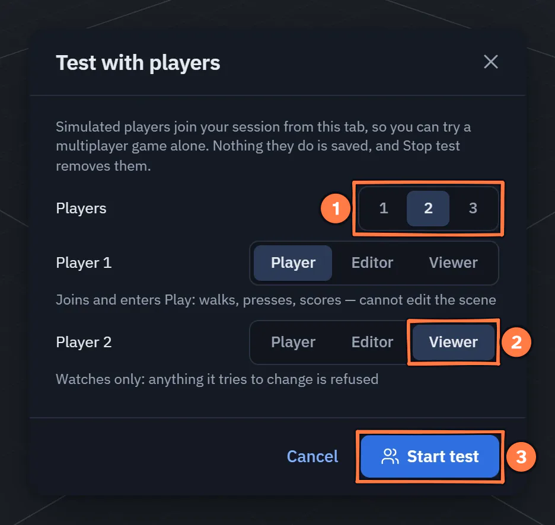

# Test with players

*New in 1.72.* Try a multiplayer game with no second person and no second device. **Test with players** starts
1 to 3 simulated players in this tab. Each one is a complete copy of the app: it joins your session the way a
friend would and gets your scene, your logic and your HUD. Watch it in a small view, or take it over and play as it.

## Where it is

| Where | How |
|---|---|
| Play button | right-click **Play** ▸ **Test with players…** |
| Phone | long-press **Play** ▸ **Test with players…** |

## Run a test

{ .shot width="468" height="443" loading=lazy }
/// caption
Right-click Play ▸ Test with players… opens this sheet.
///

1. **Players**: how many simulated players join (up to 3; 1 on a phone or a headset).
2. A **role** for each one: Player, Viewer or Editor.
3. **Start test** adds them to your session.

1. Choose how many players (1 to 3; 1 on a phone or a headset) and a role for each one:
    - **Player**: joins and goes straight into Play. It can press, trigger and score. It cannot change the scene.
    - **Viewer**: watches. Everything it tries to change is refused, exactly as for a real view-only guest.
    - **Editor**: may do anything a guest editor may.
2. Press **Start test**. A strip at the bottom shows each player's view and its state: loading, joining, joined or
   playing. The players start one after another, so the second one appears a few seconds after the first. A player
   that cannot start is tried once more and then shows **Did not start**.
3. Press the gamepad button on a view to **Drive** it. The view gets bigger and takes your keyboard, so the keys
   you press are that player's keys. Press it again to hand the keyboard back.
4. **Stop test** (on the strip, or right-click **Play** ▸ **Stop test**) removes them all. Nothing stays behind:
   no rows in People, no saves and no settings changes. The simulated players never write to your storage.

## Good for

- Checking that a win or lose condition fires for one player and that everyone sees it.
- Checking that a viewer really cannot edit.
- Checking that a HUD reads right for a second player.
- Seeing what a joiner sees when they arrive mid-round.
- Checking that an [enemy](make-an-enemy.md) chases whoever is nearest.

## Limits

- A test runs in a session of your own. If other people are connected, leave the session first.
- The simulated players make no sound and do not use a headset view.
- Each one is a whole app: about 35 MB of script memory, measured on a computer, plus its own 3D view. On a slower
  computer, 3 players can make the editor slower while the test runs.
- On a headset you can enter and leave VR while a test runs; the players stay joined.
