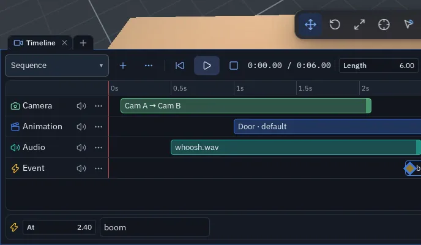
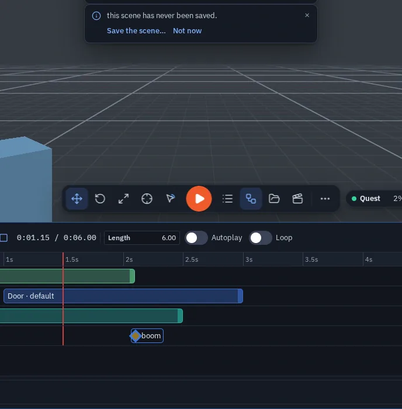
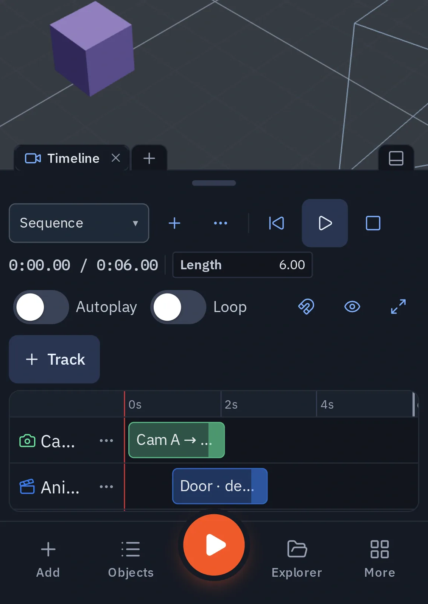
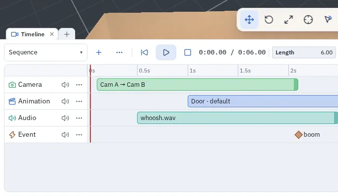

# Timeline (cutscenes)

*New in 1.39.* The **Timeline** is a sequencer for cutscenes and scripted moments. A **sequence** is a set of tracks
laid out over time: camera shots, animation clips, sounds and events for your node graph.

Sequences are part of the scene: they are saved with it, shared live with everyone in the session (late joiners too),
undoable, and they play in exported and published games.

!!! info "Not the Animation timeline"
    The [Animation](animation.md) editor keys **one object's** clips. The Timeline arranges whole clips, shots and
    sounds into a scene-wide sequence.

{ .shot .fade-r .fade-t width="688" height="400" loading=lazy }
/// caption
The Timeline docked under the viewport.
///

## Opening it

- <kbd>Alt</kbd>+<kbd>T</kbd>, or the dock's **+** menu ▸ **Timeline**.
- A toolbar button (the video icon) can be added from **Customize toolbar…** (see [The toolbar](controls.md#the-toolbar)).
- On a phone it opens as a tab of the bottom sheet: **More ▸ Timeline**.
- A [Play Sequence](nodes/playseq.md) node's **Open in Timeline** link jumps to its sequence.

## Tracks

| Track | What an item does |
|---|---|
| **Camera** | A *shot*: everyone watching looks through a [camera object](camera.md#camera-objects) for the item's length. Pick a second camera in **→ glide to** and the view moves from the first camera to the second over the shot — a dolly or pan between two marks, *smooth* or *linear*. A camera driven by a [Camera Rig](nodes/camerarig.md) node follows its target during the shot. |
| **Animation** | Starts one of an object's clips — one you authored in the [Animation](animation.md) editor, or one the model was imported with. |
| **Audio** | Plays a sound from the Explorer, cut at the item's end. |
| **Event** | Fires a named event into the node graph — the [On Sequence Event](nodes/onseqevent.md) node pulses. |

## Building a sequence

1. **New sequence** (or the **+** next to the sequence picker). Set its **Length**.
2. **+ Track** ▸ Camera / Animation / Audio / Event.
3. **Double-click a lane** to add an item at that time. It picks the selected camera or animated object (or the first
   one); audio takes the first sound in the Explorer. Select the item and finish it in the strip below the tracks:
   time, length, camera(s), object + clip + speed, sound + gain + **caption**, event name.
   An audio clip's **Caption** (one line, up to 200 characters) shows at the bottom of the screen while the clip plays
   for anyone with captions on ([Accessibility](accessibility.md#captions)).
4. **Drag** an item to move it; drag its **right edge** to change its length. Items snap to other items' edges, the
   playhead and the frame grid (the magnet button turns snapping off; hold <kbd>Alt</kbd> to drag freely). Each drag is
   one undo step.
5. **Scrub** by clicking or dragging the ruler: the viewport looks through the shot at that moment and animated objects
   take their pose. The eye button keeps your own view instead.
6. **Preview** with ▶ or <kbd>Space</kbd>. A preview is yours alone and does **not** fire graph events — events fire
   when the sequence plays in the game.

{ .shot .fade-l .fade-r .fade-t width="688" height="700" loading=lazy }
/// caption
Scrubbing at 1.15 s.
///

| Key | Does |
|---|---|
| <kbd>Space</kbd> | Play / pause the preview |
| <kbd>←</kbd> / <kbd>→</kbd> | Nudge the selection one frame (<kbd>Shift</kbd>: 10), or step the playhead |
| <kbd>Home</kbd> / <kbd>End</kbd> | Playhead to the start / end |
| <kbd>K</kbd> | Add an item on the selected track at the playhead |
| <kbd>Delete</kbd> | Delete the selected items |
| <kbd>Esc</kbd> | Cancel a drag, or clear the selection |
| <kbd>Ctrl</kbd>+<kbd>A</kbd> | Select all |
| Wheel / <kbd>Shift</kbd>+wheel | Zoom / pan |

A track's **…** menu renames it, moves it up or down, or deletes it; its speaker button mutes it.

## Playing it in the game

- **[Play Sequence](nodes/playseq.md)** node (Animation group): wire a trigger in — On Click, On Enter, Key Press.
  Actions: *play*, *stop*, *toggle*, *restart*. Every player runs the sequence from the same moment, and each player's
  own view cuts to the shots.
- **Autoplay** (the switch beside Length): the sequence starts when a player enters Play — and when an exported game
  opens. **Loop** repeats it.
- **[On Sequence Event](nodes/onseqevent.md)** node: pulses when a running sequence passes an event with that name
  (blank = any), or **`end`** when it finishes. Wire it to Play Animation, Set Game State, a Sound.

!!! tip "An intro cutscene"
    Turn **Autoplay** on for the intro sequence, then wire **On Sequence Event** with event `end` → **Set Game State**
    *playing*. The game starts the moment the cutscene ends.

## On a phone

The Timeline is a tab of the bottom sheet (**More ▸ Timeline**). The controls wrap onto extra rows, and the tracks
scroll under them.

{ .shot .fade-t width="390" height="550" loading=lazy }
/// caption
The Timeline as a tab of the bottom sheet on a folded phone.
///

## Limits

- One view at a time: a sequence's shots replace what that player looks through until it ends (or a later shot cuts
  in); then the previous view comes back.
- Clips a model was imported with start from their beginning — playing from the middle of the sequence does not start
  them mid-clip.
- A preview never fires graph events, so it cannot change the game state for one player only.
- Scenes with sequences need 1.39 or later to show them; older versions open the scene without its sequences.

{ .shot .fade-r .fade-t width="688" height="400" loading=lazy }
/// caption
The Timeline in the light theme.
///
