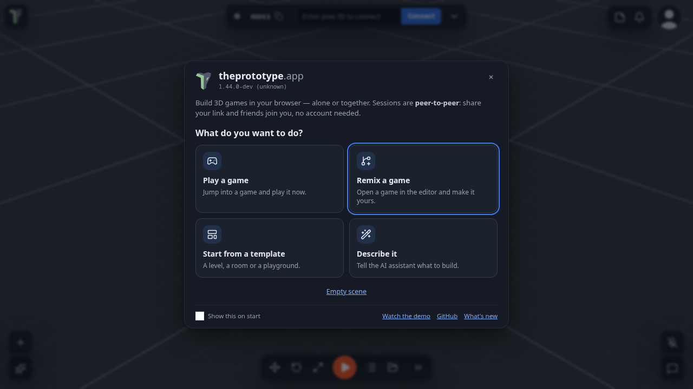
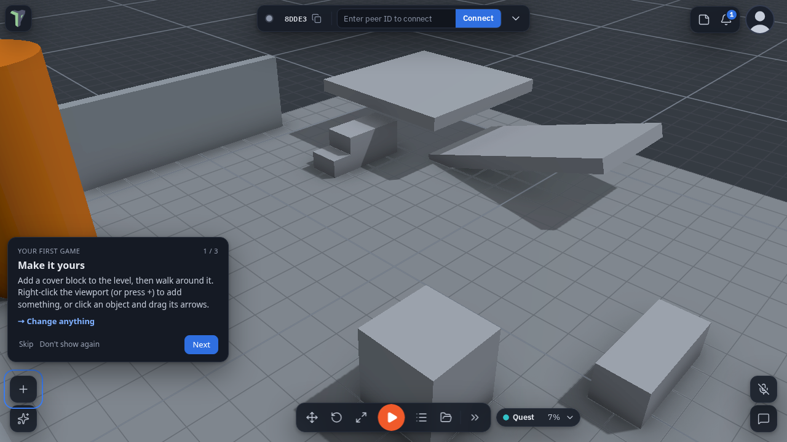
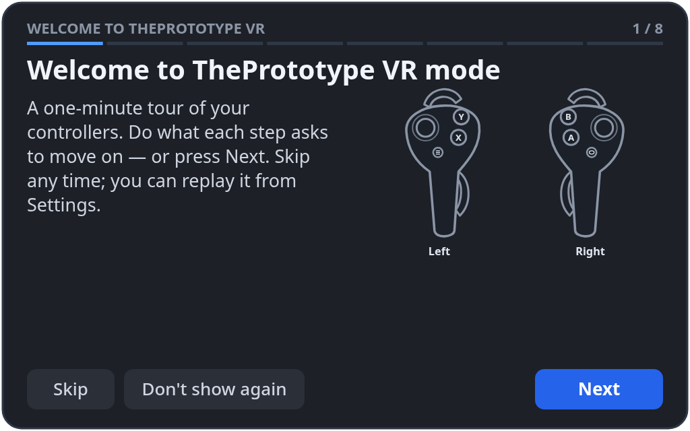
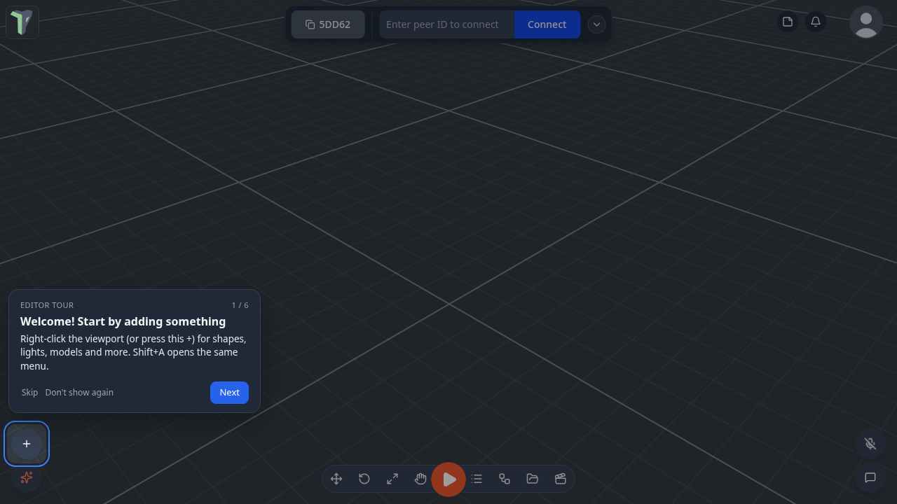
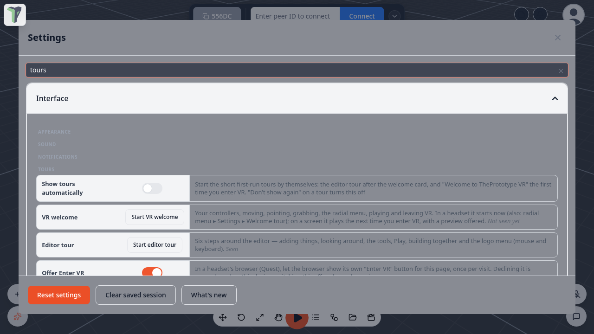

# Tours

Your first visit asks one question and walks you through making a game in three steps (the **first-game quest**). After
that, short tours show you around when you want them: **Welcome to ThePrototype VR mode** in the headset, and the
**editor tour** on a screen. Every tour has **Skip**, **Back**, **Next** and **Don't show again**. A tour you leave
half-way — you take the headset off, or reload the page — picks up where you stopped.

## Your first visit

The first time you open the app, the Welcome card asks **What do you want to do?**

- **Play a game** — pick a game and it opens straight in Play. When you leave it, the app offers to make it yours.
- **Remix a game** / **Start from a template** — pick one from the list and it opens in the editor. **All games…** /
  **All templates…** open the full Templates window.
- **Describe it** — type what you want and the AI assistant builds it, or pick one of the example prompts. It needs an
  AI provider first (your own key, see [AI Providers](ai/providers.md)); without one the card says so and offers **Set up in
  Settings ▸ AI** or **Start from a template instead**.
- **Empty scene** — the link under the answers.

### The first-game quest

Every answer except Play (and Play once you leave the game) starts three short steps:

1. **Make it yours** — change anything: add something with **+** or a right-click, or move an object by its arrows. A
   game or template can carry its own suggestion, such as *Add a cover block to the level*.
2. **Now play it** — press Play to try your change (Esc, or Back on a phone, returns to editing).
3. **You made a game!** — invite a friend: copy your link (click or tap your ID); a friend joining counts too.

Each step completes when you do it; a ring marks where to look and the scene stays usable. **Skip** and **Don't show
again** close it. When all three are done, a toast offers **Tour the interface** and **More templates**.

### Fewer buttons until your first Play

On that first visit the advanced buttons — the node editor, Animation, Pivot and the click mode — wait in the bottom
bar's **»** menu, and **Modules** and **Layouts** wait under **More** in the logo menu. Your first Play brings them all
back. **Settings ▸ Interface ▸ Show everything** does it at any time (and turning it off hides them again). If you used
the app before this release, nothing is hidden.

## Welcome to ThePrototype VR

The first time you enter VR on a device, the welcome plays on a panel in front of you, a little below eye level. Turn away
and it comes back in front of you. Point at its buttons and pull the trigger.

It has eight steps:

1. Welcome
2. Your controllers
3. Move and turn
4. Point and click
5. Grab
6. Your menu
7. Play a game
8. Leaving VR

Each step shows a drawing of your controllers with the button to use lit up. The step moves on when you do that thing —
push a thumbstick, pull a trigger, squeeze a grip, press **B**… — or when you press **Next**.

The drawing matches your controllers: **Quest 2** Touch controllers (with the ring) or **Quest 3 / 3S** Touch Plus. The
app reads which pair you have from the browser. The text and the lit buttons follow your own button layout, so if you
[remapped a button](vr.md#remapping-your-buttons), the tour names and lights the new one.

## The editor tour

Six steps on the screen: adding things, looking around, your tools, Play, building together, and the logo menu. It no
longer starts by itself — the first-game quest does that job — so start it from the logo menu ▸ **Tour the interface**
whenever you like (the quest's last toast offers it too).

On a touch screen you get the **touch version**: the same steps with finger gestures, shown as a sheet at the bottom or
top of the screen.

## Starting a tour again

- **Settings ▸ Interface ▸ Tours**: **VR welcome tour**, **Editor tour**, **First-game quest** (each with **Start**),
  **Reset all**.
- **Logo menu ▸ Tour the interface** starts the editor tour.
- In the headset: the radial menu's **Settings ▸ Welcome tour** (see the [VR Guide](vr.md#settings)).

**Start VR welcome** on a screen sets the welcome to play the next time you enter VR. A toast also offers **Preview it
here**, which shows the same steps and drawings on the screen. You can switch between the Quest 2 and Quest 3 / 3S
drawings, and the preview does not count as having seen the welcome.

## Settings

All in **Settings ▸ Interface ▸ Tours**:

| Setting | Default | What it does |
|---|---|---|
| **Show tours automatically** | on | Starts the first-game quest after the Welcome card, and the VR welcome on your first VR visit. **Don't show again** on any tour turns this off. |
| **First-game quest ▸ Start** | — | Runs the three steps again on the scene you have open. |
| **Show everything** | on (off for a brand-new visitor until their first Play) | Off: the node editor, Animation, Pivot and the click mode wait in the bottom bar's **»** menu, and Modules and Layouts under **More** in the logo menu. |
| **Offer Enter VR** | on | In a headset's browser (Quest), lets the browser show its own **Enter VR** button for the page, once per visit. If you decline it, this device remembers that; turning the setting off and on again asks again. With passthrough on, it offers AR instead, the same as Play. |
| **Reset tours ▸ Reset all** | — | Forgets which tours you have seen or skipped, and turns automatic tours back on. |

Search Settings for *tour*, *welcome*, *tutorial*, *quest*, *show everything* or *enter vr* to find these rows.

## Limits

- The VR welcome starts on its own only the **first** time you enter VR on a device, after a short delay so your
  controllers can be recognised. After that, replay it from the menu.
- On a page opened from an invite or a scene link, the Welcome card does not appear, so the first-game quest does not
  start either — you came for the session.
- The drawing cannot tell a Quest 3 from a Quest 3S: both use the same Touch Plus controllers. Hand tracking, or a
  headset the app does not know, gets a generic drawing.
